# Manual de Usuario — Pantallas de FacturacionUI

**Sistema Integral de Facturación e Inventarios (SIF)**

| Dato | Valor |
|---|---|
| Producto | FacturacionUI (Windows Forms, .NET Framework 4.8) |
| Versión del sistema documentada | 2025.0011.0021.2343 |
| Versión del manual | 1.1 |
| Fecha | Noviembre 2026 |
| Audiencia | Usuarios operativos, supervisores, administradores y personal de soporte |
| Alcance | Descripción funcional de las pantallas, campos, botones y flujos de trabajo |

> Este manual describe la operación de las pantallas del proyecto **FacturacionUI**. La
> apariencia y la disponibilidad de algunas opciones pueden variar según la empresa, el
> tipo de menú configurado, el rol del usuario y los permisos asignados.

---

## Contenido

1. [Acerca de este manual](#1-acerca-de-este-manual)
2. [Descripción general del sistema](#2-descripción-general-del-sistema)
3. [Acceso al sistema](#3-acceso-al-sistema)
4. [Elementos comunes de las pantallas](#4-elementos-comunes-de-las-pantallas)
5. [Módulo Catálogos](#5-módulo-catálogos)
6. [Módulo Transacciones](#6-módulo-transacciones)
7. [Módulo Consultas](#7-módulo-consultas)
8. [Módulo Reportes](#8-módulo-reportes)
9. [Seguridad y configuración](#9-seguridad-y-configuración)
10. [Flujos de trabajo paso a paso](#10-flujos-de-trabajo-paso-a-paso)
11. [Atajos de teclado](#11-atajos-de-teclado)
12. [Mensajes frecuentes y solución de problemas](#12-mensajes-frecuentes-y-solución-de-problemas)
13. [Buenas prácticas](#13-buenas-prácticas)
14. [Glosario](#14-glosario)
15. [Anexo A — Inventario de pantallas](#15-anexo-a--inventario-de-pantallas)
16. [Anexo B — Menús por empresa](#16-anexo-b--menús-por-empresa)
17. [Anexo C — Mapa de relaciones entre pantallas](#17-anexo-c--mapa-de-relaciones-entre-pantallas)

---

## 1. Acerca de este manual

### 1.1 Propósito

Servir de guía para localizar, entender y operar cada pantalla del sistema:
qué hace, cómo se llega a ella, qué datos solicita, qué botones ofrece y qué
reglas conviene respetar para no afectar la información contable, el inventario
o la facturación electrónica.

### 1.2 Cómo usar el manual

- **Si es usuario nuevo:** lea los capítulos 2, 3 y 4 (entorno y elementos comunes)
  y después el flujo de trabajo que corresponda a su puesto en el capítulo 10.
- **Si busca una pantalla concreta:** use el índice de módulos (capítulos 5 a 9) o
  el inventario del Anexo A.
- **Si aparece un mensaje:** consulte el capítulo 12.
- **Si necesita un atajo:** consulte el capítulo 11.
- **Si necesita saber cómo se conectan las pantallas** (qué abre qué, qué catálogos exige cada transacción, ruta de menú, ciclo de vida de un documento): consulte el Anexo C (capítulo 17).

### 1.3 Convenciones

| Convención | Significado |
|---|---|
| **Negrita** | Nombre exacto de un botón, campo, pestaña o menú |
| `F2`, `F10`, `Esc` | Teclas de función o de control del teclado |
| `*` | Campo obligatorio en la pantalla |
| `Q.` | Quetzales; moneda de los importes |
| "Pantalla 1 - Cliente" | El número es el código interno del formulario; el texto es el nombre visible |
| Nota / Precaución | Información que evita pérdida de datos o errores operativos |

### 1.4 Limitaciones

- El manual no reproduce capturas de pantalla: la apariencia depende del *skin*
  de DevExpress configurado por cada usuario (**Apariencia**).
- Algunas empresas usan menús y variantes de pantalla propias (por ejemplo, FEL,
  CompuDell, Montellano, Olinda Mazate, PCMaster, AyL, Inmobiliaria, Comida Rápida).
  Las variantes comparten la lógica aquí descrita, con campos adicionales.
- Las operaciones sensibles (anulación, cierre de periodo, contabilización,
  certificación FEL) requieren permisos especiales. Si un botón aparece
  deshabilitado o la pantalla se cierra, solicite revisión al administrador.

---

## 2. Descripción general del sistema

FacturacionUI es una aplicación de escritorio modular que integra:

- **Catálogos maestros:** clientes, proveedores, productos, empresas, bancos,
  cuentas contables, empleados, visitantes y catálogos de apoyo.
- **Transacciones:** ventas, cotizaciones, pedidos, compras, notas de crédito y
  débito, inventarios, ajustes, traslados, caja, bancos y contabilidad.
- **Consultas:** documentos, estados de cuenta, existencias, kardex, libros y
  balances.
- **Reportes:** visor local, parámetros de reportes y códigos de barras.
- **Seguridad:** usuarios, roles, permisos por objeto, bitácora de eventos y
  configuraciones del sistema.

### 2.1 Flujo operativo general

```
Catálogos → Transacciones → Consultas → Reportes
   │             │              │
   │             ├── Venta / Factura FEL
   │             ├── Compra / Pedido
   │             ├── Cobro / Caja / Bancos
   │             └── Inventario / Ajuste / Traslado
   │
   └── Base para validaciones: NIT, precios, existencias, crédito, cuentas
```

### 2.2 Perfiles típicos

| Perfil | Pantallas de uso principal |
|---|---|
| Cajero / vendedor | Factura, Cobro, Caja, Consulta de facturas, Cliente |
| Bodeguero | Producto, Inventario, Ajuste, Traslado, Salida de materiales, Kardex |
| Compras | Pedido de compra, Compra, Proveedor, Consulta de compras |
| Contabilidad | Asiento contable, Periodos, Libro diario/mayor, Balance, Cierre |
| Supervisor | Consultas, Reportes, Anulaciones, Metas, Cuentas por cobrar/pagar |
| Administrador | Usuarios, Roles, Configuraciones, Licencia, Equipos autorizados |

### 2.3 Regla general de integridad

Toda transacción guardada impacta, según su tipo, en el **inventario**, la
**cuenta por cobrar o por pagar**, la **caja o banco** y la **contabilidad**.
Por eso:

1. Verifique cliente/proveedor y producto antes de guardar.
2. No anule documentos sin autorización; la anulación suele ser lógica y deja
   rastro con usuario, fecha y comentario.
3. Un documento de un periodo cerrado no debe modificarse; el sistema lo marca
   como **"Fact. de Periodo Cerrado"**.
4. Cierre la caja y realice arqueos al final del turno.

---

## 3. Acceso al sistema

### 3.1 Antes de iniciar

Confirme con soporte o con su supervisor:

- Que el equipo tenga conexión con el servidor de base de datos.
- Que la fecha y hora del equipo sean correctas (afectan vigencias, periodos y FEL).
- Que la licencia esté vigente. El menú principal muestra la fecha límite y, si
  faltan menos de 30 días, aparece una advertencia; si ya venció, el sistema
  solicita regularizar y puede cerrarse.
- Que su usuario esté activo y desbloqueado.

### 3.2 Pantalla "Inicio de Sesión" (LoginUI)

<!-- img:login -->
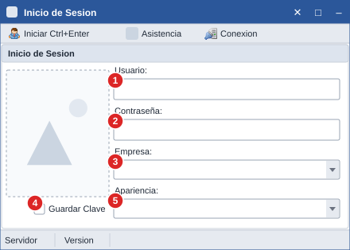

**Leyenda** (los números rojos de la imagen):

1. **Usuario** con el que se ingresa al sistema.
2. **Contraseña** del usuario.
3. **Empresa** a la que se ingresará (sólo aparecen las empresas autorizadas para el usuario; si no lo está, el sistema muestra "Este usuario no esta autorizado para esta empresa").
4. **Guardar Clave**: recuerda la contraseña en este equipo.
5. **Apariencia**: tema visual (*skin*) de la sesión.

<!-- /img:login -->

**Propósito:** autenticar al usuario, seleccionar empresa y cargar la
configuración del sistema.

**Acceso:** al ejecutar `FacturacionUI.exe`.

**Elementos principales**

| Elemento | Descripción |
|---|---|
| **Usuario** | Código o nombre de usuario asignado |
| **Contraseña** | Clave personal; se muestra enmascarada |
| **Empresa** | Empresa activa sobre la que se trabajará |
| **Guardar Clave** | Recuerda la clave en el equipo (úsese solo en equipos de confianza) |
| **Apariencia** | Selector del tema visual de la aplicación |
| **Iniciar (Ctrl+Enter)** | Valida credenciales e ingresa al sistema |
| **Asistencia** | Registro de asistencia/marcaje del personal |
| **Conexión** | Abre la configuración de conexión con el servidor |
| **Servidor** | Muestra o permite revisar el servidor configurado |
| **Versión** | Versión del sistema en ejecución |
| **Salir (Shift+Esc)** | Cierra la aplicación |

**Pasos**

1. Escriba su **Usuario**.
2. Escriba su **Contraseña**.
3. Seleccione la **Empresa** correcta.
4. Pulse **Iniciar** o `Ctrl+Enter`.
5. Espere la carga de configuraciones, catálogos y validaciones iniciales.
6. Si el sistema lo solicita, cambie la clave o complete el desbloqueo.

**Validaciones y avisos típicos**

| Situación | Acción recomendada |
|---|---|
| Usuario o clave incorrectos | Verifique mayúsculas, teclado numérico y bloqueo de mayúsculas |
| Usuario bloqueado por intentos fallidos | Solicite **Desbloqueo de Usuarios** al administrador |
| Clave vencida | Use **Cambiar Clave** o el flujo de **Desbloqueo Cambio Clave** |
| Error de licencia | Verifique la fecha del equipo y la licencia; contacte a soporte |
| Mensaje de nueva versión | Actualice el sistema antes de continuar operando |
| No conecta al servidor | Revise **Conexión**, red/VPN y disponibilidad del servidor |

### 3.3 Menú principal

<!-- img:menu_fel_transacciones -->
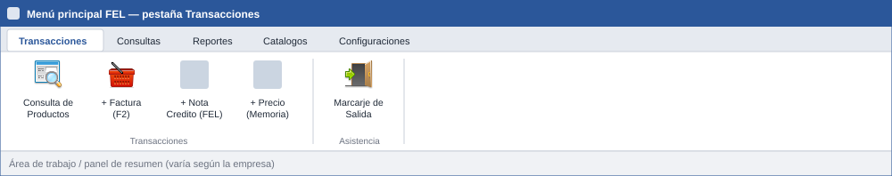

<!-- /img:menu_fel_transacciones -->

<!-- img:menu_fel_consultas -->
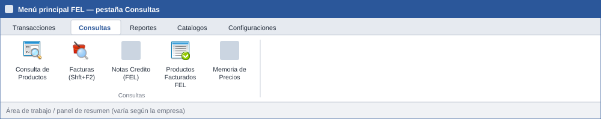

<!-- /img:menu_fel_consultas -->

<!-- img:menu_fel_catalogos -->
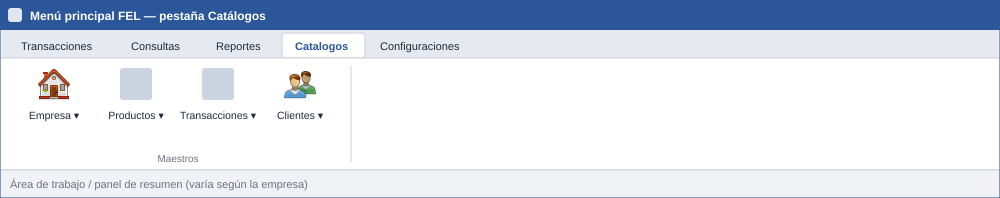

<!-- /img:menu_fel_catalogos -->

<!-- img:menu_fel_configuraciones -->
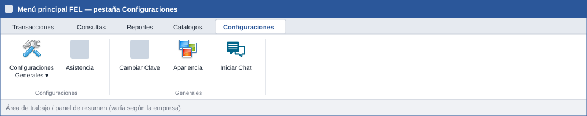

<!-- /img:menu_fel_configuraciones -->

<!-- img:menu_demo_ventas -->
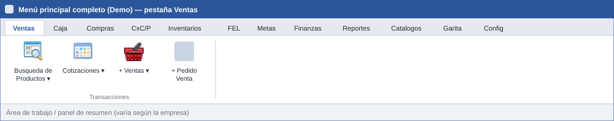

<!-- /img:menu_demo_ventas -->

**Propósito:** punto de partida de todas las pantallas. Está organizado en barra
de menús, accesos rápidos y barra de estado.

**Barra de estado (parte inferior)**

| Indicador | Significado |
|---|---|
| **Empresa** | Código y nombre de la empresa activa |
| **Usuario** | Usuario conectado |
| **Periodo** | Periodo contable activo |
| **Versión** | Versión del sistema |
| **Licencia** | Fecha límite de la licencia |
| **Srv** | Servidor activo (producción o desarrollo) |
| **Ambiente de PRUEBAS** | Solo aparece cuando la conexión es de desarrollo |
| **Sistema con Caja / Usuario con Caja / Caja Central de Cobro** | Indica si el control de efectivo está habilitado |

**Menús habituales**

| Menú | Contenido representativo |
|---|---|
| **Archivo / Configuraciones** | Perfil, **Cambiar Clave**, **Apariencia**, **Cerrar Sesión**, **Salir** |
| **Catálogos** | Clientes, Productos, Proveedores, Empresa, Periodos, Formas de pago, Bancos, Monedas, Cajas, Estaciones, RH, Visitas |
| **Transacciones** | Ventas, Cotizaciones, Pedidos, Compras, Notas, Ajustes, Traslados, Inventarios, Caja, Bancos, Contabilidad, Metas |
| **Consultas** | Facturas, Compras, Cotizaciones, Pedidos, Inventarios, Kardex, Caja/Bancos, CxC, CxP, Contabilidad |
| **Reportes** | Reportes de facturas, compras, inventarios, catálogos, usuarios, visor local y códigos de barras |
| **Seguridad** | Usuarios, Roles, Objetos, Configuraciones de seguridad, Desbloqueos, Log de eventos |
| **Configuraciones Generales** | Conexión, parámetros generales, datos FEL/Infile, equipos autorizados, licencia, respaldos |
| **Ayuda** | Ayuda del sistema y documentos de referencia |

**Acceso rápido**

El menú incluye una lista **Acceso Rápido** con las opciones más usadas
(**+ Venta**, **+ Compra**, **+ Cotización**, **Movimientos de Caja**, consultas
de ventas/compras/salidas). Seleccione una opción y pulse **Abrir**.

**Atajos del menú principal**

| Atajo | Acción |
|---|---|
| `F2` | Nueva venta/factura (si está habilitada) |
| `Shift+F2` | Consulta de ventas/facturas |
| `Ctrl+K` | Kardex por producto |
| `Shift+Esc` | Salir del sistema |
| `Ctrl+R` | Abrir la ventana de permisos (Run2UI) |

**Otros elementos**

- **Resumen de Caja:** visible cuando el sistema controla efectivo en caja.
- **Iniciar Chat:** mensajería interna; avisa cuando hay mensajes pendientes.
- **Validador NIT:** permite mostrar u ocultar el validador de NIT.
- **Vencimiento de licencia:** advertencia clicable para revisar la licencia.

---

## 4. Elementos comunes de las pantallas

### 4.1 Anatomía de una pantalla

<!-- img:anatomia_pantalla -->
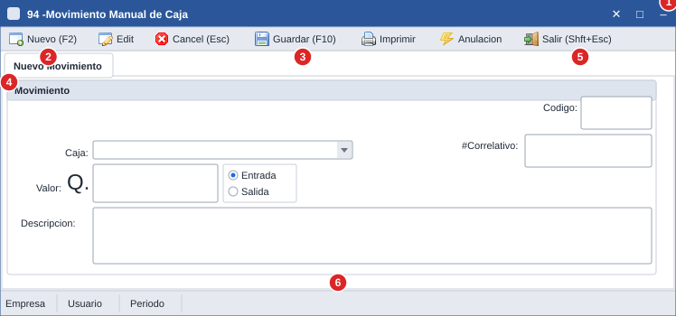

**Leyenda** (los números rojos de la imagen):

1. **Barra de título**: muestra el código de opción y el nombre de la pantalla (el mismo código que se asigna en Seguridad > Objeto).
2. **Nuevo (F2)**: habilita los campos para crear un registro.
3. **Guardar (F10)**: graba el registro.
4. **Área de datos**: campos del encabezado; el detalle (si existe) está en pestañas o cuadrículas.
5. **Salir (Shift+Esc)**: cierra la pantalla.
6. **Barra de estado**: empresa, usuario y periodo activos.

<!-- /img:anatomia_pantalla -->

La mayoría de los formularios sigue este patrón:

```
┌────────────────────────────────────────────────────────────┐
│ Barra de acciones: Nuevo | Editar | Cancelar | Guardar ... │
├────────────────────────────────────────────────────────────┤
│ Encabezado / pestañas (Info General, Detalle, Otros...)    │
│  Campos, combos, casillas y grids                          │
├────────────────────────────────────────────────────────────┤
│ Barra de estado: Empresa | Usuario | Periodo | Registros   │
└────────────────────────────────────────────────────────────┘
```

El título de la ventana muestra el código y el nombre, por ejemplo
`1 - Cliente`, `14 - Factura`, `41 - Ajuste`, `135 - Pedido Compra`.

### 4.2 Botones estándar

| Botón | Atajo | Función |
|---|---|---|
| **Nuevo** | `F2` | Prepara la pantalla para un registro nuevo y limpia campos |
| **Editar** | — | Habilita la edición del registro seleccionado |
| **Cancelar** | `Esc` | Descarta cambios y vuelve al estado de consulta |
| **Guardar** | `F10` | Valida y graba el registro |
| **Eliminar** | — | Elimina o inactiva el registro; suele pedir confirmación |
| **Imprimir** | `Ctrl+P` | Envía a impresión o vista previa |
| **Anulación** | — | Submenú con **Anular** y **Ver Comentario Anulacion** |
| **Salir** | `Shift+Esc` | Cierra la pantalla |
| **Consultar** | `F8` | Ejecuta la consulta con los filtros indicados |
| **Exportar / Exportar a Excel** | — | Genera un archivo para análisis externo |
| **Registros** | — | Muestra la cantidad de registros del listado |

### 4.3 Atajos globales

| Atajo | Acción |
|---|---|
| `F5` | Actualizar el formulario |
| `Shift+F12` | Maximizar o restaurar la ventana |
| `Ctrl+R` | Abrir la ventana de permisos |
| `Shift+Esc` | Salir de la pantalla (en la mayoría de formularios) |
| `Ctrl+Enter` | Iniciar sesión (pantalla de login) |

### 4.4 Campos y validaciones

- Los campos con `*` son obligatorios.
- Los campos de código (cliente, producto, banco, cuenta) suelen abrir un
  buscador al pulsar el botón asociado o una tecla de función (`F3` en varias
  pantallas de venta/compra).
- Los importes se expresan en `Q.` salvo que la pantalla indique otra moneda.
- Las casillas **Ver Cod.** / **Ver Código** muestran el código además de la
  descripción en los combos.
- Los campos calculados (subtotal, total, diferencia, saldo) se actualizan al
  cambiar cantidad, precio, descuento o forma de venta y no deben editarse
  manualmente salvo que la pantalla lo permita.
- Al guardar, el sistema valida permisos, periodo abierto, licencia, existencias
  (si aplica) y reglas propias de la transacción.

### 4.5 Grillas (grids)

- Se pueden ordenar, agrupar y filtrar por encabezados; el menú contextual ofrece
  opciones de exportación y configuración de columnas.
- Las columnas **Edit**, **Del**, **Info** o **Ver** son acciones por fila.
- En documentos, las columnas calculadas (Sub-Total, Unds.Tot, Diferencia,
  Valor Pendiente) no se capturan: las calcula el sistema.
- **Eliminar** en una fila quita la línea del documento mientras esté en edición;
  **Eliminar Todo** quita todas las líneas.
- Use **Exportar** para llevar el contenido a Excel cuando necesite análisis.

### 4.6 Estados visibles en pantalla

| Etiqueta | Significado |
|---|---|
| **¡Cobrada!** | El documento ya tiene pago registrado |
| **¡Contabilizada!** | El documento generó asiento contable |
| **¡Entregada Completa!** | Las salidas de materiales cubren el total |
| **¡Factura Anulada!** | Documento anulado; no debe usarse |
| **¡Fact. de Periodo Cerrado!** | El periodo contable está cerrado |
| **¡Compra Anulada!** | Compra anulada |
| **¡Ajuste Anulado!** / **¡Traslado Anulado!** | Movimiento de inventario anulado |
| **¡Nota Anulada!** | Nota de crédito/débito anulada |
| **¡Cheque Anulado!** | Cheque anulado |
| **¡Movimiento Anulado!** | Movimiento de caja/banco anulado |
| **¡Inventario Cerrado!** | Toma de inventario finalizada |
| **¡Caja Cerrada!** | Arqueo/caja cerrada |
| **¡Meta Anulada!** | Meta de vendedor anulada |
| **¡Visita Anulada!** | Visita anulada |
| **¡Pedido Anulado!** | Pedido anulado |
| **¡Venta Generada!** / **¡Compra Generada!** | El pedido ya generó su documento |

### 4.7 Permisos y bitácora

- Cada pantalla está asociada a un **objeto** de seguridad. Si el usuario no
  tiene permiso, la opción puede no mostrarse o la pantalla puede cerrarse.
- El ingreso a cada pantalla queda registrado en la **bitácora de eventos**
  (usuario, equipo, IP, objeto, versión y fecha).
- Las anulaciones también registran usuario, fecha y comentario.

---

## 5. Módulo Catálogos

Los catálogos son la base de las transacciones. Un dato mal capturado aquí se
propaga a facturas, compras, inventarios y contabilidad.

### 5.1 Clientes

#### 5.1.1 Pantalla "1 - Cliente" (ClienteUI_01)

<!-- img:pantalla_01_cliente -->
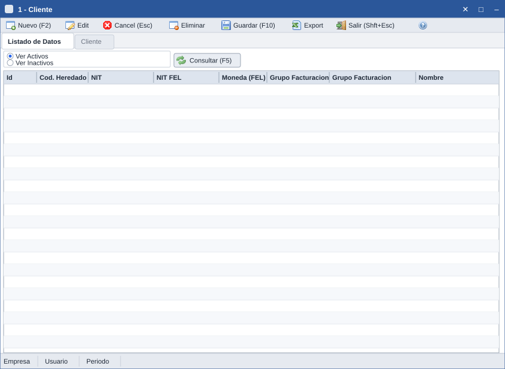

<!-- /img:pantalla_01_cliente -->

**Propósito:** mantener el maestro de clientes, sus datos fiscales, crédito,
referencias, documentos, fotos y servicios.

**Acceso:** Catálogos → Clientes → **Cliente**.

**Pestañas y campos principales**

| Pestaña | Contenido |
|---|---|
| **Info. General** | **Código**, **Nombre**, **NIT**, **DPI**, **Dirección**, **Teléfono 1**, **Teléfono 2**, **Correo**, **Sector/Ruta**, **# Contador**, **Estado**, **Tipo/Record**, **Perfil de Descuentos**, **Vendedor/Rutero**, **Código Heredado**, **Grupo Facturación** |
| **Datos FEL** | **NIT**, **Nombre**, **Dirección**, **Correo**, **Moneda**, **Grupo Facturación**, **Incluir Periodo en FEL (Auto)** |
| **Otros** | **Costos Viaje para pago de Piloto**: **Precio Fijo**, **Tarifa QQ**, **Tarifa KMS**, **KMS (Distancia)** |
| **Fotos** | Galería de imágenes del cliente; **Archivo** y **Buscar** |
| **Crédito** | **Definición de Límites de Crédito**: **Diario Q.**, **Mensual Q.**, **Total Q.**, **Vencimiento de Saldos (Días)** |
| **Referencias** | **# Ref.**, **Nombre**, **Dirección**, **Teléfono**, **DPI**, **NIT**; botones **Nuevo**, **Guardar**, **Eliminar**, **Exportar** |
| **Documentos** | **# Doc.**, **Tipo Doc.**, **Archivo** (**Buscar**/**Bajar**), **Observaciones**; botones **Nuevo**, **Guardar**, **Eliminar**, **Exportar** |
| **Servicios** | Producto/servicio, **Forma Venta**, **Cantidad**, **Precio**, **Total**, **Fecha Servicio**, **Fecha Pago**, **Token**, **Correo**; **Agregar**, **Eliminar**, **Eliminar Todo** |
| **Empresa** | **Empresa**, **Área**, **Departamento**, **Centro de Costo** |
| **Info. Confidencial** | **Firma** (imagen) con **Explorar** |
| **Listado de Datos** | Grid con Id, Nombre, Dirección, NIT, DPI, Ruta, #Contador, Teléfonos, Límites, e-mail, Estado, Record, Vendedor/Rutero, Capacidad Camión, Vencimiento de Saldos, Total Deuda, Código Heredado, NIT FEL, Moneda y Grupo de Facturación |

**Botones**

- **Nuevo (F2)**, **Edit**, **Cancel (Esc)**, **Eliminar**, **Guardar (F10)**,
  **Export**, **Salir (Shift+Esc)**.
- **Consultar (F5)** en la pestaña de listado.
- **Re-Activar** cuando el cliente está marcado como anulado/inactivo.
- **Salir al Guardar**: cierra la pantalla después de grabar.

**Reglas y observaciones**

- El **NIT** debe ser válido y coherente con los datos FEL; si la configuración
  permite duplicados, aun así se recomienda evitarlos.
- Los límites de crédito se validan al facturar; un cliente sin crédito o con
  saldo vencido puede quedar bloqueado para ventas al crédito.
- La **Ruta** y el **Vendedor/Rutero** determinan reportes, metas y reparto.
- Use **Datos FEL** para clientes que requieren factura electrónica; revise
  **Moneda** y **Grupo Facturación**.
- El botón **Eliminar** puede inactivar el cliente; confirme el mensaje y no lo
  use si el cliente tiene documentos.

#### 5.1.2 Pantalla "164 - Cliente FEL"

<!-- img:pantalla_164_cliente_fel -->
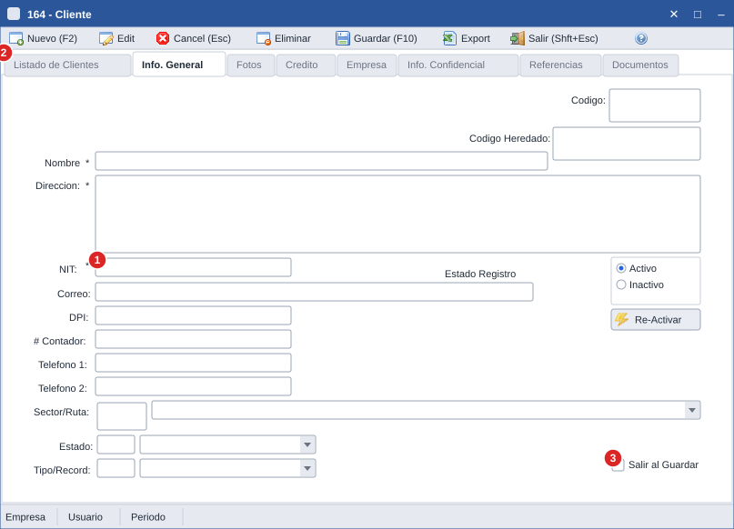

**Leyenda** (los números rojos de la imagen):

1. **NIT** del cliente (se usa al facturar; CF para consumidor final).
2. **Pestañas**: *Listado de Clientes* (búsqueda), *Info. General*, fotos, crédito, datos de empresa, información confidencial, referencias y documentos.
3. **Salir al Guardar**: cierra la pantalla después de grabar.

<!-- /img:pantalla_164_cliente_fel -->

Variante simplificada del maestro de clientes orientada a facturación
electrónica. Comparte las pestañas **Info. General**, **Fotos**, **Crédito** y
**Listado de Clientes**. Incluye **NIT**, **DPI**, **Dirección**, **Correo**,
**Ruta**, **Record**, **Estado**, límites de crédito y **Re-Activar**.

#### 5.1.3 Catálogos relacionados con clientes

| Pantalla | Uso |
|---|---|
| **Estado de Clientes** | Define estados (activo, moroso, bloqueado, etc.) |
| **Record** | Clasificación del historial crediticio |
| **Tipo de Documento** | Tipos de documento de identificación o respaldo |
| **Sector/Ruta** | Rutas de reparto y sectores comerciales |
| **Perfil de Descuentos** | Porcentajes de descuento aplicables al cliente |
| **Empresa Externa / Área / Departamento / Centro de Costo** | Estructura organizacional para clientes corporativos |
| **Vendedores y Rutas** | Asignación de vendedor/rutero a ruta |

### 5.2 Productos

#### 5.2.1 Pantalla "12 - Producto" (ProductoUI_12)

<!-- img:pantalla_12_producto -->
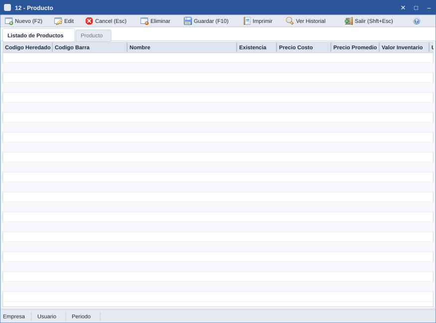

<!-- /img:pantalla_12_producto -->

<!-- img:pantalla_163_producto_fel -->
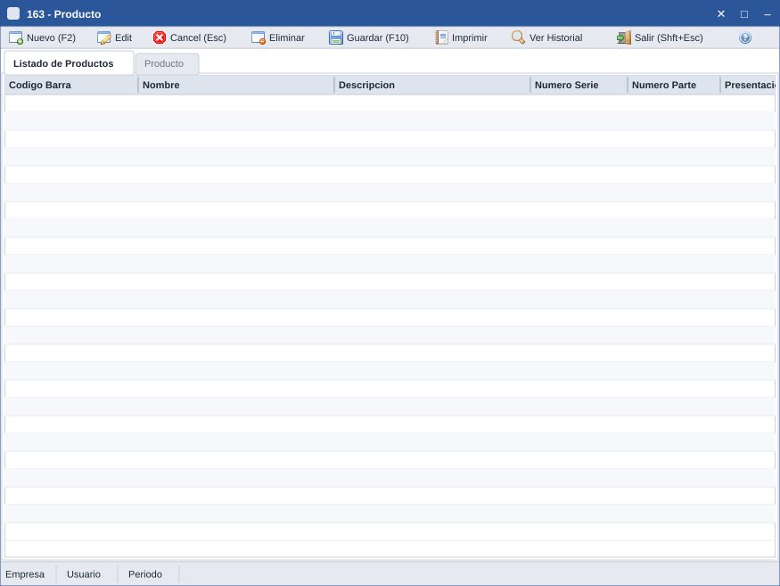

<!-- /img:pantalla_163_producto_fel -->

**Propósito:** mantener productos, servicios, precios, existencias, formas de
venta, componentes, fotos y lista de materiales.

**Acceso:** Catálogos → Productos → **Producto** (o variante **Producto Std**,
**Producto FEL**, **Producto CompuDell**, **Producto Montellano**,
**Producto Olinda Mazate**, **Producto PCMaster**, **Producto AyL**).

**Pestañas y campos principales**

| Pestaña | Contenido |
|---|---|
| **Info General** | **Código**, **Nombre**, **Nombre Corto (máx. 25)**, **Descripción**, **BarCode**, **Fabricante**, **Presentación**, **Marca**, **Familia**, **Categoría**, **Código Heredado**, **Precio Costo**, **Precio Costo Promedio**, **Existencia**, **Existencia Base**, **Existencia Mínima**, **Margen de Advertencia**, **Vitrina/Estantería/Mostrador**, **Nivel**, casillas **Activo Global**, **Activo Por Empresa**, **Maneja Existencia**, **Es Servicio**, **Monitoreado**, **Usa Decimales**, **Usa Lote/Vencimiento**, **Permite Precio Especial Factura/Cotización**, **Permite Nombre Especial FEL/Cotización** |
| **Otra Info** | **Tiempo Máx. Bodega (Días)**, **Peso**, **UM Peso**, **Número de Serie**, **Número de Parte** |
| **Apartamento** | Para proyectos inmobiliarios: **Tipología**, **Nivel**, **Vista**, **Área Construida**, **Área Jardín/Terraza**, **Parqueos**, **Área por Parqueo**, **Total área parqueos**, **Estado**, **Precio/Sin Impuestos**, **Impuestos**, **Precio/Con Impuestos**, **% Enganche**, **Valor Enganche**, **Valor Reserva**, **Valor a Financiar** |
| **Tipos de Producto** | Asignación de uno o varios tipos; **Agregar**, **Eliminar**, **Eliminar Todo** |
| **Componentes** | **Componente**, **Unidad de Medida**, **Cantidad**; **Agregar**, **Eliminar**, **Eliminar Todo** |
| **Formas de Ventas** | **Forma**, **Precio**, **Unidades**, **Código de Barra Especial**; **Agregar**, **Eliminar**, **Eliminar Todo**; muestra la **Forma Predeterminada** |
| **Fotos** | **Galería de Imágenes**, **Archivo**, **Buscar** |
| **Lista de Materiales** | Productos que componen un servicio o kit, con cantidad y precio |
| **Listado de Productos** | Grid con Id, Código Barra, Nombre, Precio Costo, Precio Promedio, Existencia, Valor Inventario, Vitrina, Nivel, Descripción, Presentación, Fabricante, Componentes, Tipos, Marca, Existencia Mínima, Estado, Activo por Empresa, Vencimiento, Es Servicio, Monitoreado, Maneja Existencia, Código Heredado, Familia, Pesos, Tiempo Máx. Bodega, UM/Peso, Serie, Parte, Métodos de precio/lotes, Genérico FEL |

**Botones**

- **Nuevo (F2)**, **Edit**, **Cancel (Esc)**, **Eliminar**, **Guardar (F10)**,
  **Imprimir**, **Imprimir Código De Barras**, **Exportar/Imprimir**,
  **Ver Historial**, **Salir (Shift+Esc)**.

**Reglas y observaciones**

- **Maneja Existencia** determina si el producto afecta inventario y si se
  validan existencias al vender.
- **Usa Lote/Vencimiento** obliga a registrar lote y fecha de vencimiento en
  compras y salidas.
- El **Precio Costo** y su **Promedio** alimentan costos, márgenes y valuación
  de inventario; no los modifique sin autorización.
- Las **Formas de Venta** permiten precios por presentación (unidad, caja,
  docena). Verifique **Unidades** para que la conversión a unidades base sea
  correcta.
- Un producto **Es Servicio** no maneja existencia ni bodega.
- El **Código de Barra** debe ser único; se usa en ventas, compras y búsquedas.
- Para productos compuestos use **Componentes**; para recetas o kits use
  **Lista de Materiales** según la configuración de su empresa.

#### 5.2.2 Catálogos de productos

| Pantalla | Uso |
|---|---|
| **Categoría** | Agrupación comercial de productos |
| **Familia** | Agrupación para metas, reportes y filtros |
| **Marca** | Marca del producto |
| **Fabricante** | Fabricante o proveedor de origen |
| **Presentación** | Empaque o presentación (caja, bolsa, unidad) |
| **Componente** | Insumos o partes de productos compuestos |
| **Tipo Producto** | Clasificación operativa/contable |
| **Unidad de Medida** | Unidades y símbolos de medida |

#### 5.2.3 Actualización rápida de productos

| Pantalla | Uso |
|---|---|
| **Actualización Rápida de Precios/Costos** | Cambia precios o costos por producto, familia o filtro |
| **Actualización Rápida de Existencias** | Ajusta existencias masivamente con control |
| **Actualización Rápida de Descripciones** | Corrige nombres/descripciones en lote |
| **Actualización Rápida de Precios (transacción)** | Recalcular precios de venta por porcentaje o regla |

> Estas pantallas afectan muchos registros a la vez. Úselas con autorización,
> respaldo previo y filtros bien definidos. Registre el motivo del cambio.

#### 5.2.4 Pantallas de información de producto

<!-- img:pantalla_218_info_producto_fel -->
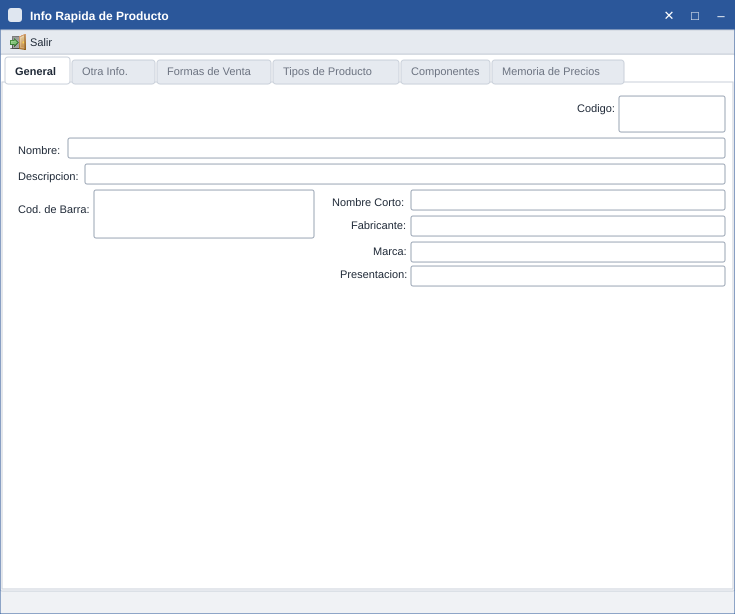

<!-- /img:pantalla_218_info_producto_fel -->

<!-- img:pantalla_165_buscar_producto_fel -->
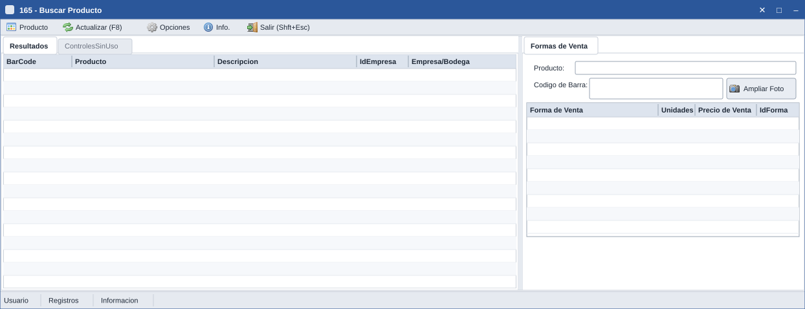

<!-- /img:pantalla_165_buscar_producto_fel -->

**Ver Info Producto** (y variantes **Std**, **FEL**, **AyL**, **CompuDell**,
**Montellano**, **Olinda Mazate**, **PCMaster**) muestran ficha, existencias,
precios, fotos, componentes, formas de venta e historial. Son de solo consulta.

### 5.3 Proveedores

<!-- img:pantalla_18_proveedor -->
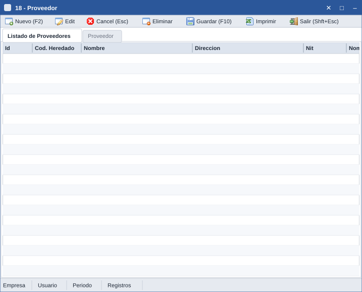

<!-- /img:pantalla_18_proveedor -->

**Pantalla "18 - Proveedor"**

**Propósito:** maestro de proveedores para compras, cuentas por pagar y cheques.

**Campos habituales**

| Grupo | Campos |
|---|---|
| **Proveedor** | **Código**, **Nombre Proveedor**, **NIT Proveedor**, **Dirección Proveedor**, **Código Heredado** |
| **Contacto** | **Nombre Contacto**, **Teléfono Contacto**, **Teléfono Contacto 2**, **Correo Contacto** |
| **Listado** | Nombre, Dirección, NIT, Contacto, Teléfonos, Correo, Estado, Código Heredado |

**Botones:** **Nuevo (F2)**, **Edit**, **Cancel (Esc)**, **Eliminar**,
**Guardar (F10)**, **Imprimir**, **Salir (Shift+Esc)**; casilla **Salir al
Guardar**.

**Reglas:** el NIT y el nombre deben coincidir con la documentación fiscal; el
proveedor inactivo no debe usarse en compras nuevas.

### 5.4 Empresa, periodos y catálogos generales

<!-- img:pantalla_03_empresa -->
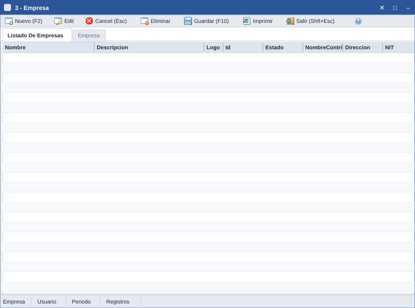

<!-- /img:pantalla_03_empresa -->

<!-- img:pantalla_02_periodo -->
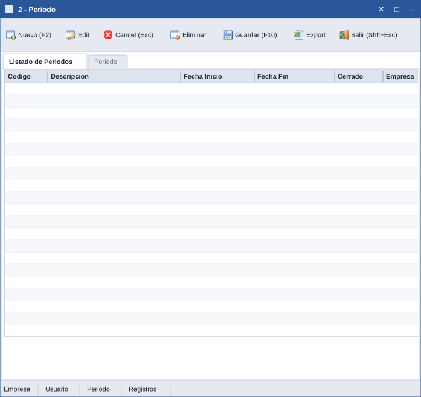

<!-- /img:pantalla_02_periodo -->

| Pantalla | Propósito | Campos/acciones clave |
|---|---|---|
| **3 - Empresa** | Datos de la empresa y su configuración | Código, nombre, descripción, NIT y datos SAT, dirección, contacto, logo, configuración de reportes y correos |
| **2 - Periodo** | Periodos operativos/contables | Código, empresa, descripción, fecha inicio/fin, **Periodo Cerrado**, **Abrir/Cerrar**, fecha y usuario de cierre |
| **11 - Forma Venta** | Formas de venta (unidad, caja, docena) | Código, nombre, **Número Unidades**, abreviatura, estado |
| **74 - Forma de Pago** | Formas de pago y su uso por módulo | Código, descripción, **Es Crédito**, **Es Contra Entrega**, **Es Para Cobro de Efectivo**, uso en Ventas, Compras, FEL, Pedidos y ND/NC |
| **90 - Moneda** | Monedas y símbolos | Código, nombre, símbolo, tasa |
| **93 - Tipo Cambio** | Tipos de cambio por fecha | Moneda, fecha, valor |
| **82 - Caja** | Cajas de efectivo | Código, nombre, usuario/estación, estado |
| **84 - Tipo Tarjeta Crédito** | Tipos de tarjeta | Código, nombre, banco |
| **85/86 - Estación de Trabajo** | Equipos y tipos de estación | Código, nombre, tipo, autorización |
| **39 - Tipo Ajuste** | Tipos de ajuste de inventario | Código, descripción, sentido, cuenta |
| **389 - Proyecto** (Presupuestos) | Proyectos y presupuestos | Código, nombre, fechas, montos |

> Los códigos y nombres de estos catálogos aparecen en combos de todas las
> transacciones. Evite duplicados y mantenga solo los registros activos.

### 5.5 Bancos

<!-- img:pantalla_83_banco -->
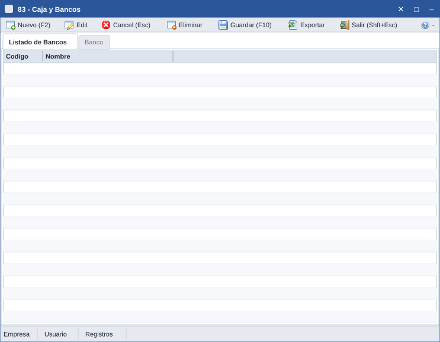

<!-- /img:pantalla_83_banco -->

<!-- img:pantalla_129_cuenta_bancaria -->
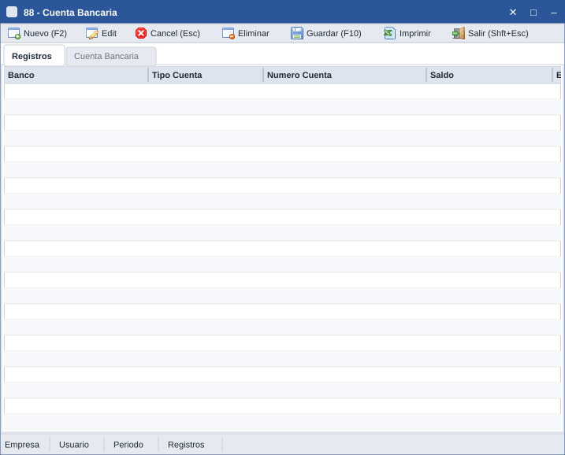

<!-- /img:pantalla_129_cuenta_bancaria -->

| Pantalla | Propósito | Campos clave |
|---|---|---|
| **83 - Banco** | Catálogo de bancos | Código, nombre, cuenta contable |
| **96 - Tipo Cuenta Bancaria** | Clasificación de cuentas | Código, descripción |
| **129 - Cuenta Bancaria** | Cuentas de la empresa | Banco, número de cuenta, moneda, saldo, cuenta contable |
| **97 - Tipo Movimiento Bancario** | Tipos de movimiento | Código, descripción, naturaleza (entrada/salida), cuenta |

**Reglas:** la cuenta bancaria debe tener cuenta contable asociada para que los
movimientos y cheques generen asiento. Verifique el saldo antes de emitir cheques.

### 5.6 Contabilidad

| Pantalla | Propósito | Campos clave |
|---|---|---|
| **381 - Tipo Cuenta Contable** | Clasificación (activo, pasivo, capital, ingreso, gasto) | Código, nombre, naturaleza |
| **382 - Cuenta Contable** | Plan de cuentas | Código, nombre, tipo, cuenta padre, acepta movimiento, moneda |

**Reglas:** no elimine cuentas con movimientos; inactívelas. La estructura del
plan de cuentas determina los reportes de balance y los libros.

### 5.7 Recursos Humanos

| Pantalla | Propósito | Campos clave |
|---|---|---|
| **179 - Empleado** | Maestro de empleados | Código, nombre, DPI, puesto, departamento, fechas, salario, estado |
| **180 - Puesto** | Catálogo de puestos | Código, nombre, descripción |
| **181 - Departamento Empresa** | Departamentos | Código, nombre, empresa |

Se usan en asistencia, marcajes, reportes de personal y visitas.

### 5.8 Visitas

| Pantalla | Propósito | Campos clave |
|---|---|---|
| **173 - Visitante** | Maestro de visitantes | Nombre, DPI, NIT, pasaporte, licencia, teléfono, dirección, empresa, país |
| **175 - Área Visitada** | Áreas de la empresa | Nombre, encargado, teléfono |
| **176 - Persona Visitada** | Personas anfitrionas | Nombre, área, teléfono |

Se usan en el registro de visitas y en el control de acceso.

### 5.9 Otros catálogos

- **Empresa Externa** y su estructura (**Área**, **Departamento**, **Centro de
  Costo**) para clientes corporativos.
- **Proyecto** para presupuestos y control de proyectos.
- **Tipos de estación de trabajo** y **equipos autorizados** para control de
  licencias por equipo.

---

## 6. Módulo Transacciones

Las transacciones son el corazón del sistema. Antes de operar, confirme:

1. **Empresa** y **Periodo** activos en la barra de estado.
2. Que la **caja** esté abierta, si su operación controla efectivo.
3. Que el **usuario** tenga permisos para la transacción.
4. Que la **fecha del equipo** sea correcta (afecta FEL y vigencias).

### 6.1 Ventas

#### 6.1.1 Consideraciones generales

- Cada venta genera un correlativo interno (**#Id** / **Transacción**). En FEL
  se agrega el número, serie y autorización del documento electrónico.
- La venta afecta inventario al **despachar** (salidas de materiales) o al
  guardar, según la configuración de la empresa.
- Una venta puede quedar **Cobrada**, **Pendiente de cobro** o **Anulada**.
- La **forma de pago** determina si la venta es de contado o al crédito y si
  aparece en cuentas por cobrar.
- No modifique una factura de **periodo cerrado** ni una factura **certificada
  FEL** sin seguir el proceso de anulación correspondiente.

#### 6.1.2 Pantalla "14 - Factura" / "184 - Factura FEL" / venta con pedido

<!-- img:pantalla_161_factura_fel -->
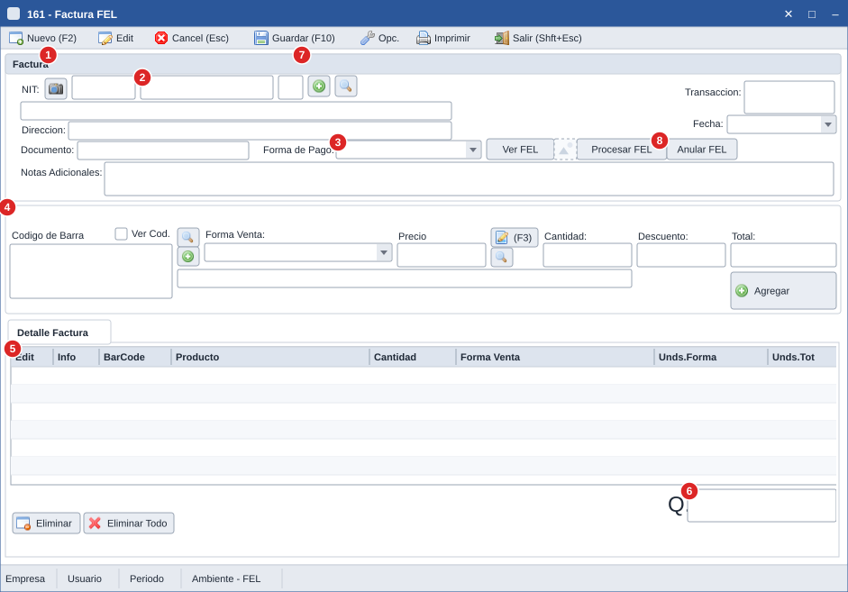

**Leyenda** (los números rojos de la imagen):

1. **Nuevo (F2)**: inicia la factura; si quedó un borrador sin guardar, pregunta si desea recuperarlo.
2. **NIT y nombre del cliente**: se busca por NIT (o con la lupa); use CF para consumidor final.
3. **Forma de pago**: contado o crédito.
4. **Captura del producto**: código de barra o nombre, forma de venta, precio, cantidad y descuento; **Agregar** lo pasa al detalle.
5. **Detalle de la factura**: una línea por producto, con botones **Edit** e **Info**.
6. **Total** de la factura.
7. **Guardar (F10)**: graba la factura y envía la certificación FEL (excepto en modo de depuración).
8. **Procesar FEL / Ver FEL / Anular FEL**: certifica, consulta o anula el documento ante la SAT.

<!-- /img:pantalla_161_factura_fel -->

**Propósito:** registrar la venta de productos o servicios, calcular impuestos,
descuentos y totales, cobrar y generar el documento fiscal.

**Acceso:** Transacciones → **+ Ventas** → seleccione la variante
(**Venta N**, **Venta con FEL Std**, **Venta CompuDell**, **Venta Montellano**,
**Venta Yojcom**, **Venta con Pedido**, **Venta por Mes**, **Venta Olinda
Mazate**, **Venta PCMaster**, **Venta AyL**, **Venta Inmobiliaria**,
**Venta Touch**).

**Encabezado (pestaña "Encabezado" o "Factura")**

| Campo | Descripción |
|---|---|
| **#Id / Transacción** | Correlativo interno; se asigna al guardar |
| **#Pedido** | Pedido de venta de origen, si la venta se genera desde uno |
| **#FEL** | Número de documento electrónico, cuando aplica |
| **NIT / NIT Cliente** | Identificación del cliente; se busca en el maestro |
| **NIT SAT** | NIT para efectos de facturación electrónica |
| **Dirección** | Dirección del cliente para el documento |
| **F.Venta / Fecha** | Fecha de la venta |
| **F.Factu. / Fecha FEL** | Fecha de facturación electrónica |
| **Moneda** | Moneda del documento |
| **Forma de Pago** | Efectivo, crédito, tarjeta, cheque, etc. |
| **Documento** | Documento de referencia o número externo |
| **% Desc** | Descuento global de la venta |
| **Notas Adicionales** | Texto libre que puede imprimirse |

**Indicadores de estado:** **¡Factura Anulada!**, **¡Fact. de Periodo
Cerrado!**, **¡Cobrada!**, **¡Contabilizada!**, **¡Entregada Completa!**.

**Detalle de la factura**

Columnas habituales: **Edit**, **Info**, **Id Detalle**, **Producto**,
**Cantidad**, **Forma Venta**, **Unds.Forma**, **Unds.Tot**, **Precio Costo**,
**Precio Venta**, **Descuento**, **Sub-Total**, **Unds.Pend.**

**Cómo agregar un producto**

1. En el bloque de captura, escriba o escanee el **Código de Barra**, o pulse
   **Producto (F3)** y búsquelo por código, nombre, marca o familia.
2. Seleccione la **Forma Venta**; el sistema convierte a unidades base.
3. Ingrese la **Cantidad**.
4. Ajuste **Precio** y **Descuento** si su perfil lo permite.
5. Revise el **Total** de la línea.
6. Pulse **Agregar**.
7. Repita para cada producto.
8. Para quitar una línea use **Eliminar**; para vaciar el detalle use
   **Eliminar Todo**.

**Totales**

La pantalla muestra **SubTotal**, **Descuento**, **Impuestos** y **Total**.
Verifique el total antes de guardar; los descuentos y precios especiales
requieren permisos.

**Botones principales**

| Botón | Función |
|---|---|
| **Nuevo (F2)** | Inicia una factura nueva |
| **Editar** | Habilita la edición de una factura existente (si el periodo lo permite) |
| **Cancel (Esc)** | Cancela la captura |
| **Guardar (F10)** | Valida y graba la factura |
| **Producto (F3)** | Abre el buscador de productos |
| **Clientes** | Abre el buscador/maestro de clientes |
| **Cobrar (F12)** | Abre la pantalla de cobro |
| **Salidas (F11)** | Registra el despacho de materiales |
| **Certificar (Ctrl+F)** / **Procesar FEL** | Envía la factura a certificación electrónica |
| **Anular FEL** | Anula el documento electrónico |
| **Ver FEL / Ver Datos FEL** | Consulta el detalle y estado FEL |
| **Ver Pedidos Relacionados** | Muestra pedidos vinculados |
| **Imprimir / Print (Ctrl+P)** | Imprime o previsualiza |
| **Imprimir con Datos de Ganancia y Costo** | Reporte interno con costo y margen |
| **Anulación → Anular / Ver Comentario Anulacion** | Anula la factura o consulta el motivo |
| **Salir (Shift+Esc)** | Cierra la pantalla |

**Pasos para facturar**

1. Pulse **Nuevo (F2)**.
2. Busque y seleccione el **cliente**; verifique NIT, dirección y crédito.
3. Confirme **Forma de Pago** y **Moneda**.
4. Agregue los productos (código de barras o `F3`).
5. Revise cantidades, precios, descuentos, impuestos y total.
6. Si aplica, agregue **Notas Adicionales**.
7. Pulse **Guardar (F10)**.
8. Si su operación es FEL, pulse **Certificar (Ctrl+F)** o **Procesar FEL** y
   espere la respuesta.
9. Pulse **Cobrar (F12)** para registrar el pago, o deje la factura al crédito.
10. Pulse **Salidas (F11)** para despachar, si maneja bodega.
11. Pulse **Imprimir (Ctrl+P)** para entregar el comprobante.

**Buenas prácticas**

- Verifique el **NIT** antes de certificar; un dato fiscal incorrecto obliga a
  anular y emitir de nuevo.
- No certifique dos veces: el sistema marca la factura como certificada.
- Si el FEL falla, revise conexión, credenciales y ambiente (pruebas/producción);
  no anule sin seguir el procedimiento de contingencia.

**Anulación**

1. Abra la factura desde la consulta.
2. Pulse **Anulación**.
3. Elija **Anular**.
4. Escriba el **comentario/motivo** en la ventana de anulación.
5. Confirme. El sistema marcará **¡Factura Anulada!** y registrará usuario y fecha.
6. Si la factura estaba certificada, use el flujo **Anular FEL** según
   corresponda.

> La anulación no borra el documento: lo deja sin efecto y conserva la traza.
> No anule documentos con pagos o salidas aplicadas sin revertir antes esos
> movimientos.

#### 6.1.3 Edición de producto en la factura

<!-- img:pantalla_189_editar_item_factura_fel -->
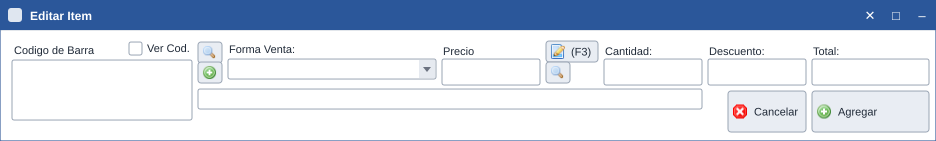

<!-- /img:pantalla_189_editar_item_factura_fel -->

Al pulsar **Edit** en una línea se abre la ventana de edición de producto
(**EditarProductoFactura**). Permite ajustar:

- **Forma Venta** y **Cantidad**.
- **Precio Venta** y **Descuento**.
- **Precio especial** (si el producto/cliente lo permiten).
- **Lote / Fecha de vencimiento**, cuando el producto lo maneja.
- **Observaciones** de la línea.

Confirme con **Aceptar/Guardar** para recalcular el **Sub-Total** y los totales.

#### 6.1.4 Pantalla de cobro (CobroFacturaUI / Rapid_CobroFacturaUI)

<!-- img:pantalla_209_cobro_rapido -->
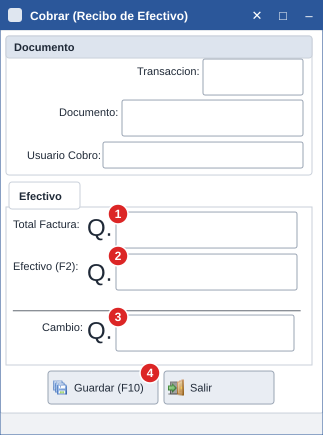

**Leyenda** (los números rojos de la imagen):

1. **Total Factura**: importe a cobrar.
2. **Efectivo (F2)**: monto recibido del cliente.
3. **Cambio**: se calcula automáticamente.
4. **Guardar (F10)**: registra el cobro.

<!-- /img:pantalla_209_cobro_rapido -->

<!-- img:pantalla_202_cobro_factura -->
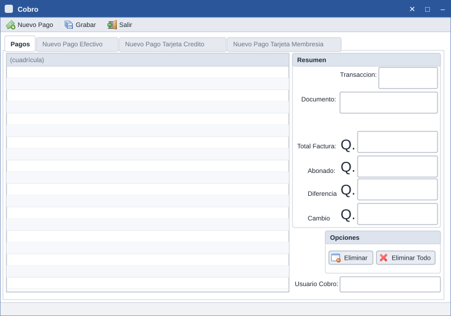

<!-- /img:pantalla_202_cobro_factura -->

**Propósito:** registrar uno o varios pagos de una factura y calcular cambio y
diferencia.

**Acceso:** desde la factura con **Cobrar (F12)**, desde **Consulta de
facturas**, o desde el flujo de cobro rápido.

> Según la variante de la empresa, **Cobrar (F12)** puede abrir el cobro rápido
> (recibo de efectivo simplificado) o el cobro completo con pestañas por medio
> de pago. Ambos comparten el cálculo de **Total**, **Abonado**, **Diferencia**
> y **Cambio**.

**Encabezado**

| Campo | Descripción |
|---|---|
| **Transacción** | Factura que se cobra |
| **Documento** | Documento de referencia |
| **Usuario Cobro** | Usuario que registra el pago |
| **Total Factura** | Importe facturado |
| **Abonado** | Suma de pagos aplicados |
| **Diferencia** | Pendiente o excedente |
| **Cambio** | Vuelto a entregar |

**Pestañas**

| Pestaña | Contenido |
|---|---|
| **Efectivo** | **Efectivo (F2)**, **Valor Abono**, **Cambio**; botón **Agregar** |
| **Tarjeta Crédito** | **Banco**, **Tipo de Tarjeta**, **Número de Tarjeta**, **Valor Abono**, **Fotografía Comprobante** (**Explorar**, **Capturar**, **Iniciar**, **Detener**) |
| **Tarjeta Membresía** | **Número de Tarjeta**, **Saldo Tarjeta**, **Valor Abono**, **Diferencia** |

**Botones:** **Efectivo**, **Tarjeta Crédito**, **Tarjeta Membresía**,
**Grabar**, **Salir**; en el detalle, **Eliminar** y **Eliminar Todo**.

**Pasos**

1. Abra el cobro desde la factura.
2. Verifique **Total Factura** y **Abonado**.
3. Elija el medio de pago.
4. Ingrese el **Valor Abono**.
5. Pulse **Agregar**; el pago aparece en el detalle.
6. Repita para pagos mixtos.
7. Revise **Diferencia** y **Cambio**.
8. Pulse **Grabar**.
9. Confirme el mensaje de éxito e imprima el recibo si corresponde.

**Reglas**

- No grabe si la **Diferencia** es distinta de cero, salvo que el sistema
  permita abonos parciales y su política lo autorice.
- El **Cambio** debe calcularse antes de cerrar el cobro.
- Adjunte la fotografía del comprobante en pagos con tarjeta cuando sea exigido.
- Un pago grabado no se edita: se anula/reversa según el procedimiento.

#### 6.1.5 Venta Touch / Comida Rápida

<!-- img:pantalla_204_venta_touch -->
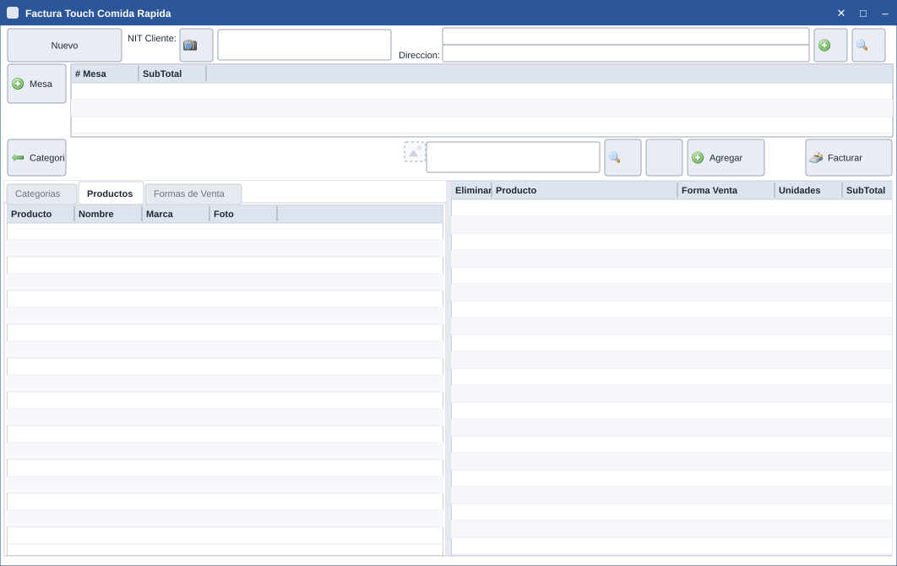

<!-- /img:pantalla_204_venta_touch -->

**Propósito:** facturación táctil para mostrador o restaurante, con selección
visual de productos y mesas.

**Uso:** seleccione productos, cantidades y mesa; confirme la venta y cobre.
Comparte las validaciones de inventario, caja y FEL de la factura estándar.

#### 6.1.6 Generar Facturas de Servicios

<!-- img:pantalla_294_facturas_servicios -->
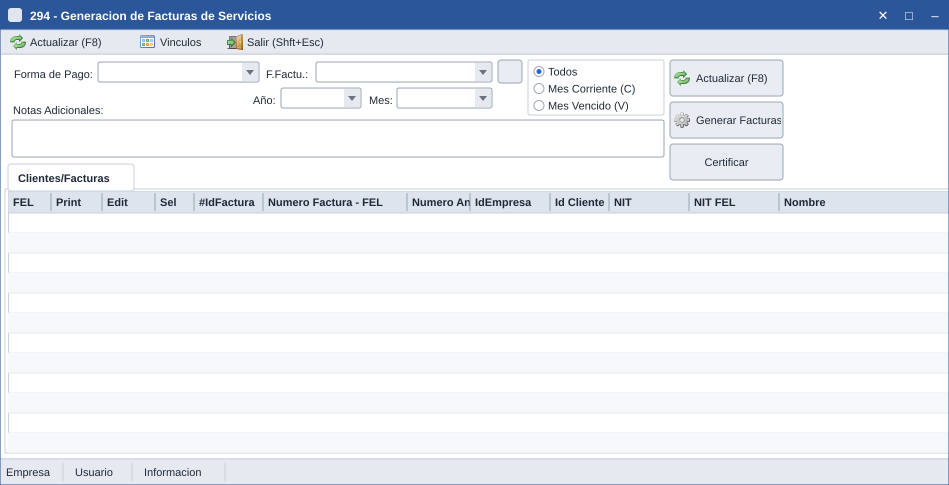

<!-- /img:pantalla_294_facturas_servicios -->

**Propósito:** generar facturas a partir de servicios recurrentes registrados
en el cliente (pestaña **Servicios**).

**Uso:** seleccione cliente/periodo, revise los servicios pendientes, genere la
factura y cobre. Verifique fechas y precios antes de generar en lote.

### 6.2 Cotizaciones

#### Pantalla "95 - Cotización" (y variantes Std, CompuDell, PCMaster, con Aprobación)

<!-- img:pantalla_95_cotizacion -->
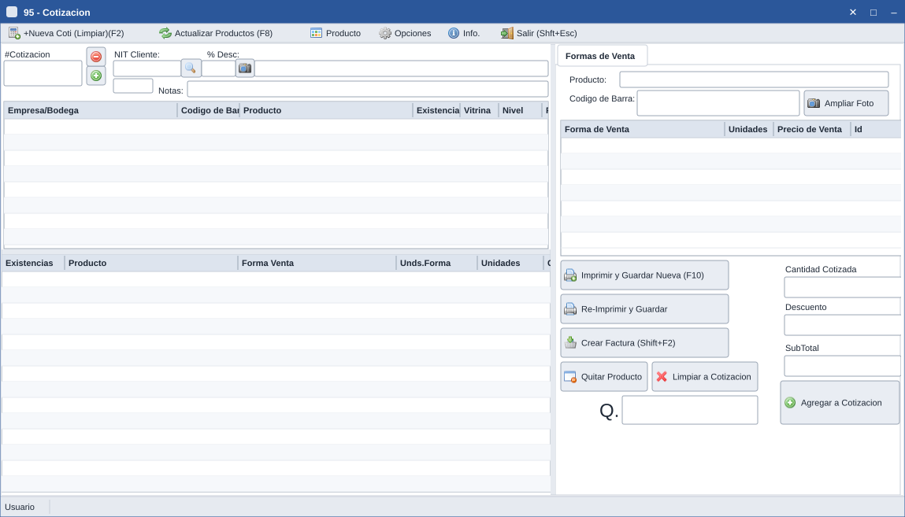

<!-- /img:pantalla_95_cotizacion -->

**Propósito:** preparar una oferta de productos/servicios sin afectar inventario
ni contabilidad, e imprimirla o convertirla en factura.

**Acceso:** Transacciones → **Cotizaciones** → **+ Cotización**.

**Elementos**

| Elemento | Descripción |
|---|---|
| **#Cotización** | Correlativo de la cotización |
| **NIT Cliente** | Cliente de la cotización |
| **% Desc** | Descuento global |
| **Notas** | Condiciones y observaciones |
| **Código de Barra / Producto** | Búsqueda de productos |
| **Cantidad Cotizada** | Cantidad solicitada |
| **SubTotal / Descuento** | Totales |
| **Formas de Venta** | Precios por presentación |

**Botones**

- **+Nueva Coti (Limpiar) (F2)**
- **Actualizar Productos (F8)**
- **Agregar a Cotización**
- **Quitar Producto**
- **Limpiar a Cotización**
- **Ampliar Foto**
- **Imprimir y Guardar Nueva (F10)**
- **Re-Imprimir y Guardar**
- **Crear Factura (Shift+F2)**
- **Salir (Shift+Esc)**
- **Ver Todas las Empresas** (si su perfil lo permite)

**Pasos**

1. Pulse **F2** para limpiar/iniciar.
2. Seleccione el cliente.
3. Agregue productos y cantidades.
4. Aplique descuentos y revise totales.
5. Escriba las notas/condiciones.
6. Pulse **Imprimir y Guardar Nueva (F10)** para guardar e imprimir.
7. Para convertir a venta, pulse **Crear Factura (Shift+F2)** y complete la
   factura.

**Reglas**

- La cotización no reserva inventario ni genera cuenta por cobrar.
- Si el cliente acepta, convierta a factura en lugar de crear una venta manual
  para conservar la trazabilidad.
- Las cotizaciones con aprobación pueden requerir autorización antes de facturar.

### 6.3 Pedidos de venta

#### Pantalla "131 - Pedido Venta" (y variantes Std/Con Aprobación)

<!-- img:pantalla_131_pedido_venta -->
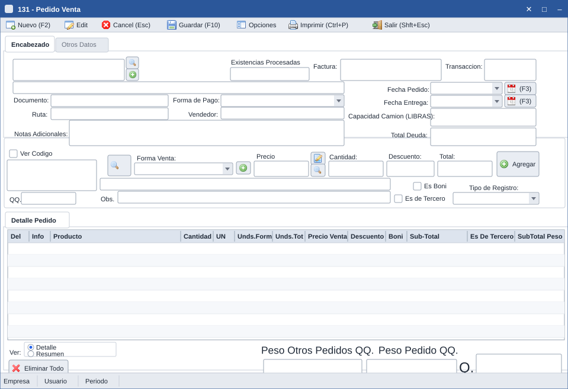

<!-- /img:pantalla_131_pedido_venta -->

**Propósito:** registrar el pedido del cliente, controlar peso/ruta/vendedor y
generar la factura y las salidas de materiales.

**Acceso:** Transacciones → **+ Pedido Venta**; consulta en **Pedidos Venta**.

**Pestaña "Encabezado"**

| Campo | Descripción |
|---|---|
| **Transacción** | Correlativo del pedido |
| **Documento** | Documento de referencia |
| **Factura** | Factura generada, cuando aplica |
| **Cliente / NIT** | Cliente del pedido |
| **Fecha Pedido / Fecha Entrega** | Fechas del pedido y de entrega |
| **Forma de Pago** | Condición de pago |
| **Ruta / Ruta Suplente** | Ruta de reparto |
| **Vendedor** | Vendedor/rutero |
| **Capacidad Camión (LIBRAS)** | Capacidad de carga |
| **Total Deuda** | Saldo del cliente |
| **Notas Adicionales** | Observaciones |
| **Peso Pedido QQ. / Peso Otros Pedidos QQ.** | Control de peso |

**Pestaña "Otros Datos":** **Límite Crédito Diario/Mensual/Total**, **Ruta
Suplente**, **Vendedor**, **Capacidad Camión**, **Es de Tercero**.

**Detalle del pedido**

Columnas: **Del**, **Info**, **Ver.Mem**, **Id Detalle**, **Producto**,
**Cantidad**, **Forma Venta**, **Unds.Forma**, **Sentido**, **Unds.Tot**,
**Precio Venta**, **Descuento**, **Sub-Total**, **Observaciones**,
**SubTotal Peso (KG/Lb/QQ)**, **Tipo Registro**, **+ Ajuste**, **Ajuste
Generado**, **Boni**, **EsMem**, **Precio std.**, **Es De Tercero**, **UN**.

**Captura de línea:** **Código de Barra**, **Forma Venta**, **Cantidad**,
**Precio**, **Descuento**, **Obs.**, casillas **Es Boni** (bonificación) y
**Es de Tercero**, **Tipo de Registro**, **QQ./Kg.**; botón **Agregar**.

**Botones principales**

| Botón | Función |
|---|---|
| **Nuevo (F2)** / **Editar** / **Cancel (Esc)** / **Guardar (F10)** | Operación estándar |
| **Facturar (Manual)** | Genera la factura desde el pedido |
| **Facturar (Automática)** | Genera la factura con la configuración automática |
| **Procesar (Salida de Existencias)** | Registra la salida de inventario |
| **Ver Salidas (F11)** | Consulta las salidas del pedido |
| **Ver Saldos de Documentos (CxC)** | Consulta el estado de cuenta |
| **Imprimir (Ctrl+P)** | Imprime el pedido |
| **Anulación** | Anula el pedido y registra comentario |
| **Salir (Shift+Esc)** | Cierra la pantalla |

**Pasos**

1. **Nuevo (F2)**.
2. Seleccione cliente, ruta, vendedor y fechas.
3. Confirme la forma de pago y revise el crédito.
4. Agregue productos, cantidades, precios y descuentos.
5. Marque **Es Boni** para bonificaciones y **Es de Tercero** cuando aplique.
6. Revise peso y total.
7. **Guardar (F10)**.
8. Genere la factura (**Facturar Manual** o **Automática**).
9. Procese la salida de existencias y despache.

**Reglas**

- Un pedido **anulado** o **facturado** no debe modificarse.
- Si el pedido es de tercero, el costo/precio se trata de forma especial;
  verifique la configuración.
- El peso (QQ/Kg/Lb) se usa para capacidad de camión, rutas y pago de piloto.

#### 6.3.1 Aprobación de pedidos de venta

**Pantalla "386 - Aprobación Pedido Venta"** (Consulta)

Permite revisar pedidos pendientes de autorización y aprobarlos/rechazarlos
según el flujo de la empresa. Use los filtros, seleccione el pedido y aplique la
acción; el pedido aprobado queda disponible para facturar.

### 6.4 Pedidos de compra

#### Pantalla "135 - Pedido Compra"

<!-- img:pantalla_135_pedido_compra -->
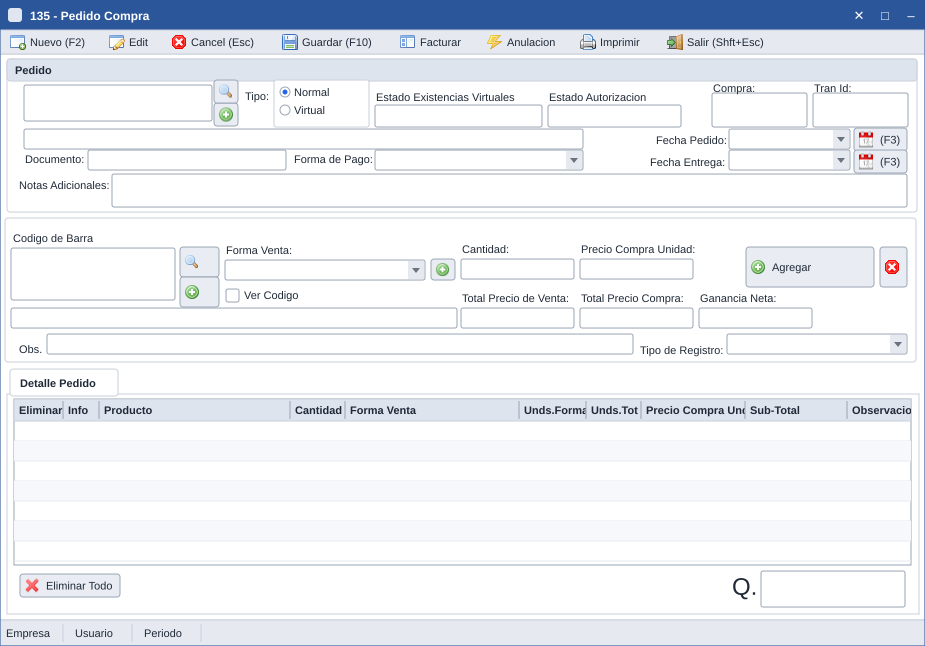

<!-- /img:pantalla_135_pedido_compra -->

**Propósito:** solicitar mercadería al proveedor, controlar la autorización y
generar la compra.

**Campos principales:** **Tran Id**, **Documento**, **Proveedor/NIT**,
**Fecha Pedido**, **Fecha Entrega**, **Forma de Pago**, **Tipo**, **Notas
Adicionales**, **Estado Autorización**, **Estado Existencias Virtuales**.

**Detalle:** **Eliminar**, **Info**, producto, cantidad, forma de venta,
unidades, **Precio Compra Und**, **Precio Venta**, **Sub-Total**,
**Observaciones**, **Tipo Registro**, **+ Ajuste**, **Ajuste Generado**.

**Captura:** **Código de Barra**, **Forma Venta**, **Cantidad**, **Precio
Compra Unidad**, **Obs.**, **Tipo de Registro**; **Agregar**.

**Totales:** **Total Precio Compra**, **Total Precio de Venta**, **Ganancia
Neta**.

**Botones**

- **Nuevo (F2)**, **Edit**, **Cancel (Esc)**, **Guardar (F10)**.
- **Compra (Manual)**: genera la compra desde el pedido.
- **Procesar Existencias Pedido Virtual**: registra existencias virtuales.
- **Aprobar Pedido para COMPRA**: envía a autorización.
- **Anulación**.
- **Imprimir**, **Salir (Shift+Esc)**.

**Pasos**

1. **Nuevo (F2)** y seleccione proveedor.
2. Defina fechas y forma de pago.
3. Agregue productos y precios de compra.
4. Revise la ganancia estimada.
5. **Guardar (F10)**.
6. Envíe a aprobación si el flujo lo exige.
7. Genere la **Compra (Manual)** cuando se reciba la mercadería.

**Reglas**

- El pedido no afecta inventario real hasta procesar existencias o generar la
  compra.
- Revise **Estado Autorización** antes de generar la compra.

#### 6.4.1 Aprobación de pedidos de compra

**Pantalla "387 - Aprobación Pedido Compra"** (Consulta): revisa y autoriza
pedidos pendientes. Seleccione el pedido, revise el detalle y aplique la acción.

### 6.5 Compras

#### Pantalla "17 - Compra" (y variantes CompuDell, Montellano, Olinda Mazate, PCMaster, Lite, Estándar, con Pedido)

<!-- img:pantalla_244_compra -->
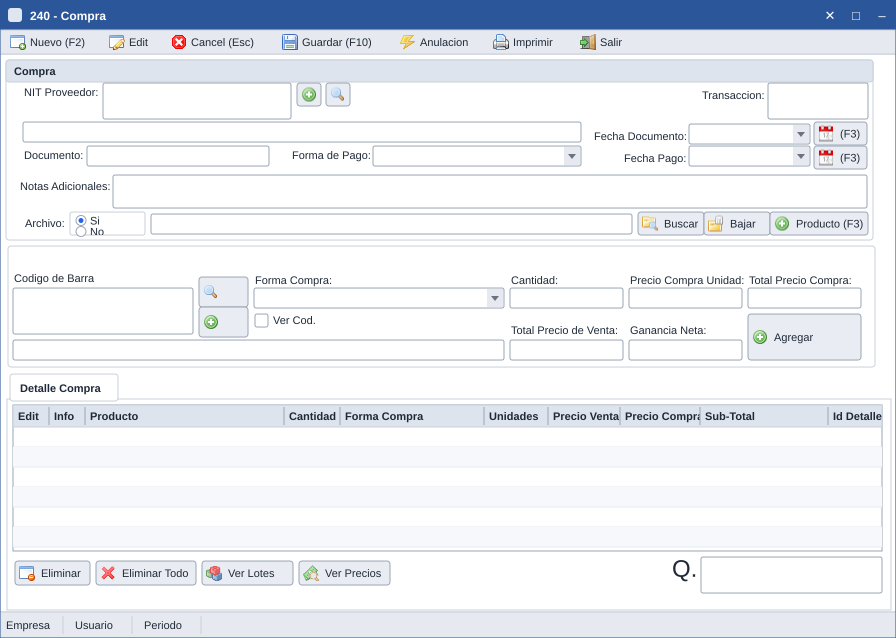

<!-- /img:pantalla_244_compra -->

**Propósito:** registrar la compra al proveedor, actualizar costo/existencia,
controlar fechas de pago y generar cuentas por pagar.

**Acceso:** Transacciones → **+ Compras** → variante.

**Encabezado**

| Campo | Descripción |
|---|---|
| **Transacción** | Correlativo de compra |
| **NIT Proveedor** | Proveedor |
| **Documento** | Número de factura/documento del proveedor |
| **Fecha Documento** | Fecha del documento; botón **(F3)** para hoy |
| **Fecha Pago** | Fecha de pago; botón **(F3)** para hoy |
| **Forma de Pago** | Condición de pago |
| **Archivo** | Adjunto (**Buscar**, **Bajar**) |

**Detalle de compra**

Columnas: **Info**, **Id Detalle**, **Producto**, **Forma Compra**,
**Unidades**, **Cantidad**, **Precio Compra**, **Precio Venta**, **Sub-Total**,
**Fecha Vencimiento**, **Lote**.

**Captura:** **Código de Barra**, **Forma Compra**, **Cantidad**, **Precio
Compra Unidad**; **Agregar**. Indicador **\*\*\* Maneja Lotes \*\*\***.

**Totales:** **Total Precio Compra**, **Total Precio de Venta**, **Ganancia
Neta**.

**Botones**

- **Nuevo (F2)**, **Edit**, **Cancel (Esc)**, **Guardar (F10)**.
- **Ver Precios**, **Ver Lotes**.
- **Eliminar**, **Eliminar Todo**.
- **Imprimir**.
- **Anulación → Anular / Ver Comentario Anulacion**.
- **Salir (Shift+Esc)**.

**Pasos**

1. **Nuevo (F2)**.
2. Seleccione el proveedor por NIT.
3. Capture **Documento**, **Fecha Documento** y **Fecha Pago**.
4. Seleccione **Forma de Pago**.
5. Agregue productos, cantidades y precios de compra.
6. Si el producto maneja lotes, registre **Lote** y **Vencimiento**.
7. Revise costos, precios de venta y ganancia.
8. **Guardar (F10)**.
9. Adjunte el documento si su política lo requiere.

**Reglas**

- El costo de compra actualiza el costo promedio y la valuación del inventario.
- Si el producto maneja lotes, no guarde sin lote/vencimiento.
- Una compra **anulada** no debe pagarse; revise cuentas por pagar.
- La **Fecha Pago** alimenta la programación de pagos y cheques.

### 6.6 Notas de crédito y débito

#### Pantalla "143 - Nota de Crédito/Débito Individual"

<!-- img:pantalla_143_nota_credito_debito -->
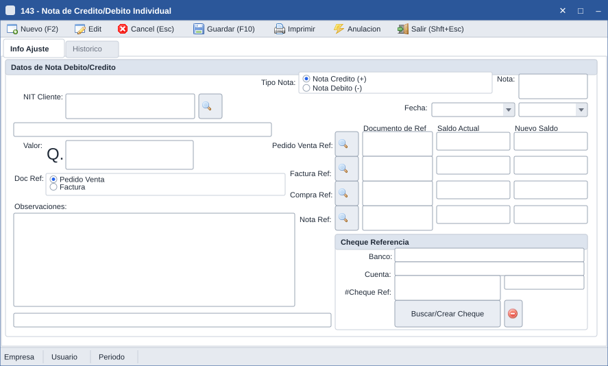

<!-- /img:pantalla_143_nota_credito_debito -->

<!-- img:pantalla_160_nota_credito_fel -->
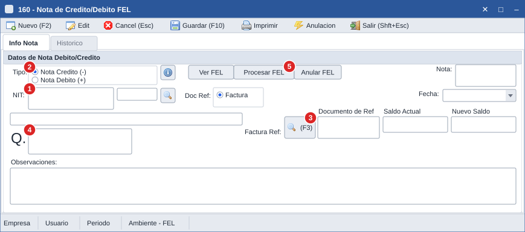

**Leyenda** (los números rojos de la imagen):

1. **NIT y cliente** de la nota.
2. **Sentido**: nota de crédito o de débito.
3. **Factura de referencia** (F3): documento FEL al que se aplica la nota.
4. **Valor** de la nota.
5. **Procesar FEL / Ver FEL**: certifica y consulta la nota ante la SAT.

<!-- /img:pantalla_160_nota_credito_fel -->

**Propósito:** ajustar el saldo de un documento (factura, compra, pedido) o
registrar devoluciones/descuentos posteriores, sin alterar el documento original.

**Acceso:** Transacciones → **+ Notas de Crédito** (individual o FEL) y desde la
consulta de facturas/compras con **Nueva Nota**.

**Campos principales**

| Campo | Descripción |
|---|---|
| **Nota** | Correlativo |
| **Fecha** | Fecha de la nota |
| **NIT Cliente** | Cliente o proveedor |
| **Tipo Nota** | Crédito o débito |
| **Nota Ref** | Nota de referencia, si aplica |
| **Doc Ref / Factura Ref / Pedido Venta Ref / Compra Ref** | Documento que se ajusta |
| **Saldo Actual** | Saldo antes de la nota |
| **Valor** | Importe de la nota |
| **Nuevo Saldo** | Saldo después de la nota |
| **Periodo** | Periodo contable |
| **Observaciones** | Motivo de la nota |
| **Cheque Referencia** | **Banco**, **Cuenta**, **#Cheque Ref**, **Buscar/Crear Cheque** |

**Pestaña "Histórico":** IdNota, Observaciones, Saldo Actual, Valor Nota, Nuevo
Saldo, Fecha Nota.

**Botones:** **Nuevo (F2)**, **Edit**, **Cancel (Esc)**, **Guardar (F10)**,
**Imprimir**, **Anulación → Anular**, **Ver Comentario Anulacion**,
**Salir (Shift+Esc)**.

**Pasos**

1. **Nuevo (F2)**.
2. Seleccione el **Tipo Nota**.
3. Busque el documento de referencia.
4. Verifique **Saldo Actual**.
5. Ingrese **Valor** y **Observaciones**.
6. Revise **Nuevo Saldo**.
7. **Guardar (F10)**.
8. Imprima y entregue el comprobante.

**Reglas**

- El valor no debe exceder el saldo, salvo que el tipo de nota lo permita.
- Una nota de crédito disminuye el saldo; una de débito lo aumenta.
- Si la nota es FEL, use la variante FEL y complete la referencia fiscal.
- No anule notas conciliadas sin revisar bancos y contabilidad.

#### 6.6.1 Variantes

- **Nota de Crédito/Débito en Bloque:** aplica varias notas o documentos en un
  solo proceso. Revise el detalle antes de confirmar.
- **Notas FEL (160/271/221):** incluye referencias fiscales y certificación.
- **Ver Datos Notas FEL / Info Help FEL:** consulta del documento electrónico.
- **Anulando Nota FEL:** proceso de anulación fiscal.

### 6.7 Inventarios

#### 6.7.1 Pantalla "41 - Ajuste"

<!-- img:pantalla_41_ajuste -->
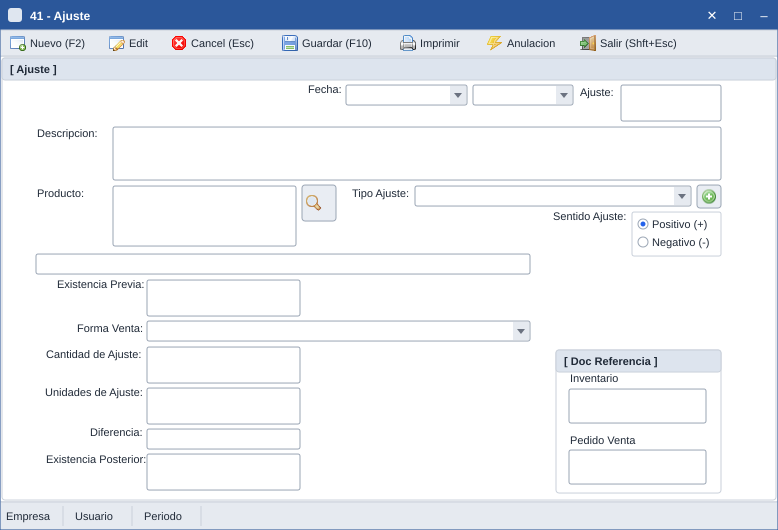

<!-- /img:pantalla_41_ajuste -->

**Propósito:** corregir la existencia de un producto, dejando evidencia del
motivo, la existencia previa y la posterior.

**Campos**

| Campo | Descripción |
|---|---|
| **Ajuste** | Correlativo |
| **Fecha** | Fecha del ajuste |
| **Tipo Ajuste** | Motivo/clasificación |
| **Sentido Ajuste** | Entrada o salida |
| **Producto** | Producto ajustado |
| **Forma Venta** | Presentación |
| **Cantidad de Ajuste / Unidades de Ajuste** | Cantidad a mover |
| **Existencia Previa / Posterior** | Control del efecto |
| **Diferencia** | Variación |
| **Descripción** | Motivo detallado |
| **Inventario / Doc Referencia** | Toma de inventario o documento de origen (incluye **Pedido Venta**) |

**Botones:** **Nuevo (F2)**, **Edit**, **Cancel (Esc)**, **Guardar (F10)**,
**Imprimir**, **Anulación → Anular**, **Ver Comentario Anulacion**,
**Salir (Shift+Esc)**.

**Pasos**

1. **Nuevo (F2)**.
2. Seleccione **Tipo Ajuste** y **Sentido**.
3. Busque el **Producto** y la **Forma Venta**.
4. Ingrese la **Cantidad de Ajuste**.
5. Verifique **Existencia Previa**, **Posterior** y **Diferencia**.
6. Escriba la **Descripción** del motivo.
7. **Guardar (F10)**.

**Reglas**

- Un ajuste modifica inventario y valuación; requiere autorización.
- Use el tipo de ajuste correcto para que la contabilidad se afecte bien.
- No ajuste para "cuadrar" sin investigar la causa.

#### 6.7.2 Pantalla "35 - Traslado" y "Traslado en Bloque"

<!-- img:pantalla_35_traslado -->
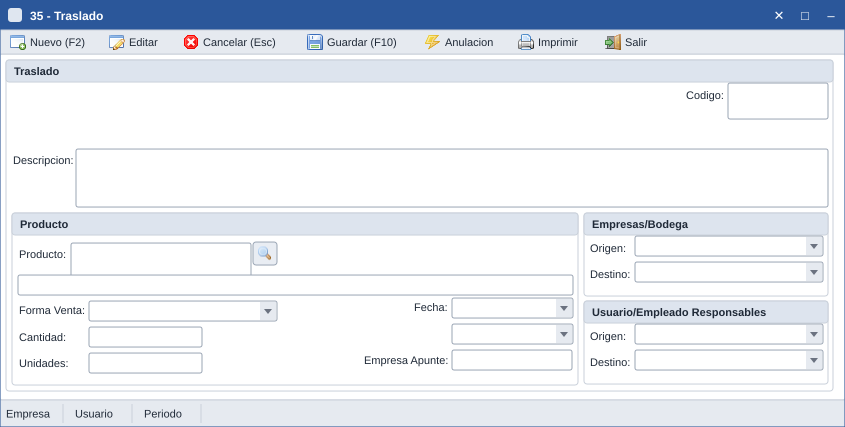

<!-- /img:pantalla_35_traslado -->

<!-- img:pantalla_35b_traslado_bloque -->
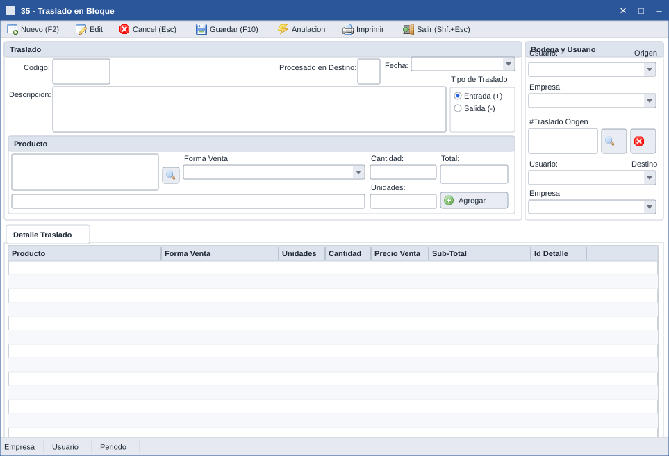

<!-- /img:pantalla_35b_traslado_bloque -->

**Propósito:** mover existencias entre empresas/bodegas, registrando origen,
destino y responsables.

**Campos**

| Campo | Descripción |
|---|---|
| **Código / Fecha** | Identificación del traslado |
| **Empresa Origen / Destino** | Bodegas involucradas |
| **Usuario Origen / Destino** | Responsables |
| **Producto** | Producto a trasladar |
| **Forma Venta / Cantidad / Unidades** | Presentación y cantidad |
| **Descripción** | Motivo |

**Botones:** **Nuevo (F2)**, **Editar**, **Cancelar (Esc)**, **Guardar (F10)**,
**Anulación**, **Imprimir**, **Salir**.

**Pasos**

1. **Nuevo (F2)**.
2. Seleccione empresa y usuario de origen y destino.
3. Agregue el producto y la cantidad.
4. Revise la existencia en origen.
5. **Guardar (F10)**.
6. Confirme la recepción en destino según su procedimiento.

**Reglas**

- No traslade más de la existencia disponible en origen.
- El traslado en bloque permite varios productos; revise el detalle completo.
- Un traslado anulado debe revertirse también en destino.

#### 6.7.3 Pantalla "37 - Inventario"

<!-- img:pantalla_37_inventario -->
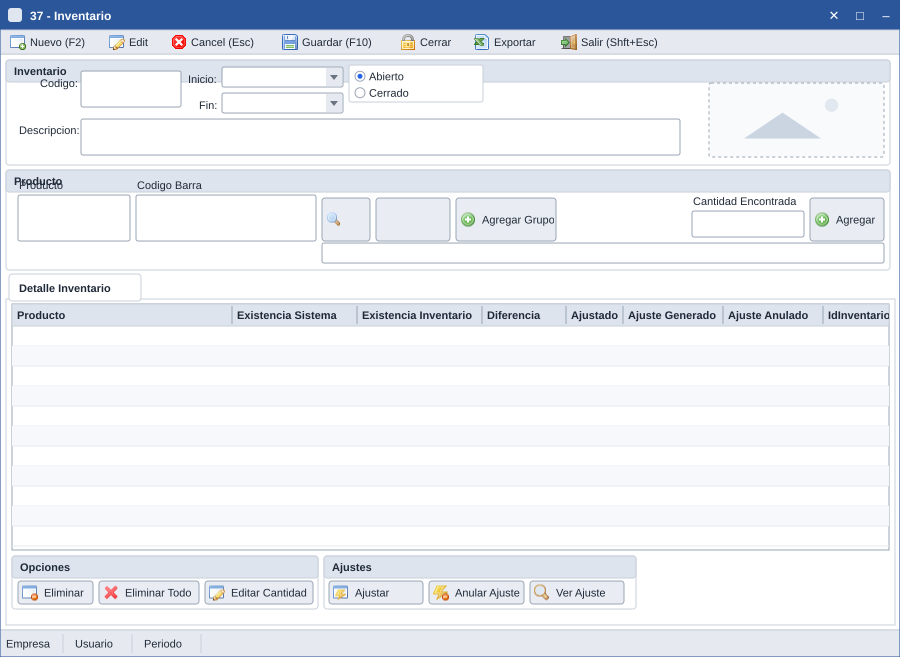

<!-- /img:pantalla_37_inventario -->

**Propósito:** realizar tomas de inventario físico, comparar existencia de
sistema contra contada y generar ajustes.

**Campos y pestañas**

| Elemento | Descripción |
|---|---|
| **Código** | Correlativo del inventario |
| **Descripción** | Nombre/objetivo de la toma |
| **Inicio / Fin** | Fechas de la toma |
| **Producto / Código Barra** | Búsqueda del producto |
| **Cantidad Encontrada** | Existencia física contada |
| **Agregar / Agregar Grupos** | Agrega producto o grupos/familias |

**Detalle del inventario:** IdInventario, IdDetalle, IdProducto, Código de Barra,
Producto, **Existencia Sistema**, **Existencia Inventario**, **Diferencia**,
**Ajuste Generado**, **Ajuste Anulado**.

**Pestaña "Ajustes":** **Ver Ajuste**, **Anular Ajuste**, **Ajustar**.

**Botones:** **Nuevo (F2)**, **Edit**, **Cancel (Esc)**, **Guardar (F10)**,
**Cerrar**, **Exportar**, **Editar Cantidad**, **Eliminar**, **Eliminar Todo**,
**Anulación**, **Salir (Shift+Esc)**.

**Pasos**

1. **Nuevo (F2)** y registre descripción y fechas.
2. Agregue productos (**Agregar**) o grupos (**Agregar Grupos**).
3. Capture la **Cantidad Encontrada** de cada producto.
4. Revise **Diferencia**.
5. Genere los ajustes (**Ajustar**) o ajuste individualmente.
6. **Guardar (F10)** y luego **Cerrar**.
7. Exporte el resultado si necesita respaldo.

**Reglas**

- El inventario cerrado no debe modificarse.
- Revise que no existan movimientos posteriores a la fecha de corte.
- Los ajustes generados afectan inventario y contabilidad.

#### 6.7.4 Pantalla "117 - Cierre de Existencias"

<!-- img:pantalla_117_cierre_existencias -->
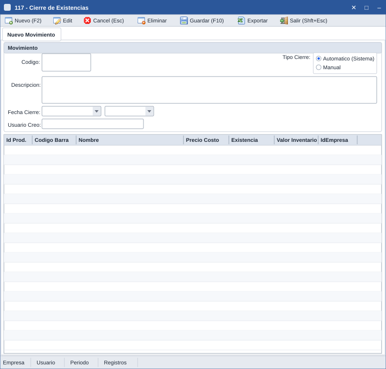

<!-- /img:pantalla_117_cierre_existencias -->

**Propósito:** congelar la existencia y el valor del inventario a una fecha,
como respaldo para contabilidad y auditoría.

**Campos:** **Código**, **Tipo Cierre**, **Fecha Cierre**, **Descripción**,
**Usuario Creo**.

**Detalle:** IdEmpresa, IdProducto, Nombre, Código Barra, Precio Costo,
Existencia, Valor Inventario.

**Botones:** **Nuevo (F2)**, **Edit**, **Cancel (Esc)**, **Eliminar**,
**Guardar (F10)**, **Exportar**, **Salir (Shift+Esc)**.

**Reglas:** verifique que todas las transacciones del periodo estén registradas
antes de cerrar. El cierre es un respaldo, no un ajuste.

#### 6.7.5 Movimiento de Inventario

**Pantalla "205 - Movimiento Inventario"**: registra entradas/salidas manuales
con documento de referencia. Use el tipo de movimiento correcto y justifique el
motivo. Comparte las validaciones de existencia y periodo.

#### 6.7.6 Pantalla "107 - Despacho de Materiales" / Salidas

<!-- img:pantalla_107_despacho_materiales -->
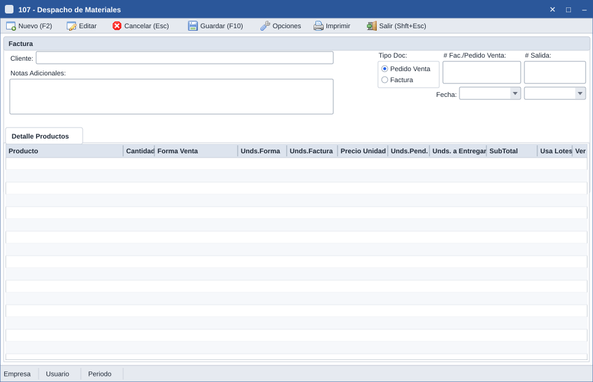

<!-- /img:pantalla_107_despacho_materiales -->

**Propósito:** registrar la entrega de productos de una factura o pedido,
controlando unidades pendientes y lotes.

**Encabezado:** **#Salida**, **#Fac./Pedido Venta**, **Cliente**, **Fecha**,
**Tipo Doc**, **Notas Adicionales**; indicadores **¡Salida Anulada!** y
**¡Tran. Anulada!**.

**Detalle:** Producto, Cantidad, Forma Venta, Precio Unidad, Unds.Forma,
Unds.Factura, **Unds.Pend.**, **Unds. a Entregar**, Código Barra, Usa Lotes,
**Ver Lotes**, Tiene Lotes, #Factura, #Factura Detalle, #Salida, #Salida
Detalle, SubTotal, #Pedido Venta.

**Botones:** **Nuevo (F2)**, **Editar**, **Cancelar (Esc)**, **Guardar (F10)**,
**Opciones**, **Anulación**, **Imprimir**, **Cobrar (F12)**, **Salir
(Shift+Esc)**.

**Reglas**

- No entregue más de las unidades pendientes.
- Si el producto maneja lotes, seleccione el lote correcto.
- La salida actualiza inventario y el estado **¡Entregada Completa!**.

#### 6.7.7 Salida Rápida de Productos

**Pantallas "59/60 - Salida Rápida"**: para consumos internos o salidas sin
factura. Registre producto, cantidad, motivo y responsable. Afecta inventario;
use la plantilla/tipo de salida autorizado.

### 6.8 Caja y bancos

#### 6.8.1 Pantalla "88 - Arqueo de Caja"

<!-- img:pantalla_88_arqueo_caja -->
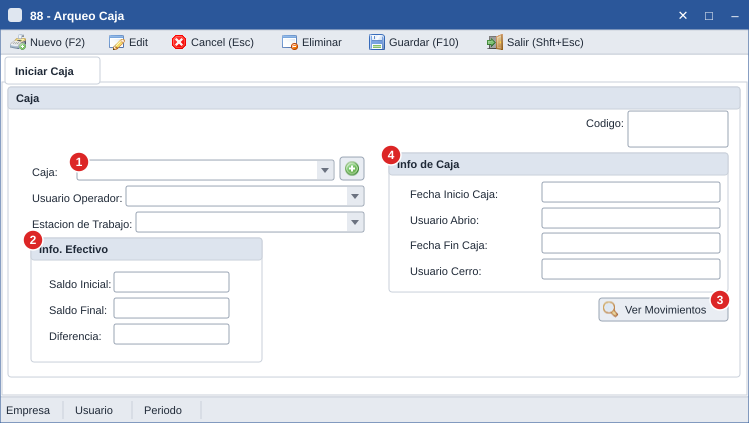

**Leyenda** (los números rojos de la imagen):

1. **Caja** que se abre o se cierra.
2. **Info. Efectivo**: saldo inicial, saldo final y diferencia del arqueo.
3. **Ver Movimientos**: abre los movimientos de la caja.
4. **Info de Caja**: quién y cuándo abrió y cerró la caja.

<!-- /img:pantalla_88_arqueo_caja -->

**Propósito:** abrir y cerrar la caja del turno, registrar el efectivo inicial y
final, y calcular la diferencia.

**Pestaña "Iniciar Caja"**

| Campo | Descripción |
|---|---|
| **Caja / Código** | Caja asignada |
| **Estación de Trabajo** | Equipo desde el que opera |
| **Usuario Operador / Abrió / Cerró** | Responsables |
| **Fecha Inicio Caja / Fecha Fin Caja** | Apertura y cierre |
| **Saldo Inicial** | Fondo de apertura |
| **Saldo Final** | Efectivo contado al cierre |
| **Diferencia** | Saldo final menos saldo inicial |
| **Ver Movimientos** | Consulta los movimientos de la caja |

**Botones:** **Nuevo (F2)**, **Edit**, **Cancel (Esc)**, **Eliminar**,
**Guardar (F10)**, **Salir (Shift+Esc)**.

**Apertura**

1. **Nuevo (F2)**.
2. Seleccione la **Caja**.
3. Confirme **Estación de Trabajo** y **Usuario Operador**.
4. Capture el **Saldo Inicial**.
5. **Guardar (F10)**.

**Cierre**

1. Abra el registro de caja activo.
2. Revise **Saldo Inicial** y **Ver Movimientos**.
3. Capture el **Saldo Final** contado.
4. Revise **Diferencia**; investigue faltantes/sobrantes.
5. **Guardar (F10)**.
6. Imprima el arqueo si su procedimiento lo exige.

**Reglas**

- Sin caja abierta no se deben registrar cobros en efectivo, si el sistema
  controla efectivo.
- La diferencia debe justificarse; no la ajuste sin autorización.
- Cierre la caja al final del turno y entregue el efectivo.

#### 6.8.2 Pantalla "94 - Movimiento Manual de Caja"

<!-- img:pantalla_94_movimiento_manual_caja -->
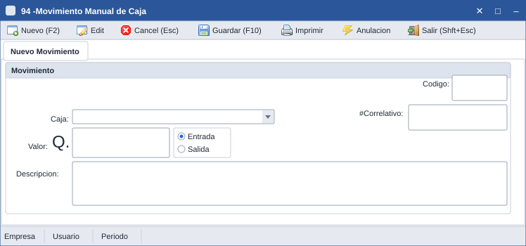

<!-- /img:pantalla_94_movimiento_manual_caja -->

**Propósito:** registrar entradas o salidas de efectivo ajenas a una venta
(depósitos, retiros, gastos, fondo).

**Campos:** **Código**, **Caja**, **#Correlativo**, **Descripción**, **Valor**,
**Fecha**.

**Botones:** **Nuevo (F2)**, **Edit**, **Cancel (Esc)**, **Guardar (F10)**,
**Eliminar**, **Imprimir**, **Anulación**, **Salir (Shift+Esc)**.

**Reglas:** todo movimiento debe tener descripción y soporte; afecta el saldo de
la caja y puede generar asiento.

#### 6.8.3 Cajas Chicas

**Pantallas "288/289 - Cajas Chicas" y Movimientos de Caja Chica**: controlan
fondos fijos por responsable. Registre apertura, movimientos y reposición;
verifique el saldo antes de cerrar.

#### 6.8.4 Pantalla "111 - Cheque"

<!-- img:pantalla_111_cheque -->
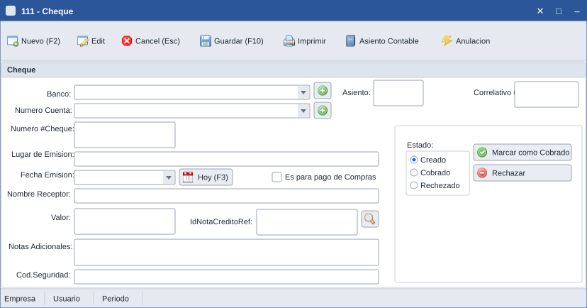

<!-- /img:pantalla_111_cheque -->

**Propósito:** emitir, cobrar, rechazar y anular cheques.

**Campos**

| Campo | Descripción |
|---|---|
| **Correlativo Cheque** | Número interno |
| **Número #Cheque** | Número del cheque |
| **Banco / Número Cuenta** | Cuenta de cargo |
| **Fecha Emisión** | Fecha; botón **Hoy (F3)** |
| **Valor** | Importe |
| **Nombre Receptor** | Beneficiario |
| **Lugar de Emisión** | Ciudad/lugar |
| **Cod. Seguridad** | Código de seguridad |
| **Archivo** | Adjunto (**Buscar**, **Bajar**) |
| **Notas Adicionales** | Observaciones |
| **Estado** | Estado del cheque |
| **Motivo de Rechazo** | Se usa al rechazar |
| **Es para pago de Compras** | Vincula el cheque a compras |
| **Asiento** | Asiento contable generado |

**Indicadores:** **¡Cheque Anulado!**, **¡Contabilizada!**.

**Botones:** **Nuevo (F2)**, **Edit**, **Cancel (Esc)**, **Guardar (F10)**,
**Imprimir**, **Asiento Contable**, **Marcar como Cobrado**, **Rechazar**,
**Anulación → Anular**, **Ver Comentario Anulacion**, **Salir (Shift+Esc)**.

**Pasos de emisión**

1. **Nuevo (F2)**.
2. Seleccione banco y cuenta.
3. Capture número, fecha, valor y beneficiario.
4. Marque **Es para pago de Compras** si aplica.
5. **Guardar (F10)**.
6. Imprima o registre el cheque.

**Reglas**

- Verifique el saldo de la cuenta antes de emitir.
- Un cheque rechazado debe registrar el motivo.
- No anule un cheque conciliado sin revisar bancos y contabilidad.

#### 6.8.5 Pantalla "121 - Movimiento Bancario"

<!-- img:pantalla_121_movimiento_bancario -->
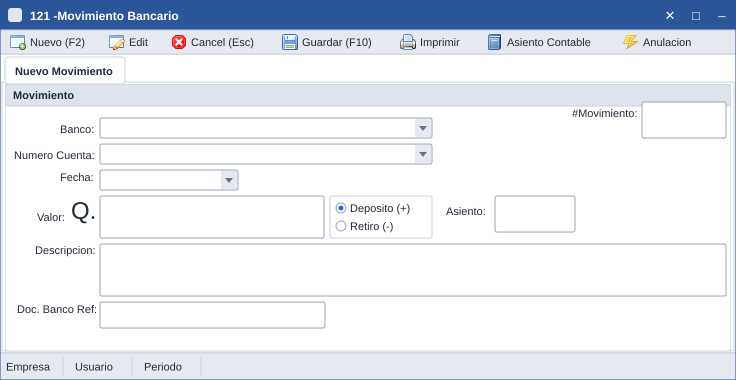

<!-- /img:pantalla_121_movimiento_bancario -->

**Propósito:** registrar depósitos, retiros, notas bancarias y comisiones.

**Campos:** **Banco**, **Número Cuenta**, **#Movimiento**, **Fecha**,
**Doc. Banco Ref**, **Descripción**, **Valor**, **Asiento**, **¡Contabilizada!**.

**Botones:** **Nuevo (F2)**, **Edit**, **Cancel (Esc)**, **Guardar (F10)**,
**Eliminar**, **Imprimir**, **Asiento Contable**, **Anulación**, **Salir**.

**Reglas:** use el tipo de movimiento correcto y adjunte la referencia bancaria;
afecta el saldo de la cuenta y la contabilidad.

### 6.9 Contabilidad

#### 6.9.1 Pantalla "383 - Asiento Contable"

<!-- img:pantalla_383_asiento_contable -->
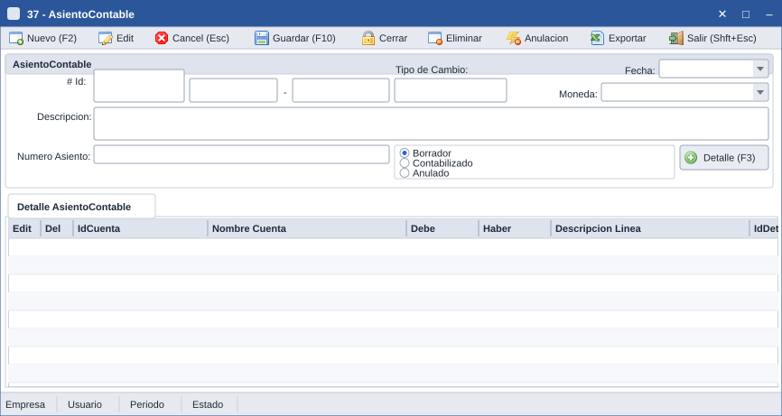

<!-- /img:pantalla_383_asiento_contable -->

**Propósito:** registrar asientos manuales con líneas al Debe y al Haber.

**Campos**

| Campo | Descripción |
|---|---|
| **# Id / Número Asiento** | Correlativo |
| **Fecha** | Fecha del asiento |
| **Descripción** | Concepto general |
| **Moneda / Tipo de Cambio** | Moneda y tasa |
| **Estado** | Estado del asiento |

**Detalle**

Columnas: **Edit**, **Del**, **IdDetalle**, **IdCuenta**, **Nombre Cuenta**,
**Debe**, **Haber**, **Descripción Línea**.

**Botones:** **Nuevo (F2)**, **Edit**, **Cancel (Esc)**, **Guardar (F10)**,
**Cerrar**, **Eliminar**, **Detalle (F3)**, **Anulación**, **Exportar**,
**Salir (Shift+Esc)**.

**Pasos**

1. **Nuevo (F2)**.
2. Capture fecha, descripción y moneda.
3. Pulse **Detalle (F3)** y agregue las líneas.
4. Verifique que **Debe = Haber**.
5. **Guardar (F10)**.
6. Cierre/contabilice según el flujo.

**Reglas:** un asiento descuadrado no debe guardarse. No modifique asientos de
periodos cerrados.

#### 6.9.2 Periodos y ejercicios contables

| Pantalla | Uso |
|---|---|
| **Periodo Contable** | Crea y administra periodos; apertura/cierre |
| **Editar Periodo Contable** | Ajusta fechas y estado |
| **Ejercicio Contable** | Agrupa periodos por ejercicio |
| **Editar Ejercicio Contable** | Modifica el ejercicio |
| **Cierre Periodo Contable** | Ejecuta el cierre y valida pendientes |
| **Cierre Periodo Contable Validación** | Revisa documentos/conflictos antes del cierre |

**Reglas:** cierre solo cuando todas las transacciones estén registradas y
cuadradas. Un periodo cerrado bloquea ediciones y limita anulaciones.

### 6.10 Metas de vendedor

#### Pantalla "151 - Meta para Vendedor"

<!-- img:pantalla_151_meta_vendedor -->
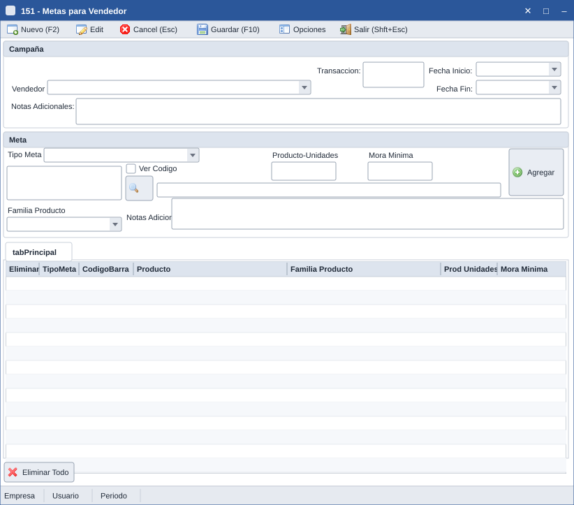

<!-- /img:pantalla_151_meta_vendedor -->

**Propósito:** definir campañas y metas por vendedor, producto o familia, con
reglas de mora.

**Campos:** **Transacción**, **Vendedor**, **Fecha Inicio**, **Fecha Fin**,
**Notas Adicionales**; detalle con **Producto**, **Familia Producto**,
**Tipo Meta**, **Producto-Valor**, **Producto-Unidades**, **Mora Mínima**,
**Días Vencimiento**, **Notas Adicionales**.

**Botones:** **Nuevo (F2)**, **Edit**, **Cancel (Esc)**, **Guardar (F10)**,
**Agregar**, **Eliminar**, **Eliminar Todo**, **Anulación**, **Salir**.

**Reglas:** las metas se evalúan con ventas del periodo; no las anule si ya se
usaron en liquidaciones.

### 6.11 Visitas

#### Pantalla "172 - Visita"

<!-- img:pantalla_172_visita -->
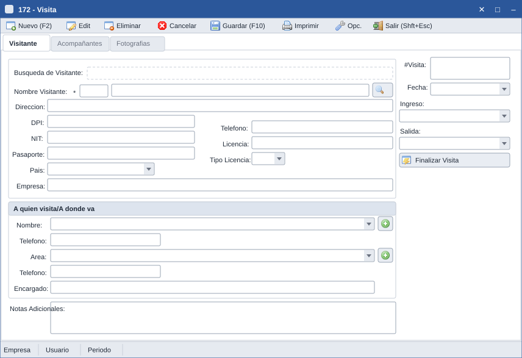

<!-- /img:pantalla_172_visita -->

**Propósito:** registrar ingreso/salida de visitantes, acompañantes y persona o
área visitada.

**Pestaña "Visitante":** búsqueda de visitante, **Nombre**, **DPI**, **NIT**,
**Pasaporte**, **Licencia**, **Teléfono**, **Dirección**, **Empresa**, **País**,
**Tipo Licencia**, **Ingreso**, **Salida**, **Notas Adicionales**, **Área**,
**Encargado**, **Teléfono**, **Persona Visitada**, **Finalizar Visita**.

**Pestaña "Acompañantes":** Visitante, DPI, NIT, Dirección; **Edit**, **Del**.

**Botones:** **Nuevo (F2)**, **Edit**, **Eliminar**, **Cancelar**, **Guardar
(F10)**, **Imprimir**, **Anulación**, **Exportar Detalle**, **Salir**.

**Reglas:** registre la salida o finalice la visita; una visita abierta puede
aparecer como pendiente en el control de acceso.

### 6.12 Precios especiales y memoria de precios

<!-- img:pantalla_170_precio_especial -->
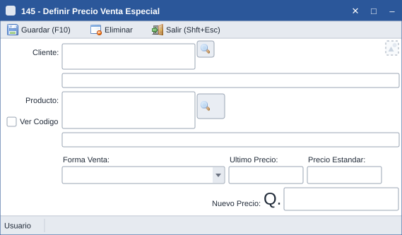

<!-- /img:pantalla_170_precio_especial -->

<!-- img:pantalla_146_memoria_precios -->
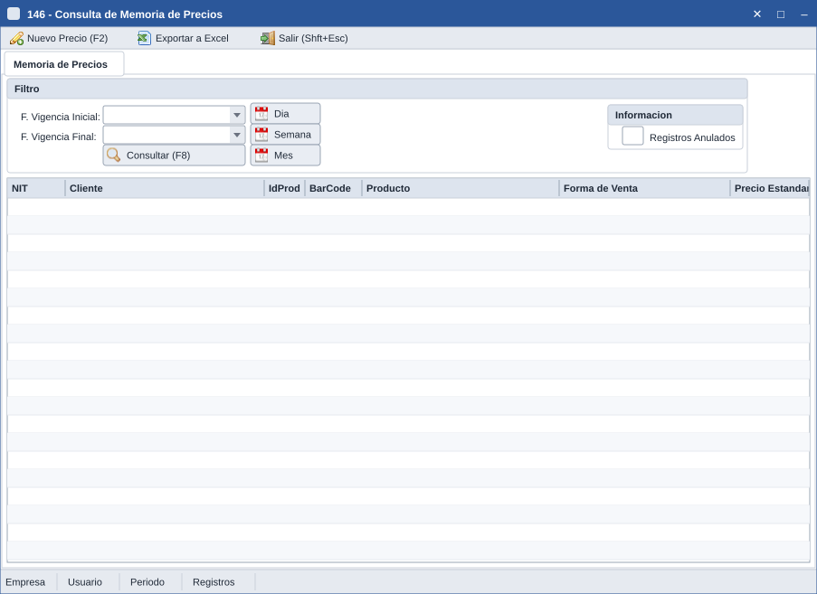

<!-- /img:pantalla_146_memoria_precios -->

| Pantalla | Uso |
|---|---|
| **145 - Definir Precio Venta Especial** | Acuerda precio especial por cliente/producto |
| **170 - Precio Venta Especial FEL** | Variante para facturación electrónica |
| **+ Precio (Memoria)** | Registra precios históricos/acordados |
| **Memoria de Precios (Consulta)** | Consulta y da seguimiento a precios pactados |

**Reglas:** un precio especial debe tener vigencia y autorización; revise que no
genere pérdida ni conflicto con listas de precios.

---

## 7. Módulo Consultas

Las consultas son de solo lectura salvo que incluyan acciones como **Editar**,
**Nueva Nota**, **Duplicar** o **Anular**. Suelen compartir esta estructura:

- **Filtro** con fechas, estados, cliente/proveedor, ruta, vendedor o número de
  documento.
- Botones rápidos **Día**, **Semana**, **Mes**, **1M**, **2M**, **3M**, **6M**.
- **Consultar (F8)** para ejecutar.
- **Actualizar** y **Tiempo de Refresco (Segs)** para refresco automático.
- **Exportar / Exportar a Excel**.
- **Registros** con el total de filas.
- **Salir (Shift+Esc)**.

### 7.1 Consultas de ventas y facturas

#### Pantalla "293 - Consulta de Facturas" (y variantes)

<!-- img:pantalla_162_consulta_facturas_fel -->
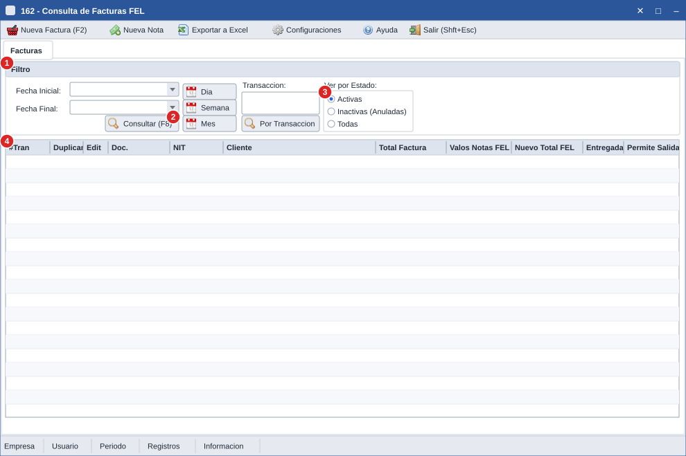

**Leyenda** (los números rojos de la imagen):

1. **Filtro**: rango de fechas, atajos **Mes / Semana / Dia** o búsqueda **Por Transacción**.
2. **Consultar (F8)**: carga las facturas del filtro.
3. **Ver por Estado**: limita la lista por estado de la factura.
4. **Facturas**: una fila por documento, con columnas FEL (serie, número, autorización) y botones **Duplicar** y **Edit** para abrirla.

<!-- /img:pantalla_162_consulta_facturas_fel -->

<!-- img:pantalla_293_consulta_facturas_std -->
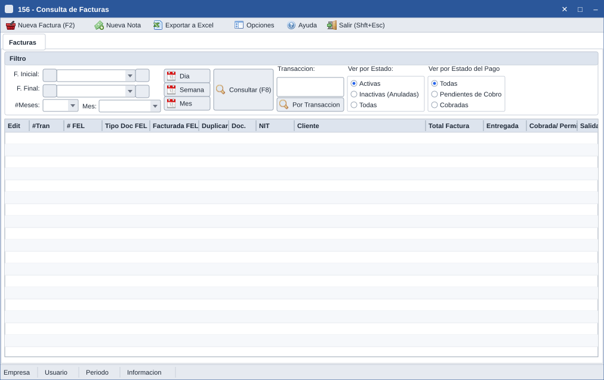

<!-- /img:pantalla_293_consulta_facturas_std -->

**Propósito:** localizar facturas, revisar su estado, cobrarlas, duplicarlas,
anularlas o generar notas.

**Filtros**

| Filtro | Uso |
|---|---|
| **F. Inicial / F. Final** | Rango de fechas |
| **Día / Semana / Mes** | Rangos rápidos |
| **#Meses** | Periodo hacia atrás |
| **Ver por Estado** | Anuladas, cobradas, pendientes, etc. |
| **Ver por Estado del Pago** | Situación de cobro |
| **Transacción** | Búsqueda por número |
| **Por Transacción** | Consulta directa |

**Indicadores:** **Facturas Cobradas**, **Fact. Pendientes de Cobro**,
**Facturas Anuladas**, **Fact. de Periodo Eliminado**.

**Columnas habituales:** **Edit**, **#Tran**, **Factura Origen**, **Duplicar**,
**Tipo Doc FEL**, **Salidas**, **Cobrada/Permite Salidas**, **Entregada**,
**Doc.**, **Fecha**, **Moneda**, **NIT**, **Cliente**, **Grupo**, **S/IVA**,
**Forma Pago**, **Fecha Facturación**, **EstadoCobrada**, **#Asiento Contable**,
**Estado Asiento**, **Usuario Cobro**, **Usuario Creo**, **Certificación FEL**
(Numero, Serie, Autorización), **Estado**, **EstadoPeriodo**, **Facturada FEL?**,
**# FEL**.

**Botones**

- **Nueva Factura (F2)**
- **Nueva Nota**
- **Detalle de Ventas**
- **Exportar a Excel**
- **Ver Resumen Reportado FEL**
- **Opciones**: tiempo de refresco, ayuda
- **Consultar (F8)**, **Salir (Shift+Esc)**

**Acciones por fila**

| Acción | Resultado |
|---|---|
| **Edit** | Abre la factura para consulta/edición según permisos |
| **Duplicar** | Crea una nueva factura copiando cliente y detalle |
| **Salidas** | Consulta las salidas de materiales |
| **Nueva Nota** | Abre una nota de crédito/débito asociada |

**Reglas:** una factura anulada o de periodo cerrado se abre en modo consulta.
Duplicar no copia pagos ni certificación FEL.

#### Otras consultas de ventas

| Pantalla | Uso |
|---|---|
| **281/286 - Detalle de Factura** | Detalle de productos, impuestos y totales |
| **15/162/185 - Factura con Pedido** | Facturas originadas en pedidos |
| **157 - Facturas FEL Pendientes** | Documentos electrónicos pendientes de certificar |
| **225 - Ver Resumen FEL** | Resumen/reporte de documentos FEL |
| **228 - Cambios de Caja** | Facturas afectadas por cambios de caja |
| **250/260/239, etc.** | Variantes por empresa |
| **277 - Ventas Inmobiliaria** | Ventas de proyectos inmobiliarios |
| **283 - Ventas Lite** | Consulta simplificada |
| **156 - Ventas Cutzan / DYG** | Variantes por empresa |

### 7.2 Consultas de compras

#### Pantalla "241 - Consulta de Compras"

<!-- img:pantalla_249_consulta_compras -->
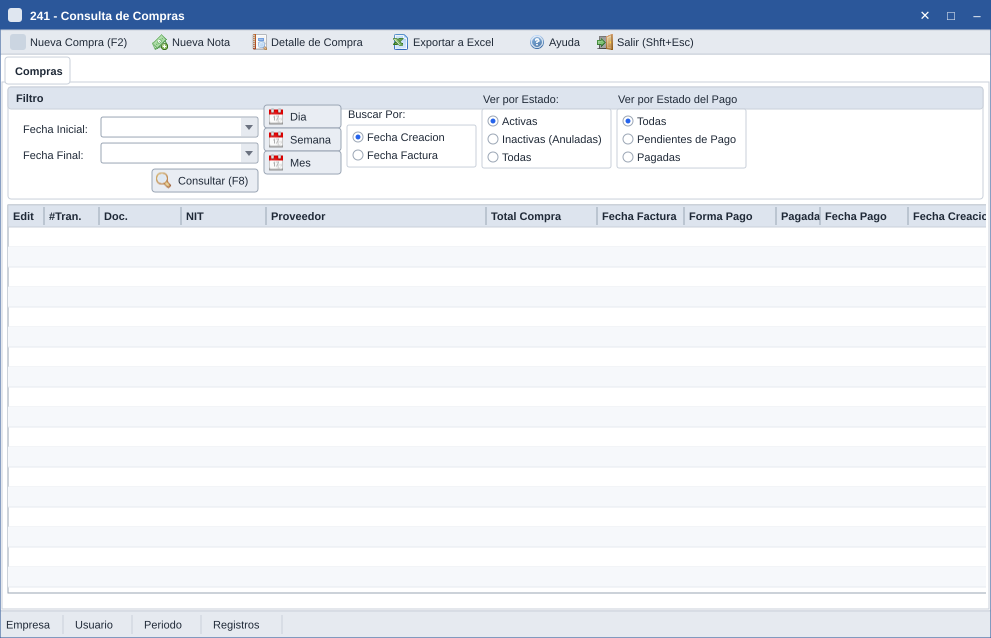

<!-- /img:pantalla_249_consulta_compras -->

**Filtros:** **F. Inicial/Final**, **Día/Semana/Mes**, **Ver por Estado**,
**Ver por Estado del Pago**, **Buscar Por**, **Documento/Proveedor**.

**Indicadores:** **Pagada**, **Compras Anuladas**, **Compras de Periodo
Eliminado**.

**Columnas:** **Edit**, **#Tran.**, **NIT**, **Proveedor**, **Total Compra**,
**Fecha Factura**, **Fecha Pago**, **Fecha Creación**, **Doc.**, **Forma Pago**,
**#Asiento Contable**, **Estado Asiento**, **Estado**, **EstadoPeriodo**,
**Pagada**.

**Botones:** **Nueva Compra (F2)**, **Nueva Nota**, **Detalle de Compra**,
**Exportar a Excel**, **Consultar (F8)**, **Salir**.

**Reglas:** **Detalle de Compra** muestra los productos y costos; use **Nueva
Nota** para ajustes o devoluciones.

### 7.3 Consultas de cotizaciones y pedidos

<!-- img:pantalla_132_consulta_pedidos_venta -->
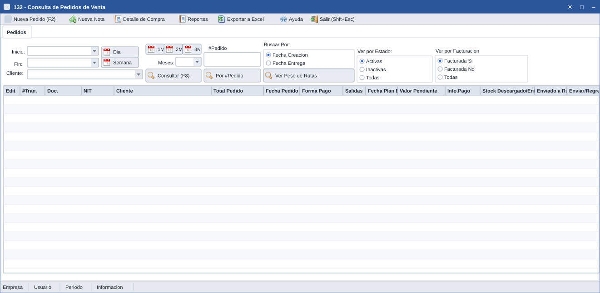

<!-- /img:pantalla_132_consulta_pedidos_venta -->

| Pantalla | Uso | Acciones |
|---|---|---|
| **125 - Consulta Cotización** | Buscar cotizaciones | Editar, imprimir, convertir a factura |
| **284 - Cotización con Aprobación** | Cotizaciones que requieren autorización | Aprobar/rechazar, convertir |
| **132 - Consulta Pedido Venta** | Pedidos de venta | Editar, facturar, ver salidas |
| **280 - Detalle Pedido Venta** | Detalle del pedido | Consulta |
| **137 - Consulta Pedido Compra** | Pedidos de compra | Editar, aprobar, generar compra |
| **158 - Pedido Venta para FEL** | Pedidos a consolidar/facturar FEL | Consolidar, generar |
| **168 - Consolidado Detalle Pedido Venta FEL** | Detalle consolidado | Revisar, generar |
| **386/387 - Aprobación Pedido Venta/Compra** | Autorizaciones pendientes | Aprobar/rechazar |

**Reglas:** el pedido facturado deja de estar pendiente; el consolidado FEL debe
cuadrar con los pedidos seleccionados.

### 7.4 Consultas de inventario y productos

<!-- img:pantalla_38_consulta_inventario -->
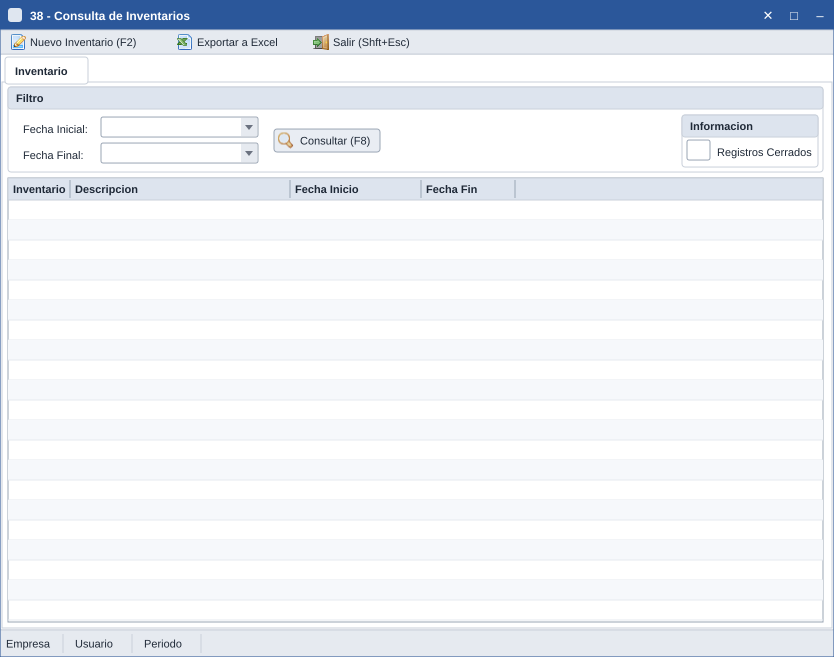

<!-- /img:pantalla_38_consulta_inventario -->

<!-- img:pantalla_287_verificacion_existencias -->


<!-- /img:pantalla_287_verificacion_existencias -->

| Pantalla | Propósito | Elementos clave |
|---|---|---|
| **38 - Consulta Inventario** | Existencias por producto/empresa | Filtros, exportar |
| **19 - Verificación de Existencias** | Alertas de faltantes o mínimos | Comparación contra mínimos |
| **998 - Kardex** | Historial de movimientos por producto | Ver detalle abajo |
| **36 - Consulta Traslados** | Traslados realizados | Filtros, detalle |
| **40 - Consulta Ajustes** | Ajustes realizados | Filtros, detalle |
| **116 - Cierre de Existencias** | Cierres registrados | Filtros, exportar |
| **108 - Consulta Salidas de Materiales** | Despachos | Filtros, detalle |
| **60 - Salida Rápida de Productos** | Salidas rápidas | Filtros |
| **34 - Buscar Producto** | Búsqueda rápida de productos | Código, nombre, existencias, precios |
| **146 - Memoria de Precios** | Historial de precios | Filtros, cliente/producto |
| **148 - Historial Rápido Memoria de Precios** | Últimos precios | Consulta rápida |
| **142 - Resumen Peso por Ruta** | Peso transportado por ruta | Filtros |
| **215 - Ver Formas de Venta** | Precios por presentación | Consulta |

#### Kardex — "Consulta de Movimientos del Producto"

<!-- img:pantalla_998_kardex -->


<!-- /img:pantalla_998_kardex -->

**Filtros:** **F. Inicio**, **F. Fin**, **Día/Semana/1M/2M/3M**, **Actualizar**.

**Indicadores:** **Exis. Inicial**, **Exis. Actual**, **Exis. Final**,
**Segundos** (refresco).

**Grid con bandas:**

- **Entradas:** Unds., Valor.
- **Salidas:** Unds., Valor.
- **Saldos:** Existencia, Valor.
- **Columnas:** Tipo de Movimiento, F. Anulación, DocRef, Cliente/Proveedor,
  Sentido, Precio Venta, Existencia Previa, Fecha, Usuario, Estado.

**Botones:** **Consultar (F8)**, **Exportar**, **Salir (Shift+Esc)**.

**Uso:** seleccione el producto, el rango y consulte. Sirve para auditar
diferencias, ver el efecto de anulaciones y explicar el saldo.

### 7.5 Consultas de caja y bancos

<!-- img:pantalla_87_cajas_abiertas -->


<!-- /img:pantalla_87_cajas_abiertas -->

| Pantalla | Uso |
|---|---|
| **87 - Caja Abierta** | Caja actual, saldo y movimientos |
| **89 - Movimientos de Caja** | Entradas/salidas de caja |
| **113 - Cuentas Bancarias** | Saldos y datos de cuentas |
| **122 - Movimientos Bancarios** | Movimientos por cuenta |
| **123 - Movimientos Bancarios General** | Todos los bancos |
| **112 - Consulta Cheques** | Cheques emitidos, cobrados, rechazados |
| **288/289 - Cajas Chicas** | Fondos y movimientos de caja chica |

**Reglas:** use **Actualizar** para refrescar saldos; el tiempo de refresco
permite monitoreo. Los movimientos anulados se muestran con su estado.

### 7.6 Cuentas por cobrar y por pagar

#### Pantalla "99 - Consulta Documentos Por Cobrar"

<!-- img:pantalla_99_documentos_por_cobrar -->


<!-- /img:pantalla_99_documentos_por_cobrar -->

**Propósito:** controlar saldos de clientes, abonos y vencimientos.

**Filtros:** **Cliente**, **Actualizar**, **Segundos**, **Consultar (F8)**.

**Columnas:** **Edit**, **Empresa**, **#Transaccion**, **#TranID**, **Cliente**,
**NIT**, **T.Doc.**, **Valor Original**, **Valor Abonado**, **Valor
Pendiente**, **Fecha**, **Ruta**, **Rutero**, **Record**, **Obs.**, **Número
Factura**, **Serie Factura**, **Número Autorización**.

**Botones:** **Nueva Nota (F2)**, **Exportar**, **Consultar (F8)**, **Salir**.

**Uso:** identifique documentos vencidos, aplique notas o abra el detalle para
gestionar el cobro.

#### Otras consultas de cartera

| Pantalla | Uso |
|---|---|
| **98 - Resumen CxC por Cliente** | Totales por cliente |
| **269 - Análisis CxC** | Antigüedad y comportamiento de cartera |
| **101 - Documentos Por Pagar** | Saldos con proveedores |
| **100 - Resumen CxP por Proveedor** | Totales por proveedor |
| **226/227 - Variantes Cutzan/DYG** | Formatos por empresa |
| **Estado de Cuenta (Clientes/Proveedores)** | Estado de cuenta imprimible |
| **Antigüedad de Saldos** | Reporte de antigüedad |

**Reglas:** los saldos provienen de facturas, compras, notas y pagos. Si un
saldo no cuadra, revise notas, cobros y anulaciones antes de ajustar.

### 7.7 Consultas y libros de contabilidad

<!-- img:pantalla_375_libro_diario -->


<!-- /img:pantalla_375_libro_diario -->

| Pantalla | Uso |
|---|---|
| **374 - Consulta Asiento Contable** | Buscar asientos por fecha/cuenta |
| **375 - Libro Diario** | Movimientos cronológicos |
| **379 - Libro Mayor** | Movimientos por cuenta y saldos |
| **376 - Balance de Comprobación** | Debe/Haber y saldos por cuenta |
| **379/385 - Libro Ventas / Libro Compras** | Libros fiscales/operativos |
| **266 - Balance de Operaciones** | Balance operativo |
| **378 - Validación Cierre Periodo** | Pendientes antes del cierre |
| **380 - Resumen Documentos/Conflictos** | Documentos con problemas |

**Reglas:** los libros se alimentan de asientos y documentos contabilizados. Use
**Exportar** para respaldos y revise **Estado Asiento** en las consultas de
ventas/compras.

### 7.8 Otras consultas

| Pantalla | Uso |
|---|---|
| **171 - Consulta Visitas** | Visitas registradas, pendientes y salidas |
| **152 - Consulta Metas** | Metas por vendedor y avance |
| **153 - Seguimiento Metas** | Cumplimiento y comisiones |
| **115 - Productos Más Vendidos** | Ranking de ventas |
| **110 - Ventas por Usuario/Vendedor** | Productividad |
| **130 - Log de Eventos** | Auditoría de accesos y acciones |
| **142 - Resumen Peso por Ruta** | Carga por ruta |
| **147/150/58 - Modificación rápida** | Existencias, descripciones, precios |

---

## 8. Módulo Reportes

### 8.1 Visor de Reportes Locales

<!-- img:pantalla_213_visor_reportes -->


<!-- /img:pantalla_213_visor_reportes -->

**Pantalla "213 - VisorReportesLocalesUI"**

**Propósito:** mostrar e imprimir reportes generados localmente por la
aplicación, con parámetros definidos por el usuario.

**Elementos:** nombre del reporte, área de vista previa, **Imprimir (Ctrl+P)**,
**Salir (Shift+Esc)**.

**Uso:** el visor se abre desde las opciones de reportes o desde consultas que
generan un informe. Revise el encabezado (empresa, fechas, filtros) antes de
imprimir.

### 8.2 Parámetros de Reportes

<!-- img:pantalla_212_parametros_reportes -->


<!-- /img:pantalla_212_parametros_reportes -->

**Pantalla "212 - Parámetros de Reportes"**

**Propósito:** capturar los filtros que alimentan un reporte.

**Campos habituales**

| Grupo | Campos |
|---|---|
| **Reporte** | Nombre del reporte, **Buscar Por** |
| **Fechas** | **Fecha Inicial**, **Fecha Final**, **Periodo** |
| **Documento** | **Tran. Inicial**, **Tran. Final** |
| **Cliente** | **NIT Cliente**, **Todos los Clientes** |
| **Ruta/Vendedor** | **Ruta**, **Todas las Rutas**, **Vendedor/Rutero**, **Todos los Ruteros** |
| **Producto** | **Producto**, **Activo**, **Presentación**, **Activo**, **Fabricante**, **Activo** |

**Botones:** **Aceptar (F10)**, **Salir (Shift+Esc)**.

**Uso:** complete solo los filtros necesarios; marque **Todos** para incluir
todos los valores. Al aceptar se abre el visor o se genera el archivo.

### 8.3 Generación de Códigos de Barra

<!-- img:pantalla_211_codigos_barra -->


<!-- /img:pantalla_211_codigos_barra -->

**Pantalla "211 - Genera Códigos de Barra"**

**Propósito:** imprimir etiquetas con código de barras de productos.

**Parámetros:** **Tamaño de Letra**, **# Líneas**.

**Botones:** **Ver**, **Salir**.

**Requisitos:** el equipo debe tener instalada la fuente de código de barras
(**Free 3 of 9 Extended** o **IDAutomationHC39M**, disponibles en el menú de
configuraciones). Si la etiqueta sale con texto en lugar de barras, instale la
fuente correspondiente.

### 8.4 Reportes disponibles por categoría

| Categoría | Reportes representativos |
|---|---|
| **Facturas/Ventas** | Facturas del Día, Facturas por Fecha, Facturas con Ganancia, Productos del Día, Fluctuación de Ventas por Producto, Top Facturas por Usuario, Top Ventas por Día, Log de Salidas |
| **Compras** | Compras por Fecha, Detalle de Compra por Fecha, Cantidad de Compras por Fecha y Producto, Fluctuación de Precios |
| **Inventarios** | Toma de Inventario General, Toma de Inventarios, Salidas por Fecha, Existencias de Productos para Contabilidad |
| **Ajustes/Traslados** | Listado de Ajustes por Fecha, Ajustes Más Utilizados, Top Productos Más Ajustados, Reportes de Traslados |
| **Catálogos** | Clientes, Empresas, Formas, Fabricantes, Periodos, Presentaciones, Proveedores, Tipos de Producto, Unidades de Medida |
| **Cartera** | Consumo por Fecha, Consumo por Periodo con Notas, Resumen/Detalle por Cliente, Antigüedad de Saldos |
| **Usuarios/Personal** | Asistencia de Empleados, Ventas por Usuario/Vendedor, Reportes de Personal |
| **Especiales** | Consolidado de Pedido por Vendedor, Detalle por Cliente/Ruta/Vendedor, Resumen de Peso por Ruta |

> La lista exacta depende de la empresa y del menú configurado. Si un reporte no
> aparece, verifique permisos y la configuración del menú.

---

## 9. Seguridad y configuración

> Estas pantallas suelen estar reservadas al administrador. Un cambio incorrecto
> puede afectar a todos los usuarios. Documente cada modificación.

### 9.1 Usuarios

<!-- img:pantalla_05_usuario -->


<!-- /img:pantalla_05_usuario -->

**Pantalla "5 - Usuario"**

**Propósito:** crear y administrar usuarios, claves, roles, permisos por empresa
y control de efectivo.

**Pestaña "Usuario":** **Código**, **Nombre**, **Usuario**, **Clave**, **Fecha
de Próximo Cambio**, **No Intentos de Acceso**, casillas **Admin**, **Usuario
Bloqueado**, **Es Vendedor Rutero**, **Comisión sobre Ventas**, **Usa Control de
Efectivo de Caja**, **Salir al Guardar**.

**Pestaña "Rol":** asigna roles al usuario (**Rol**, **Agregar**, **Eliminar**,
**Eliminar Todo**).

**Pestaña "Permisos por Empresa":** empresas a las que puede acceder el usuario.

**Pestaña "Listado de Usuarios":** #, Nombre, Usuario, Fecha Próximo Cambio,
Bloqueado, Admin, Es Rutero, Control Efectivo, Comisión, Información, Estado.

**Botones:** **Nuevo**, **Editar**, **Cancelar**, **Eliminar**, **Guardar**,
**Salir**.

**Reglas**

- La clave debe cumplir el tamaño mínimo y el periodo de cambio configurados.
- **Admin** otorga privilegios amplios; asigne solo a quien corresponda.
- El bloqueo puede ser automático por intentos fallidos o manual.
- Los permisos efectivos son la unión de roles y permisos por objeto.

### 9.2 Roles y objetos

<!-- img:pantalla_04_rol -->


<!-- /img:pantalla_04_rol -->

<!-- img:pantalla_06_objeto -->


<!-- /img:pantalla_06_objeto -->

**Pantalla "4 - Rol"**

**Propósito:** agrupar permisos por puesto/función.

**Campos:** **Código**, **Nombre**, **Descripción**, **Estado**.

**Pestaña "Permisos":** **Objeto**, **Agregar**, **Eliminar**, **Eliminar
Todo**; grid con Id Objeto, CódigoRol, Objeto, Descripción.

**Botones:** **Nuevo**, **Editar**, **Cancelar**, **Eliminar**, **Guardar**,
**Salir**.

**Pantalla "6 - Objeto"**

**Propósito:** catálogo de objetos/pantallas y acciones que pueden autorizarse.
Se usa como referencia para asignar permisos a roles y usuarios.

**Reglas:** asigne el mínimo necesario; revise los permisos al crear un rol
nuevo y al incorporar una pantalla al sistema.

### 9.3 Configuraciones de seguridad

<!-- img:pantalla_42_config_seguridad -->


<!-- /img:pantalla_42_config_seguridad -->

**Pantalla "42 - Configuraciones de Seguridad"**

| Parámetro | Descripción |
|---|---|
| **Login Activado** | Exige autenticación al iniciar |
| **Periodo de Cambio** | Días de vigencia de la clave |
| **Intentos de Acceso** | Intentos fallidos antes de bloquear |
| **Tamaño Mínimo de Claves** | Longitud mínima permitida |

**Botones:** **Guardar**, **Salir**.

### 9.4 Desbloqueo y cambio de clave

<!-- img:pantalla_cambio_clave -->


<!-- /img:pantalla_cambio_clave -->

<!-- img:pantalla_92_desbloqueo_usuarios -->


<!-- /img:pantalla_92_desbloqueo_usuarios -->

| Pantalla | Uso |
|---|---|
| **Cambio Clave** | **Clave Anterior**, **Clave Nueva**, **Repetir Clave Nueva**, **Cambiar** |
| **Desbloqueo de Usuarios** | Libera usuarios bloqueados |
| **Desbloqueo Cambio Clave** | Fuerza/permite el cambio de clave |
| **Usuario Bloqueado** | Estado visible en el maestro de usuarios |

**Reglas:** no comparta claves; use cuentas nominales. Si sospecha un uso
indebido, bloquee el usuario y revise el **Log de Eventos**.

### 9.5 Bitácora de eventos

<!-- img:pantalla_130_log_eventos -->


<!-- /img:pantalla_130_log_eventos -->

**Pantalla "130 - Consulta Log de Eventos"**

**Propósito:** auditar accesos, pantallas abiertas y acciones registradas.

**Filtros:** **Fecha Inicial**, **Fecha Final**, **Día/Semana/1M/2M/3M/6M**.

**Columnas:** Usuario, Dispositivo_Cliente, Fecha, OS_Host, IP_Host,
Objeto_Accesado, Versión, Evento.

**Botones:** **Consultar (F8)**, **Exportar a Excel**, **Salir (Shift+Esc)**.

**Uso:** investigue accesos fuera de horario, equipos desconocidos o acciones
sobre objetos sensibles. Exporte a Excel para análisis.

### 9.6 Apariencia y conexión

<!-- img:pantalla_apariencia -->


<!-- /img:pantalla_apariencia -->

<!-- img:pantalla_44_conexion -->


<!-- /img:pantalla_44_conexion -->

| Pantalla | Uso |
|---|---|
| **Apariencia** | Selecciona el *skin* de DevExpress y preferencias visuales |
| **Conexión con el Servidor** | Configura servidor, base de datos y credenciales |
| **Modificar Archivo de Conexión** | Edita el archivo de configuración de conexión |
| **Equipos Autorizados** | Autoriza equipos/licencias por estación |
| **Estación de Trabajo / Tipos** | Identifica el equipo y su tipo |

**Precaución:** cambiar la conexión puede dejar el sistema sin acceso a datos.
Solo hágalo con instrucciones de soporte y registre el cambio.

### 9.7 Configuraciones generales

<!-- img:pantalla_16_config_generales -->


<!-- /img:pantalla_16_config_generales -->

**Pantalla "16 - Configuraciones Generales"**

Agrupa parámetros que afectan la operación:

| Grupo | Parámetros representativos |
|---|---|
| **Operación** | **Tipo de Sistema**, **Operar Sin Existencia**, **Verificar Existencias al Inicio**, **Permitir Facturar Desde Pedido Venta**, **Facturando Salidas Rápidas** |
| **Caja** | **Control de Efectivo de Caja**, **Usa Caja Central de Cobro**, **Comisión sobre Ventas** |
| **Impuestos/Precios** | **Impuesto (IVA)**, **Precio Venta Global** |
| **Clientes** | **Permitir Duplicados en NIT Clientes**, **Vencimiento de Saldos (Genérico)** |
| **Productos** | **Habilita Existencia en Maestro de Productos**, **Prefijo para Barcodes**, **Máximo Fotos Carrete** |
| **Respaldos** | **BackUp al Inicio**, **Ruta BackUp**, **MB**, **Días para Cierre de Existencia Auto.** |
| **Reportes** | **Servidor de Reportes**, **Visor de Reportes** |
| **Piloto/Rutas** | **Tarifa Global QQ**, **Tarifa Global KMS** |
| **Otros** | **Sonido Beep General**, **Tamaño de Adjuntos**, **Quitar Bloqueo** |

**Botones:** **Guardar**, **Salir**.

**Reglas:** los cambios aplican a toda la empresa. Documente quién, cuándo y por
qué. Algunos parámetros solo deben cambiarse con el sistema sin operación.

### 9.8 Importar y exportar

<!-- img:pantalla_62_exportar_importar_maestros -->


<!-- /img:pantalla_62_exportar_importar_maestros -->

| Pantalla | Uso |
|---|---|
| **62 - Importar/Exportar Catálogos** | Migrar maestros entre empresas/bases |
| **63 - Importar/Exportar Transacciones** | Migrar documentos |

**Precaución:** valide el archivo de origen, realice respaldo y pruebe en un
ambiente de desarrollo. Una importación incorrecta puede duplicar o corromper
datos.

### 9.9 Licencia y datos FEL

<!-- img:pantalla_crear_licencia -->


<!-- /img:pantalla_crear_licencia -->

<!-- img:pantalla_182_datos_infile -->


<!-- /img:pantalla_182_datos_infile -->

| Pantalla | Uso |
|---|---|
| **Crear Licencia** | Genera la licencia del equipo/empresa (superadministrador) |
| **Cargar Licencia** | Carga un archivo de licencia |
| **Datos FEL / Infile** | Configura credenciales, ambiente y datos del emisor FEL |

**Reglas:** la licencia está ligada al equipo/empresa. No copie licencias entre
equipos sin autorización. Los datos FEL deben coincidir con la empresa y el
ambiente (pruebas/producción).

### 9.10 Otras pantallas de seguridad

| Pantalla | Uso |
|---|---|
| **Marcar Salida** | Registra la salida del usuario/personal |
| **Chat** | Mensajería interna entre usuarios |
| **Configuraciones de Equipos Autorizados** | Control de equipos permitidos |
| **Exportar/Importar** | Respaldo y migración |

---

## 10. Flujos de trabajo paso a paso

### 10.1 Alta de un cliente

1. Catálogos → Clientes → **Cliente**.
2. **Nuevo (F2)**.
3. Capture **Nombre**, **NIT**, **Dirección** y teléfonos.
4. Asigne **Ruta**, **Vendedor/Rutero**, **Record** y **Estado**.
5. Complete **Datos FEL** si el cliente requiere factura electrónica.
6. Defina **Límites de Crédito** si aplica.
7. **Guardar (F10)**.
8. Verifique el cliente en el listado y en la consulta de CxC.

### 10.2 Alta de un producto

1. Catálogos → Productos → **Producto**.
2. **Nuevo (F2)**.
3. Capture **Nombre**, **Código de Barra**, **Descripción**.
4. Asigne **Fabricante**, **Presentación**, **Marca**, **Familia** y **Categoría**.
5. Defina **Precio Costo**, **Existencia Mínima** y **Margen**.
6. Marque **Maneja Existencia** y **Usa Lote/Vencimiento** según corresponda.
7. Agregue **Formas de Venta** con precios y unidades.
8. **Guardar (F10)**.
9. Imprima el código de barras si es necesario.

### 10.3 Venta de contado

1. Transacciones → **+ Ventas** → variante.
2. **Nuevo (F2)**.
3. Cliente (o consumidor final, según la empresa).
4. Agregue productos y cantidades.
5. Verifique precios, descuentos e impuestos.
6. **Guardar (F10)**.
7. **Cobrar (F12)**: efectivo/tarjeta, **Agregar**, **Grabar**.
8. **Salidas (F11)** si despacha de bodega.
9. **Imprimir (Ctrl+P)**.

### 10.4 Venta al crédito

1. Igual que la venta de contado, pero seleccione **Forma de Pago** al crédito.
2. Verifique el **límite de crédito** y el saldo del cliente.
3. **Guardar (F10)**; no use **Cobrar** hasta recibir el pago.
4. La factura aparecerá en **Cuentas por Cobrar** con su saldo pendiente.

### 10.5 Facturación electrónica (FEL)

<!-- img:pantalla_186_certificando_fel -->


**Leyenda** (los números rojos de la imagen):

1. **Datos FEL**: fecha, número de autorización, serie y número que devuelve el certificador.
2. Pestañas **Datos FEL**, **Errores** (si el certificador rechaza el documento; use **Reintentar**) y **JSon** (mensaje enviado y recibido).

<!-- /img:pantalla_186_certificando_fel -->

1. Complete la factura y verifique NIT, nombre, dirección y moneda.
2. **Guardar (F10)**.
3. Pulse **Certificar (Ctrl+F)** o **Procesar FEL**.
4. Espere la respuesta; no cierre la ventana.
5. Verifique **#FEL**, número, serie y autorización.
6. Imprima el documento con **Ctrl+P**.
7. Si falla, revise conexión y credenciales; aplique el procedimiento de
   contingencia y no certifique dos veces.

### 10.6 Cotización y conversión a factura

1. Transacciones → **Cotizaciones** → **+ Cotización**.
2. **F2** para limpiar.
3. Cliente y productos.
4. **Imprimir y Guardar Nueva (F10)**.
5. Cuando el cliente acepte, abra la cotización y pulse **Crear Factura
   (Shift+F2)**.
6. Complete y cobre la factura.

### 10.7 Pedido de venta y facturación

1. **+ Pedido Venta** → **Nuevo (F2)**.
2. Cliente, ruta, vendedor, fechas y forma de pago.
3. Productos, cantidades, precios y bonificaciones.
4. **Guardar (F10)**.
5. **Facturar (Manual/Automática)**.
6. **Procesar (Salida de Existencias)**.
7. **Ver Salidas (F11)** y **Ver Saldos de Documentos (CxC)**.

### 10.8 Compra y pago

1. **+ Compras** → variante → **Nuevo (F2)**.
2. Proveedor, documento, fechas y forma de pago.
3. Productos, costos, lotes/vencimientos.
4. **Guardar (F10)**.
5. Revise **Cuentas por Pagar**.
6. Emita **Cheque** o registre **Movimiento Bancario** para pagar.
7. Marque la compra como pagada según el flujo.

### 10.9 Cobro de una factura

1. **Consulta de Facturas** → localice la factura.
2. **Edit** o **Cobrar (F12)**.
3. Verifique **Total**, **Abonado** y **Diferencia**.
4. Registre el pago (efectivo/tarjeta/membresía).
5. **Grabar**.
6. Imprima el recibo.
7. Confirme que la factura quede **¡Cobrada!** y el saldo en CxC en cero.

### 10.10 Nota de crédito por devolución

1. **Consulta de Facturas** → **Nueva Nota** (o Transacciones → Notas).
2. **Nuevo (F2)**.
3. Seleccione **Tipo Nota** = Crédito.
4. Referencie la factura.
5. Verifique **Saldo Actual**.
6. Capture **Valor** y **Observaciones**.
7. Revise **Nuevo Saldo**.
8. **Guardar (F10)** e imprima.
9. Si es FEL, complete la referencia y certifique/anule según el caso.

### 10.11 Apertura y cierre de caja

1. **Arqueo de Caja** → **Nuevo (F2)**.
2. Caja, estación, usuario y **Saldo Inicial**.
3. **Guardar (F10)**.
4. Durante el turno, registre cobros y **Movimientos Manuales**.
5. Al cierre, abra la caja, revise **Ver Movimientos**.
6. Capture **Saldo Final** y revise **Diferencia**.
7. **Guardar (F10)** e imprima el arqueo.

### 10.12 Toma de inventario

1. **Inventario** → **Nuevo (F2)**.
2. Descripción y fechas de inicio/fin.
3. **Agregar** productos o **Agregar Grupos**.
4. Capture **Cantidad Encontrada**.
5. Revise **Diferencia**.
6. Genere **Ajustes**.
7. **Guardar (F10)** y **Cerrar**.
8. Exporte el resultado.

### 10.13 Cierre de periodo contable

1. Verifique que no haya documentos pendientes de contabilizar.
2. Ejecute **Validación Cierre Periodo**.
3. Revise **Resumen Documentos/Conflictos**.
4. Corrija diferencias y asientos descuadrados.
5. Ejecute **Cierre Periodo Contable**.
6. Confirme el estado del periodo y respalde la información.

---

## 11. Atajos de teclado

### 11.1 Generales

| Atajo | Acción |
|---|---|
| `F2` | Nuevo registro / nueva venta según pantalla |
| `F3` | Buscar producto, cliente, fecha de hoy o detalle, según pantalla |
| `F5` | Actualizar formulario |
| `F8` | Consultar / actualizar productos |
| `F10` | Guardar / aceptar |
| `F11` | Salidas de materiales (factura/pedido) |
| `F12` | Cobrar |
| `Esc` | Cancelar captura |
| `Shift+Esc` | Salir de la pantalla |
| `Shift+F12` | Maximizar/restaurar |
| `Ctrl+P` | Imprimir |
| `Ctrl+R` | Permisos (Run2UI) |
| `Ctrl+Enter` | Iniciar sesión |
| `Ctrl+K` | Kardex (menú principal) |
| `Ctrl+F` | Certificar FEL (factura estándar) |
| `Shift+F2` | Consulta de ventas / crear factura desde cotización |

### 11.2 Atajos por pantalla

| Pantalla | Atajo | Acción |
|---|---|---|
| Menú principal | `F2` | Nueva venta |
| Menú principal | `Shift+F2` | Consulta de ventas |
| Menú principal | `Ctrl+K` | Kardex |
| Menú principal | `Shift+Esc` | Salir |
| Login | `Ctrl+Enter` | Iniciar |
| Login | `Shift+Esc` | Salir |
| Factura | `F3` | Buscar producto/precio especial |
| Factura | `F11` | Salidas |
| Factura | `F12` | Cobrar |
| Factura | `Ctrl+F` | Certificar FEL |
| Cotización | `F2` | Nueva/limpiar |
| Cotización | `F8` | Actualizar productos |
| Cotización | `Shift+F2` | Crear factura |
| Compra | `F3` | Fecha de hoy (documento/pago) |
| Cheque | `F3` | Fecha de hoy |
| Consultas | `F8` | Consultar |

> Los atajos pueden variar si la pantalla tiene el foco en un campo de texto o
> si la variante de la empresa redefine el teclado.

---

## 12. Mensajes frecuentes y solución de problemas

| Mensaje / síntoma | Causa probable | Solución |
|---|---|---|
| "Usuario o contraseña incorrectos" | Datos mal escritos, clave vencida o usuario bloqueado | Verifique teclado, mayúsculas y bloqueo; solicite desbloqueo |
| "Clave vencida" / solicita cambio | Periodo de cambio cumplido | Use **Cambiar Clave** |
| "No se pudo conectar al servidor" | Red/VPN, servidor detenido o configuración incorrecta | Revise **Conexión**, red y disponibilidad; contacte a soporte |
| "Licencia vencida" o advertencia de licencia | Fecha límite alcanzada | Verifique fecha del equipo y licencia; contacte a soporte |
| "Hay una nueva versión" | Versión del cliente distinta a la del servidor | Actualice el sistema |
| "No tiene permisos para esta opción" / pantalla se cierra | Objeto no autorizado | Solicite permisos al administrador |
| "Periodo cerrado" | El documento pertenece a un periodo cerrado | Consulte con contabilidad; no fuerce la edición |
| "No hay existencia suficiente" | Inventario insuficiente o producto sin existencia | Revise Kardex, ajuste o compre; verifique **Operar Sin Existencia** |
| "El producto maneja lotes" | Falta lote/vencimiento | Registre lote y fecha antes de guardar |
| "No se puede anular: tiene pagos/salidas" | Documento con movimientos aplicados | Revierta pagos/salidas y luego anule |
| "Debe y Haber no cuadran" | Asiento descuadrado | Corrija las líneas antes de guardar |
| "Diferencia distinta de cero" en cobro | Pago incompleto o cambio mal calculado | Complete el pago o ajuste el efectivo |
| "No hay caja abierta" | Control de efectivo activo sin apertura | Abra la caja en **Arqueo de Caja** |
| FEL no certifica | Credenciales, conexión, datos fiscales o ambiente incorrecto | Revise datos FEL, conexión y ambiente; aplique contingencia |
| Etiqueta sin código de barras | Fuente de código de barras no instalada | Instale **Free 3 of 9 Extended** o **IDAutomationHC39M** |
| La pantalla no responde o tarda | Consulta pesada, red lenta o refresco automático | Espere, reduzca filtros y desactive el refresco |
| Error inesperado con detalle técnico | Excepción del sistema | Anote el mensaje, la pantalla y la hora; envíe el detalle a soporte |

### 12.1 Qué reportar a soporte

Incluya:

1. Usuario, empresa y periodo.
2. Pantalla y código (por ejemplo, "14 - Factura").
3. Fecha y hora del incidente.
4. Pasos realizados y el mensaje exacto.
5. Número de documento afectado.
6. Captura de pantalla, si es posible.
7. Si el error ocurrió al guardar, anular, certificar o imprimir.

---

## 13. Buenas prácticas

- **Una cuenta por usuario.** No comparta credenciales.
- **Verifique empresa y periodo** antes de capturar.
- **No anule para corregir.** Si se equivocó, revise si puede editar; si no,
  anule con motivo y emita el documento correcto.
- **Cierre la caja** y realice arqueo al final del turno.
- **No modifique precios/costos** sin autorización.
- **Revise el Kardex** ante cualquier diferencia de inventario.
- **Respalde** antes de importaciones, actualizaciones o cierres.
- **Documente** cambios de configuración y casos especiales.
- **Reporte** mensajes de error con el detalle completo.
- **Mantenga la fecha y hora** del equipo sincronizadas.
- **Use filtros** en consultas grandes para evitar demoras.
- **Exporte** la información que necesite conservar fuera del sistema.

---

## 14. Glosario

| Término | Definición |
|---|---|
| **Ajuste** | Movimiento que corrige la existencia de un producto |
| **Asiento contable** | Registro de cargos y abonos (Debe/Haber) |
| **Caja chica** | Fondo fijo para gastos menores |
| **CxC / CxP** | Cuentas por cobrar / cuentas por pagar |
| **Correlativo** | Número consecutivo interno de un documento |
| **DTE / FEL** | Documento Tributario Electrónico / Factura Electrónica en Línea |
| **Ejercicio contable** | Periodo anual que agrupa periodos contables |
| **Forma de pago** | Condición de pago (efectivo, crédito, tarjeta, cheque) |
| **Forma de venta** | Presentación de venta (unidad, caja, docena) |
| **Kardex** | Historial de entradas, salidas y saldos de un producto |
| **Lote** | Grupo de productos con características/vencimiento común |
| **NIT** | Número de Identificación Tributaria |
| **Objeto** | Recurso del sistema sobre el que se asignan permisos |
| **Periodo** | Lapso contable/operativo (mensual, quincenal, etc.) |
| **Rol** | Conjunto de permisos asignable a usuarios |
| **Salida de materiales** | Despacho de productos que descuenta inventario |
| **Traslado** | Movimiento de inventario entre empresas/bodegas |
| **UI** | Interfaz de usuario (pantallas) |
| **Valuación** | Valor monetario del inventario |

---

## 15. Anexo A — Inventario de pantallas

### 15.1 Acceso y seguridad

| Código / Pantalla | Formulario | Uso |
|---|---|---|
| Inicio de Sesión | `LoginUI` | Autenticación |
| Menú principal (por empresa) | `Menu_Principal_*` | Navegación |
| Cambio Clave | `CambioClaveUI` | Cambio de contraseña |
| Usuario | `UsuarioUI_05` | Maestro de usuarios |
| Rol | `RolUI_04` | Roles y permisos |
| Objeto | `ObjetoUI_06` | Catálogo de objetos |
| Configuraciones de Seguridad | `ConfiguracionesSeguridadUI_42` | Políticas de acceso |
| Desbloqueo de Usuarios | `DesbloqueoUsuariosUI_92` | Desbloqueo |
| Desbloqueo Cambio Clave | `DesbloqueoCambioClaveUI` | Gestión de clave |
| Log de Eventos | `ConsultaLogEventosUI_130` | Auditoría |
| Apariencia | `AparienciaUI` | Tema visual |
| Conexión con el Servidor | `ConfiguracionesConexionUI_44` | Configuración de BD |
| Equipos Autorizados | `ConfiguracionesEquiposAutorizadosUI_43` | Licencias por equipo |
| Configuraciones Generales | `ConfiguracionesGeneralesUI_16` | Parámetros |
| Crear / Cargar Licencia | `CrearLicenciaUI`, `Rapid_CargarLicenciaUI` | Licenciamiento |
| Datos FEL / Infile | `Datos_FEL_Infile_182` | Configuración FEL |
| Exportar/Importar Catálogos | `ExportarImportarMaestrosUI_62` | Migración |
| Exportar/Importar Transacciones | `ExportarImportarTransaccionesUI_63` | Migración |
| Marcar Salida | `MarcarSalidaUI_219` | Salida de personal |
| Chat | `ChatUI` | Mensajería |

### 15.2 Catálogos

| Código / Pantalla | Formulario | Uso |
|---|---|---|
| Cliente | `ClienteUI_01` | Maestro de clientes |
| Cliente FEL | `Cliente_FEL_UI_164` | Cliente electrónico |
| Estado de Cliente | `EstadoDeClienteUI_71` | Estados |
| Record | `RecordUI_72` | Historial crediticio |
| Tipo de Documento | `Tipo_DocumentoUI_73` | Tipos de documento |
| Sector/Ruta | `SectorUI_66` | Rutas |
| Perfil de Descuento | `PerfilDescuentoUI_254` | Descuentos |
| Producto | `ProductoUI_12` | Maestro de productos |
| Producto FEL | `Producto_FEL_UI_163` | Producto electrónico |
| Categoría de Producto | `CategoriaProductoUI_265` | Categorías |
| Familia de Producto | `Familia_ProductoUI_154` | Familias |
| Marca | `MarcaUI_118` | Marcas |
| Fabricante | `FabricanteUI_07` | Fabricantes |
| Presentación | `PresentacionUI_08` | Presentaciones |
| Componente | `ComponenteUI_10` | Componentes |
| Tipo de Producto | `TipoProductoUI_09` | Tipos |
| Unidad de Medida | `UnidadDeMedidaUI_13` | Unidades |
| Forma de Venta | `FormaUI_11` | Presentaciones de venta |
| Forma de Pago | `Forma_PagoUI_74` | Condiciones de pago |
| Proveedor | `ProveedorUI_18` | Maestro de proveedores |
| Empresa | `EmpresaUI_03` | Empresas |
| Periodo | `PeriodoUI_02` | Periodos |
| Moneda | `MonedaUI_90` | Monedas |
| Tipo de Cambio | `TipoCambioUI_93` | Tasas |
| Caja | `CajaUI_82` | Cajas |
| Tipo de Tarjeta | `TipoTarjetaCreditoUI_84` | Tarjetas |
| Estación de Trabajo | `EstacionDeTrabajoUI_86` | Equipos |
| Tipo de Estación | `TipoEstacionDeTrabajoUI_85` | Tipos de equipo |
| Tipo de Ajuste | `TipoAjusteUI_39` | Tipos de ajuste |
| Banco | `BancoUI_83` | Bancos |
| Cuenta Bancaria | `CuentaBancariaUI_129` | Cuentas |
| Tipo Cuenta Bancaria | `TipoCuentaBancariaUI_96` | Tipos de cuenta |
| Tipo Movimiento Bancario | `TipoMovimientoBancarioUI_97` | Tipos de movimiento |
| Tipo Cuenta Contable | `TipoCuentaContableUI_381` | Clasificación contable |
| Cuenta Contable | `CuentaContableUI_382` | Plan de cuentas |
| Empleado | `EmpleadoUI_179` | RH |
| Puesto | `PuestoUI_180` | RH |
| Departamento Empresa | `Departamento_EmpresaUI_181` | RH |
| Visitante | `VisitanteUI_173` | Visitas |
| Área Visitada | `AreaVisitadaUI_175` | Visitas |
| Persona Visitada | `PersonaVisitadaUI_176` | Visitas |
| Proyecto | `ProyectoUI_389` | Presupuestos |

### 15.3 Transacciones

| Código / Pantalla | Formulario | Uso |
|---|---|---|
| Factura estándar | `FacturaUI_Std_292` | Venta |
| Factura con pedido | `Factura_ConPedidoUI_14` | Venta desde pedido |
| Factura FEL | `Factura_FEL_*` | Venta electrónica |
| Factura N | `Factura_N_UI_139` | Venta |
| Factura por mes | `FacturaUI_Mes_270` | Venta |
| Factura Touch | `FacturaTouchComidaRapidaUI_204` | Mostrador |
| Editar producto factura | `EditarProductoFactura*` | Línea de venta |
| Cobro de factura | `CobroFacturaUI_202` | Pagos |
| Cobro rápido | `Rapid_CobroFacturaUI_209` | Pagos |
| Generar facturas servicios | `GenerarFacturasServiciosUI_294` | Servicios |
| Cotización | `CotizacionUI_95` | Oferta |
| Cotización con aprobación | `CotizacionUI_ConAprobacion_290` | Oferta autorizada |
| Pedido de venta | `PedidoVentaUI_131` | Pedido |
| Cambio de ruta de pedido | `PedidoVenta_CambioRutaUI_149` | Logística |
| Pedido de compra | `PedidoCompraUI_135` | Solicitud |
| Compra | `17_CompraUI` / `CompraUI_*` | Compra |
| Compra con pedido | `CompraUI_ConPedido_138` | Compra desde pedido |
| Nota de crédito/débito | `NotasCreditoDebitoUI_143` | Ajuste de saldo |
| Nota en bloque | `NotasCreditoDebitoBloqueUI_80` | Varias notas |
| Nota FEL | `NotasCreditoDebito_FEL_*` | Nota electrónica |
| Ajuste | `AjusteUI_41` | Inventario |
| Traslado | `TrasladoUI_35` | Inventario |
| Traslado en bloque | `TrasladoBloqueUI_35` | Inventario |
| Inventario | `InventarioUI_37` | Toma física |
| Cierre de existencias | `CierreExistenciasUI_117` | Respaldo de inventario |
| Movimiento de inventario | `MovimientoInventarioUI_205` | Entrada/salida |
| Despacho de materiales | `Salida_MaterialesUI_107` | Salidas |
| Salida rápida | `Rapid_SalidaRapida_ProductosUI_59` | Consumo |
| Arqueo de caja | `ArqueoCajaUI_88` | Apertura/cierre |
| Movimiento manual de caja | `MovimientoManualCajaUI_94` | Caja |
| Cheque | `ChequesUI_111` | Bancos |
| Movimiento bancario | `MovimientoBancarioUI_121` | Bancos |
| Asiento contable | `AsientoContableUI_383` | Contabilidad |
| Periodo contable | `PeriodoContableUI` | Contabilidad |
| Ejercicio contable | `EjercicioContableUI` | Contabilidad |
| Cierre periodo contable | `CierrePeriodoContableUI` | Cierre |
| Meta vendedor | `MetaVendedorUI_151` | Metas |
| Visita | `VisitaUI_172` | Control de acceso |
| Precio especial | `DefinirPrecioVentaEspecialUI_145` | Precios |
| Memoria de precios | `ConsultaMemoriaPreciosUI_146` | Precios |

### 15.4 Consultas

| Código / Pantalla | Formulario | Uso |
|---|---|---|
| Facturas | `ConsultaFacturaUI_*` | Ventas |
| Detalle de factura | `ConsultaDetalleFacturaUI_281` | Detalle |
| Facturas FEL pendientes | `ConsultaFacturaFEL_PendientesUI_157` | FEL |
| Resumen FEL | `VerResumenFEL_UI_225` | FEL |
| Compras | `ConsultaCompraUI_*` | Compras |
| Cotizaciones | `ConsultaCotizacionUI_125` | Cotizaciones |
| Pedidos de venta | `ConsultaPedidoVentaUI_132` | Pedidos |
| Pedidos de compra | `ConsultaPedidoCompraUI_137` | Pedidos |
| Aprobación pedido venta | `AprobacionPedidoVentaUI_386` | Autorización |
| Aprobación pedido compra | `AprobacionPedidoCompraUI_387` | Autorización |
| Inventario | `ConsultaInventarioUI_38` | Existencias |
| Kardex | `VerMovimientosProducto_KardexUI_998` | Movimientos |
| Verificación de existencias | `VerificacionExistenciasUI_19` | Alertas |
| Traslados | `ConsultaTrasladoUI_36` | Traslados |
| Ajustes | `ConsultaAjusteUI_40` | Ajustes |
| Cierre de existencias | `ConsultaCierreExistenciasUI_116` | Cierres |
| Salidas de materiales | `ConsultaSalidas_MaterialesUI_108` | Salidas |
| Caja abierta | `ConsultaCajaAbiertaUI_87` | Caja |
| Movimientos de caja | `ConsultaMovimientosCajaUI_89` | Caja |
| Cheques | `ConsultaChequesUI_112` | Bancos |
| Cuentas bancarias | `ConsultaCuentasBancariasUI_113` | Bancos |
| Movimientos bancarios | `ConsultaMovimientosBancariosUI_122` | Bancos |
| Documentos por cobrar | `ConsultaDocumentosPorCobrarUI_99` | CxC |
| Resumen CxC | `ConsultaDocumentosPorCobrarResumenClienteUI_98` | CxC |
| Análisis CxC | `ConsultaAnalisisCxCUI_269` | CxC |
| Documentos por pagar | `ConsultaDocumentosPorPagarUI_101` | CxP |
| Resumen CxP | `ConsultaDocumentosPorPagarResumenProveedorUI_100` | CxP |
| Asientos contables | `ConsultaAsientoContableUI_374` | Contabilidad |
| Libro Diario | `ConsultaLibroDiarioUI_375` | Contabilidad |
| Libro Mayor | `ConsultaLibroMayorUI_379` | Contabilidad |
| Balance de Comprobación | `ConsultaBalanceComprobacionUI_376` | Contabilidad |
| Libro Ventas | `LibroVentasUI_379` | Contabilidad |
| Libro Compras | `LibroComprasUI_385` | Contabilidad |
| Balance de Operaciones | `ConsultaBalanceOperacionesUI_266` | Contabilidad |
| Visitas | `ConsultaVisitasUI_171` | Visitas |
| Metas | `ConsultaMetaVendedorUI_152` | Metas |
| Seguimiento de metas | `ConsultaSeguimientoMetasVendedorUI_153` | Metas |
| Ventas por usuario/vendedor | `ConsultaVentasUsuarioVendedorUI_110` | Ventas |
| Productos más vendidos | `ConsultaProductosMasVendidosUI_115` | Ventas |
| Resumen peso por ruta | `ResumenPesoPorRutaUI_142` | Logística |
| Buscar producto | `BuscarProductoUI_34` | Búsqueda |
| Memoria de precios | `ConsultaMemoriaPreciosUI_146` | Precios |

### 15.5 Reportes y utilitarios

| Código / Pantalla | Formulario | Uso |
|---|---|---|
| Visor de Reportes Locales | `VisorReportesLocalesUI_213` | Vista previa/impresión |
| Parámetros de Reportes | `ParametrosReportesUI_212` | Filtros |
| Generar Códigos de Barra | `GeneraCodigosDeBarraUI_211` | Etiquetas |
| Mensaje personalizado | `MensajePersonalizadoUI` | Avisos |
| NumPad | `NumPadUI_206` | Captura táctil |
| Capturar foto | `CapturarFotoCamaralUI_214` | Evidencia |
| Galería de fotos | `VerGaleriaDeFotosUI_217` | Evidencia |
| Ver foto principal | `VerFotoPrincipalUI_216` | Evidencia |
| Mensaje de error | `CustomMsgErrorUI` | Diagnóstico |

---

## 16. Anexo B — Menús por empresa

El sistema selecciona el menú principal según el parámetro **Tipo_Menu** de la
configuración. Cada variante muestra opciones y nombres adaptados al negocio:

| Menú / variante | Enfoque |
|---|---|
| **Demo / CompuDell** | Menú completo de demostración y venta de tecnología |
| **Sensacional / Xela** | Operación comercial y FEL |
| **Yojcom** | Operación comercial |
| **Montellano** | Operación comercial |
| **Olinda Mazate** | Operación comercial |
| **PCMaster** | Venta de tecnología |
| **AyL** | Operación comercial |
| **DYG / Cutzan** | Operación comercial con variantes propias |
| **Live** | Menú de producción |
| **FOOD** | Comida rápida / mostrador |
| **Jireh / Terry / Yubitza / ProfPA / Rino** | Menús específicos por empresa |
| **AccPhone** | Accesorios/telefonía |
| **Visitas GTX** | Control de visitas |
| **FEL (Sensacional, Cutzan, DYG, Montellano, Yojcom)** | Facturación electrónica |

**Recomendación:** si una opción no aparece en su menú, confirme con el
administrador si su empresa usa una variante distinta o si falta el permiso.
No cambie el **Tipo_Menu** sin autorización: modifica la navegación de todos los
usuarios de la empresa.

---

## 17. Anexo C — Mapa de relaciones entre pantallas

Este anexo complementa los capítulos 5 a 9: muestra **cómo se conectan las pantallas entre sí**, qué catálogos necesita cada transacción y desde qué opción del menú se llega a cada una. Se elaboró analizando el código de las pantallas (qué ventanas abre cada una), por lo que refleja el comportamiento real del sistema.

### C.1 Cómo leer este anexo

| Término | Significado |
|---|---|
| **Abre** | Pantallas que se muestran desde botones, menús, columnas de botón de la cuadrícula o doble clic de la pantalla indicada |
| **Se abre desde** | Pantallas desde las que se puede llegar a esta pantalla |
| **Variantes** | Versiones de una misma pantalla para distintos clientes (CompuDell, Montellano, Olinda Mazate, PCMaster, AyL, Yojcom, Inmobiliaria, Lite, Estándar…). Se agrupan en una sola fila porque comparten la lógica y sus relaciones |
| **Número entre paréntesis** | Código de opción de la pantalla (el mismo que aparece en el título de la ventana y en **Seguridad > Objeto**). Un signo `+` indica que la familia tiene más de un código por variantes |
| **Menús** | Cuántos de los 25 menús de cliente ofrecen la pantalla (ver Anexo B) |

> **Patrón general.** Las pantallas de **Consulta** sirven de "puerta" a las pantallas de **Transacción**: al seleccionar un registro y abrirlo (doble clic o botón **Edit**/**Duplicar**), se abre la transacción correspondiente para ver, editar o anular. Las transacciones, a su vez, abren **diálogos auxiliares** (buscar NIT, editar ítem, comentario de anulación, cobro, certificación FEL) que sólo se usan dentro de ellas. Todas las impresiones pasan por el **Visor de Reportes Locales** y los errores por el diálogo de error estándar; por eso no se repiten en cada fila.

### C.2 Diagramas de relaciones por proceso

Cada flecha **A → B** significa que **A abre B**. Si su visor de Markdown no dibuja diagramas Mermaid, use las tablas de C.4.

#### C.2.1 Venta con facturación electrónica (FEL)

Es el flujo de la opción **Factura (F2)** del menú FEL: la factura se guarda, se certifica ante la SAT/Infile, y a partir de la consulta se generan notas de crédito/débito.


*Sin relaciones directas con las demás de este diagrama: Consultas de Productos Faturados FEL (169), Resumen de Certificaciones FEL (225).*

#### C.2.2 Cotización, pedido, factura, cobro y entrega

Flujo comercial completo para clientes que trabajan con cotización o pedido. El cobro puede hacerse al facturar o automáticamente al generar la factura desde el pedido.


#### C.2.3 Compras y cuentas por pagar

Del pedido de compra a la compra recibida, con ingreso de lotes, actualización de precios y pago o nota de crédito.


#### C.2.4 Inventario

Toma física, ajustes, traslados, cierre de existencias y consulta de movimientos (Kardex).


*Sin relaciones directas con las demás de este diagrama: Datos para Ajuste Automatico (207), Traslado (35).*

#### C.2.5 Caja y bancos

Apertura/cierre de caja, movimientos manuales y operaciones bancarias, con su salida a contabilidad.


#### C.2.6 Contabilidad y cierres

Ejercicios y periodos contables, asientos, libros y cierre de periodo.


*Sin relaciones directas con las demás de este diagrama: Libro Mayor (379), Balance de Comprobacion (376), Libro de Compras (385), Cuenta Contable (382), Tipo Cuenta Contable (381).*

#### C.2.7 Catálogo de productos

El mantenimiento de producto abre los catálogos que lo describen; desde la búsqueda se llega a fotos, formas de venta y Kardex.


#### C.2.8 Visitas, metas y cartera

Control de visitas (garita), metas de vendedores y análisis de cartera por cobrar.


*Sin relaciones directas con las demás de este diagrama: Registro de Personal (178).*

### C.3 Qué necesita cada transacción (dependencias de datos)

Antes de operar una transacción, los **catálogos** de la columna central deben estar cargados y vigentes; si falta uno, la lista desplegable correspondiente aparece vacía o el sistema rechaza el guardado. La última columna indica con qué **otros documentos** interactúa la pantalla al guardar o consultar.

| Pantalla | Catálogos que consume | Documentos / procesos relacionados |
|---|---|---|
| Acompañante (177) | Visitante | — |
| Agregar Productos por Grupo (183) | Producto, Marca, Fabricante, Presentación | — |
| Ajuste (41+) | Producto, Forma de venta, Tipo de ajuste | — |
| Arqueo Caja (88) | Caja, Estación de trabajo, Usuario | Arqueo de caja |
| Asiento Contable (383) | Moneda, Cuenta contable | — |
| Cambio de Ruta (149) | Cliente, Sector/Ruta | Pedido de venta |
| Cheque (111) | Banco, Cuenta bancaria | — |
| Compra (240+) | Proveedor, Producto, Forma de venta, Forma de pago | Lotes de compra |
| Compra con Pedido (138) | Proveedor, Producto, Forma de venta, Forma de pago | Compra, Lotes de compra |
| Consulta de Visitantes (174) | Visitante | — |
| Cotización (95+) | Cliente, Producto, Forma de venta | Factura |
| Cotización con Aprobación (290) | Cliente, Producto, Forma de venta, Moneda | Factura, Cotización |
| Despacho de Materiales (107) | — | Salida de materiales, Lotes de factura |
| Factura (estándar y variantes) (139+) | Cliente, Producto, Forma de venta, Forma de pago, Moneda | Factura, Salida de materiales, Documentos pendientes de cobro/pago, Notas de crédito/débito, Salida rápida, Configuraciones generales |
| Factura con Pedido (14) | Cliente, Producto, Forma de venta, Forma de pago | Factura, Salida de materiales, Salida rápida, Configuraciones generales |
| Factura FEL (161) | Cliente, Producto, Forma de venta, Forma de pago, Memoria de precios | Factura |
| Factura FEL (variantes PCMaster/Yojcom) (184) | Cliente, Producto, Forma de venta, Forma de pago, Memoria de precios | Factura |
| Factura N (139) | Cliente, Producto, Forma de venta, Forma de pago | Factura, Salida de materiales, Documentos pendientes de cobro/pago, Salida rápida, Configuraciones generales |
| Factura por Mes (270) | Cliente, Producto, Forma de venta, Forma de pago | Factura, Salida de materiales, Documentos pendientes de cobro/pago, Notas de crédito/débito, Salida rápida, Configuraciones generales |
| Factura Touch Comida Rapida (204) | Producto, Forma de venta, Categoría de producto | — |
| Generacion de Facturas de Servicios (294) | Forma de pago | Factura |
| Historico de Nota de Credito/Debito (191) | — | Notas de crédito/débito |
| Inventario (37) | Producto | Ajuste |
| Movimiento Bancario (121) | Banco, Cuenta bancaria | — |
| Movimiento Manual de Caja (94) | Caja | — |
| Nota de Crédito/Débito FEL (160+) | Cliente, Periodo | Documentos pendientes de cobro/pago, Notas de crédito/débito FEL |
| Nota de Crédito/Débito Individual (143) | Cliente, Periodo | Documentos pendientes de cobro/pago, Notas de crédito/débito, Cheque |
| Notas de Crédito/Débito (en bloque) (80) | Cliente, Forma de pago, Periodo, Tipo de documento | Documentos pendientes de cobro/pago, Notas de crédito/débito, Cheque |
| Pedido Compra (135) | Proveedor, Producto, Forma de venta, Forma de pago | Compra, Lotes de compra, Pedido de compra |
| Pedido Venta (131) | Cliente, Producto, Forma de venta, Forma de pago, Sector/Ruta | Salida de materiales, Compra, Lotes de compra, Pedido de venta |
| Registro de Personal (178) | Empleado | Factura |
| Traslado (35) | Producto, Forma de venta, Empresa, Usuario | — |
| Traslado en Bloque (35) | Producto, Forma de venta, Empresa, Usuario | Traslado |
| Visita (172) | Visitante | Factura |
| Cierre de Periodo (76) | Periodo | — |
| Consulta de Metas de Vendedores (152) | — | Meta de vendedor |
| Metas para Vendedor (151) | Producto, Usuario, Familia | Meta de vendedor |
| Analisis de Cuentas por Cobrar (269) | Cliente | Factura, Documentos pendientes de cobro/pago |
| Consulta Documentos Por Cobrar (99+) | Cliente | Factura, Documentos pendientes de cobro/pago, Notas de crédito/débito |
| Consulta Resumen Documentos Por Cobrar Por Cliente (98+) | — | Documentos pendientes de cobro/pago, Notas de crédito/débito |
| Consulta Documentos Por Pagar (101) | — | Documentos pendientes de cobro/pago, Notas de crédito/débito, Compra |
| Consulta Resumen Documentos Por Pagar Por Proveedor (100) | — | Documentos pendientes de cobro/pago, Notas de crédito/débito |

### C.4 Matriz de relaciones por pantalla

Una fila por pantalla (con sus variantes agrupadas). Las pantallas auxiliares (diálogos) están en C.5.

#### Catálogos

| Pantalla | Abre | Se abre desde | Menús |
|---|---|---|---|
| **Area Visitada (175)** | — | Visita (172) | 4 |
| **Caja (82)** | — | Arqueo Caja (88) | 25 |
| **Caja y Bancos (83)** | — | Cheque (111); Cuenta Bancaria (129) | 25 |
| **Categoria Producto (265)** | — | Producto (12+) | 1 |
| **Cliente (01)** | — | Buscar NIT de Cliente (200); Factura (estándar y variantes) (139+); Factura por Mes (270); Factura con Pedido (14); Generacion de Facturas de Servicios (294) | 18 |
| **Cliente (FEL) (164)** | — | Buscar NIT de Cliente (FEL) (199) | 9 |
| **Componente (10)** | — | Producto (12+); Producto (FEL) (163) | 25 |
| **Cuenta Bancaria (129)** | Caja y Bancos (83); Tipo de Cuenta Bancaria (96) | Cheque (111); Consulta Cajas Chicas (288); Consulta Cuentas Bancarias (113) | 25 |
| **Cuenta Contable (382)** | — | — | 3 |
| **Departamento Empresa (181)** | — | Maestro de Empleados (179) | 4 |
| **Empresa (03)** | — | — | 25 |
| **Estacion De Trabajo (86)** | — | — | 25 |
| **Estado De Cliente (71)** | — | — | 25 |
| **Fabricante (07)** | — | Producto (12+); Producto (FEL) (163) | 25 |
| **Forma (11)** | — | Producto (12+); Producto (FEL) (163) | 25 |
| **Formas de Pago (74)** | — | — | 25 |
| **Maestro de Empleados (179)** | Departamento Empresa (181); Puesto (180) | — | 4 |
| **Maestro de Familia de Productos (154)** | — | Producto (12+); Producto (FEL) (163) | 25 |
| **Marca (118)** | — | Producto (12+); Producto (FEL) (163) | 25 |
| **Modificar Rapida de Descripciones (150)** | — | — | 4 |
| **Modificar Rapida de Existencias (147)** | — | — | 25 |
| **Modificar Rapida de Precio Costo (58)** | — | — | 25 |
| **Moneda (90)** | — | — | 25 |
| **Perfil de Descuentos (254)** | — | — | 8 |
| **Periodo (02)** | — | Cierre de Periodo (76) | 25 |
| **Persona Visitada (176)** | — | Visita (172) | 4 |
| **Presentacion (08)** | — | Producto (12+); Producto (FEL) (163) | 25 |
| **Producto (12+)** | Categoria Producto (265); Componente (10); Editar Forma Venta (274); Fabricante (07); Maestro de Familia de Productos (154); Forma (11); Genera Codigos de Barra (211); Marca (118); Presentacion (08); Tipo Producto (09) y 3 más | Compra (240+) | 3 |
| **Producto (FEL) (163)** | Componente (10); Fabricante (07); Maestro de Familia de Productos (154); Forma (11); Genera Codigos de Barra (211); Marca (118); Presentacion (08); Tipo Producto (09); Unidad de Medida (13); Galería de Fotos (217) y 1 más | Buscar Producto (FEL) (165); Factura FEL (161); Factura FEL (variantes PCMaster/Yojcom) (184) | 9 |
| **Proveedor (18)** | — | Buscar NIT de Proveedor (201); Compra con Pedido (138) | 25 |
| **Proyecto (389)** | — | — | 1 |
| **Puesto (180)** | — | Maestro de Empleados (179) | 4 |
| **Record Cliente (72)** | — | — | 25 |
| **Resumen de Ruteros, Rutas y Clientes (134)** | — | — | 25 |
| **Sector (66)** | — | — | 24 |
| **Tipo Cuenta Contable (381)** | — | — | 3 |
| **Tipo de Ajuste (39)** | — | Ajuste (41+) | 25 |
| **Tipo de Cambio (93)** | — | — | 25 |
| **Tipo de Cuenta Bancaria (96)** | — | Cuenta Bancaria (129) | 25 |
| **Tipo de Documento (73)** | — | — | 25 |
| **Tipo de Estacion De Trabajo (85)** | — | — | 25 |
| **Tipo de Tarjeta (84)** | — | — | 25 |
| **Tipo Movimiento Bancario (97)** | — | — | 25 |
| **Tipo Producto (09)** | — | Producto (12+); Producto (FEL) (163) | 25 |
| **Unidad de Medida (13)** | — | Producto (12+); Producto (FEL) (163) | 25 |
| **Visitante (173)** | — | Visita (172) | 4 |

#### Transacciones

| Pantalla | Abre | Se abre desde | Menús |
|---|---|---|---|
| **Acompañante (177)** | Consulta de Visitantes (174) | Visita (172) | — |
| **Agregar Productos por Grupo (183)** | — | Inventario (37) | — |
| **Ajuste (41+)** | Buscar Producto/Servicio (34+); Comentario para Anulacion de Ajuste (102); Tipo de Ajuste (39) | Consulta de Ajustes (40+); Inventario (37); Pedido Venta (131) | 25 |
| **Arqueo Caja (88)** | Caja (82); Consulta de Movimientos en Caja (89) | Consulta de Cajas Abiertas (87) | 25 |
| **Asiento Contable (383)** | Comentario para Anulacion de Asiento | Cheque (111); Compra con Pedido (138); Consulta de Asientos Contables (374); Libro Diario (375); Factura (estándar y variantes) (139+); Movimiento Bancario (121); Notas de Crédito/Débito (en bloque) (80) | 3 |
| **Cambio de Ruta (149)** | — | Aprobacion de Pedidos de Venta (386); Cambio de Caja para Facturas (228); Consulta de Pedidos de Venta (132); Consulta Pedidos de Venta para Generar FEL (158) | — |
| **Cheque (111)** | Asiento Contable (383); Caja y Bancos (83); Cuenta Bancaria (129); Comentario para Anulacion de Cheque (114) | Buscar Cheque para Compra (198); Consulta Cajas Chicas (288); Consulta de Cheques (112); Consulta Cuentas Bancarias (113); Consulta General de Movimientos Bancarios (123); Consulta General de Movimientos Caja Chica (289) | 25 |
| **Cierre de Existencias (117)** | — | Consulta de Cierres de Existencias (116) | 25 |
| **Compra (240+)** | Actualizacion Rapida de Precios (127); Buscar NIT de Proveedor (201); Buscar Producto/Servicio (34+); Vencimiento de Lote (203); Editar Ítem de Compra (291); Ingreso e Lotes de Compra (119); Producto (12+); Comentario para Anulacion de Compra (103); Ingreso Rapido de Proveedor (210); Info Rapida de Producto (197+) | Consulta de Compras (20+); Libro de Compras (385) | 10 |
| **Compra con Pedido (138)** | Actualizacion Rapida de Precios (127); Asiento Contable (383); Buscar NIT de Proveedor (201); Vencimiento de Lote (203); Editar Ítem de Compra (291); Ingreso e Lotes de Compra (119); Proveedor (18); Comentario para Anulacion de Compra (103); Ingreso Rapido de Proveedor (210); Info Rapida de Producto (197+) | Consulta de Compras (20+); Consulta Documentos Por Pagar (101); Pedido Compra (135) | 18 |
| **Consulta de Visitantes (174)** | — | Visita (172); Acompañante (177) | — |
| **Cotización (95+)** | Buscar NIT de Cliente (200); Editar Material de Cotización; Editar Producto de Cotización; Ingreso Rápido de Cliente (208); Ingreso Rápido de Cliente (FEL) (220); Ver Formas de Venta (215); Ver Foto Principal (216); Galería de Fotos (217) | Consulta de Cotizaciones (125+) [ConsultaCotizacionUI] | 25 |
| **Cotización con Aprobación (290)** | Buscar NIT de Cliente (200); Ingreso Rápido de Cliente (208); Ver Formas de Venta (215); Ver Foto Principal (216); Galería de Fotos (217) | Consulta de Cotizaciones (284) [ConsultaCotizacionUI_ConAprobacion] | 2 |
| **Despacho de Materiales (107)** | Ingreso de Lotes en Salida (128); Comentario para Anulacion de Salida de Material (109) | Consulta de Salidas de Materiales (108) | — |
| **Factura (estándar y variantes) (139+)** | Anulando Factura FEL (187); Asiento Contable (383); Buscar NIT de Cliente (200); Buscar Producto/Servicio (34+); Cliente (01); Consulta de Salidas de Materiales (108); Definir Precio Venta Especial (145); Editar Ítem de Factura (276+); Historial Rapido de Memoria de Precios (148); Certificando FEL (186) y 6 más | Analisis de Cuentas por Cobrar (269); Consulta de Cajas Abiertas (87); Consulta de Detalles de Facturas (281+); Consulta Documentos Por Cobrar (99+); Consulta de Facturas (156+); Generacion de Facturas de Servicios (294); Libro de Ventas (379) | 16 |
| **Factura con Pedido (14)** | Buscar NIT de Cliente (200); Cliente (01); Cobro de Factura (202); Vencimiento de Lote (203); Consulta de Salidas de Materiales (108); Definir Precio Venta Especial (145); Historial Rapido de Memoria de Precios (148); Ingreso e Lotes de Compra (119); Ingreso de Lotes en Venta Rápida (279); Ingreso Rápido de Cliente (208) y 4 más | Analisis de Cuentas por Cobrar (269); Consulta de Cajas Abiertas (87); Consolidado Detalle - Pedidos de Venta para Generar FEL (168); Consulta Documentos Por Cobrar (99+); Consulta de Facturas pendientes de FEL (157); Consulta de Facturas con Pedido (15); Consulta Pedidos de Venta para Generar FEL (158); Consulta Salida Rapida de Productos (60); Pedido Venta (131) | 16 |
| **Factura FEL (161)** | Anulando Factura FEL (187); Buscar NIT de Cliente (FEL) (199); Buscar Producto (FEL) (165); Definir Precio Especial (FEL) (170); Historial Rapido de Memoria de Precios (148); Certificando FEL (186); Producto (FEL) (163); Ingreso Rápido de Cliente (208); Comentario para Anulacion de Factura FEL (167); Ver Foto Principal (216) y 2 más | Consulta de Facturas pendientes de FEL (157); Consulta de Facturas FEL (162+); Consulta de Notas de Crédito/Débito FEL (159+); Consulta Pedidos de Venta para Generar FEL (158) | 4 |
| **Factura FEL (variantes PCMaster/Yojcom) (184)** | Anulando Factura FEL (187); Buscar NIT de Cliente (FEL) (199); Buscar Producto (FEL) (165); Definir Precio Especial (FEL) (170); Historial Rapido de Memoria de Precios (148); Certificando FEL (186); Producto (FEL) (163); Ingreso Rápido de Cliente (208); Comentario para Anulacion de Factura FEL (167); Ver Foto Principal (216) y 2 más | Consulta de Facturas FEL (162+); Consulta de Notas de Crédito/Débito FEL (159+) | 4 |
| **Factura N (139)** | Anulando Factura FEL (187); Buscar NIT de Cliente (200); Consulta de Salidas de Materiales (108); Definir Precio Venta Especial (145); Historial Rapido de Memoria de Precios (148); Certificando FEL (186); Ingreso Rápido de Cliente (208); Recibo de Efectivo (cobro rápido) (209+); Comentario para Anulacion de Factura (104); Ver Foto Principal (216) y 1 más | Consulta Documentos Por Cobrar (99+) | 4 |
| **Factura por Mes (270)** | Anulando Factura FEL (187); Buscar NIT de Cliente (200); Cliente (01); Consulta de Salidas de Materiales (108); Definir Precio Venta Especial (145); Historial Rapido de Memoria de Precios (148); Certificando FEL (186); Ingreso Rápido de Cliente (FEL) (220); Recibo de Efectivo (cobro rápido) (209+); Comentario para Anulacion de Factura (104) y 2 más | — | 4 |
| **Factura Touch Comida Rapida (204)** | — | — | 25 |
| **Generacion de Facturas de Servicios (294)** | Cliente (01); Consulta de Facturas (156+); Factura (estándar y variantes) (139+); Certificando FEL (186) | — | 3 |
| **Historico de Nota de Credito/Debito (191)** | — | Notas de Crédito/Débito (en bloque) (80) | — |
| **Inventario (37)** | Ajuste (41+); Agregar Productos por Grupo (183); Teclado Numérico (206) | Consulta de Inventarios (38) | 25 |
| **Movimiento Bancario (121)** | Asiento Contable (383); Comentario para Anulacion de Movimiento Bancario (124) | Consulta Cajas Chicas (288); Consulta Cuentas Bancarias (113); Consulta General de Movimientos Bancarios (123); Consulta General de Movimientos Caja Chica (289); Consulta de Movimientos Bancarios (122) | 25 |
| **Movimiento Manual de Caja (94)** | Comentario para Anulacion de Movimiento Manual de Caja (120) | Consulta de Cajas Abiertas (87); Consulta de Movimientos en Caja (89) | 25 |
| **Nota de Crédito/Débito FEL (160+)** | Anulando Nota  FEL (192); Buscar Documentos FEL (193+); Buscar Facturas Pendientes De Pago (190); Buscar NIT de Cliente (FEL) (199); Certificando NC/ND - FEL (194); Comentario para Anulacion de Nota de Credito o Debito FEL (166); Ver Datos FEL de Nota (195); Ver info FEL (196) | Consulta de Facturas FEL (162+); Consulta de Notas de Crédito/Débito FEL (159+) | 14 |
| **Nota de Crédito/Débito Individual (143)** | Buscar Cheque para Compra (198); Buscar Facturas Pendientes De Pago (190); Buscar NIT de Cliente (200); Comentario para Anulacion de Nota de Credito o Debito (105) [Rapid_ComentarioAnulacionNotaCreditoDebitoUI] | Consulta Resumen Documentos Por Cobrar Por Cliente (98+); Consulta Documentos Por Cobrar (99+); Consulta Resumen Documentos Por Pagar Por Proveedor (100); Consulta Documentos Por Pagar (101); Consulta de Notas de Credito/Debito (Individuales) (81) | — |
| **Notas de Crédito/Débito (en bloque) (80)** | Asiento Contable (383); Buscar Cheque para Compra (198); Buscar Facturas Pendientes De Pago (190); Buscar NIT de Cliente (200); Historico de Nota de Credito/Debito (191); Comentario para Anulacion de Nota de Credito o Debito (105) [Rapid_ComentarioAnulacionNotaCreditoDebitoBloqueUI] | Aprobacion de Pedidos de Compra (387); Aprobacion de Pedidos de Venta (386); Consulta de Cajas Abiertas (87); Consulta de Compras (20+); Consolidado Detalle - Pedidos de Venta para Generar FEL (168); Consulta de Detalles de Facturas (281+); Consulta de Detalles de Pedidos de Venta (280); Consulta Resumen Documentos Por Cobrar Por Cliente (98+); Consulta Documentos Por Cobrar (99+); Consulta Resumen Documentos Por Pagar Por Proveedor (100) y 14 más | 25 |
| **Pedido Compra (135)** | Buscar NIT de Proveedor (201); Compra con Pedido (138); Aprobar Pedido Compra (140); Comentario para Anulacion de Pedido Compra (136); Ingreso Rapido de Proveedor (210); Info Rapida de Producto (197+) | Aprobacion de Pedidos de Compra (387); Consulta de Pedidos de Compra (137) | 25 |
| **Pedido Venta (131)** | Ajuste (41+); Buscar NIT de Cliente (200); Consulta Documentos Por Cobrar (99+); Consulta de Salidas de Materiales (108); Definir Precio Venta Especial (145); Factura con Pedido (14); Historial Rapido de Memoria de Precios (148); Ingreso Rápido de Cliente (208); Comentario para Anulacion de Pedido Venta (133); Generar Factura Automatica desde Pedido (141) y 1 más | Aprobacion de Pedidos de Venta (386); Analisis de Cuentas por Cobrar (269); Consolidado Detalle - Pedidos de Venta para Generar FEL (168); Consulta de Detalles de Facturas (281+); Consulta de Detalles de Pedidos de Venta (280); Consulta Documentos Por Cobrar (99+); Cambio de Caja para Facturas (228); Consulta de Pedidos de Venta (132); Consulta Pedidos de Venta para Generar FEL (158) | 25 |
| **Registro de Personal (178)** | Comentario para Anulacion de Factura FEL (167) | — | 4 |
| **Traslado (35)** | — | — | 25 |
| **Traslado en Bloque (35)** | Buscar Trasado Origen (224); Comentario para Anulacion de un Traslado (106) | Consulta de Traslados (36) | 25 |
| **Visita (172)** | Area Visitada (175); Consulta de Visitantes (174); Tomar Foto (214); Persona Visitada (176); Comentario para Anulacion de Factura FEL (167); Acompañante (177); Visitante (173) | Consulta de Visitas (171) | 4 |

#### Consultas

| Pantalla | Abre | Se abre desde | Menús |
|---|---|---|---|
| **Aprobacion de Pedidos de Compra (387)** | Notas de Crédito/Débito (en bloque) (80); Pedido Compra (135); Aprobar Pedido Compra (140) | — | 2 |
| **Aprobacion de Pedidos de Venta (386)** | Consulta de Salidas de Materiales (108); Notas de Crédito/Débito (en bloque) (80); Parámetros de Reportes (212); Pedido Venta (131); Cambio de Ruta (149); Resumen Peso por Rutas (142) | — | 2 |
| **Balance de Comprobacion (376)** | — | — | 3 |
| **Cambio de Caja para Facturas (228)** | Consulta de Salidas de Materiales (108); Notas de Crédito/Débito (en bloque) (80); Pedido Venta (131); Cambio de Ruta (149) | — | 11 |
| **Cierre de Periodos Contables** | Validacion de Cierre de Periodo Contable (378) | — | 3 |
| **Consolidado Detalle - Pedidos de Venta para Generar FEL (168)** | Buscar NIT de Cliente (200); Factura con Pedido (14); Notas de Crédito/Débito (en bloque) (80); Pedido Venta (131); Resumen Consolidado de Detalle (278) | — | 18 |
| **Consulta Cajas Chicas (288)** | Cheque (111); Consulta de Cheques (112); Consulta General de Movimientos Caja Chica (289); Consulta de Movimientos Bancarios (122); Cuenta Bancaria (129); Movimiento Bancario (121) | — | 3 |
| **Consulta Cuentas Bancarias (113)** | Cheque (111); Consulta de Cheques (112); Consulta General de Movimientos Bancarios (123); Consulta de Movimientos Bancarios (122); Cuenta Bancaria (129); Movimiento Bancario (121) | — | 25 |
| **Consulta de Ajustes (40+)** | Ajuste (41+) | — | 25 |
| **Consulta de Asientos Contables (374)** | Asiento Contable (383) | — | 3 |
| **Consulta de Cajas Abiertas (87)** | Arqueo Caja (88); Consulta de Movimientos en Caja (89); Factura (estándar y variantes) (139+); Factura con Pedido (14); Movimiento Manual de Caja (94); Notas de Crédito/Débito (en bloque) (80) | — | 25 |
| **Consulta de Cheques (112)** | Cheque (111) | Buscar Cheque para Compra (198); Consulta Cajas Chicas (288); Consulta Cuentas Bancarias (113) | 25 |
| **Consulta de Cierres de Existencias (116)** | Cierre de Existencias (117) | — | 25 |
| **Consulta de Compras (20+)** | Compra (240+); Compra con Pedido (138); Notas de Crédito/Débito (en bloque) (80) | — | 25 |
| **Consulta de Cotizaciones (125+) [ConsultaCotizacionUI]** | Cotización (95+) | — | 25 |
| **Consulta de Cotizaciones (284) [ConsultaCotizacionUI_ConAprobacion]** | Cotización con Aprobación (290) | — | 2 |
| **Consulta de Detalles de Facturas (281+)** | Buscar NIT de Cliente (200); Factura (estándar y variantes) (139+); Notas de Crédito/Débito (en bloque) (80); Pedido Venta (131) | — | 6 |
| **Consulta de Detalles de Pedidos de Venta (280)** | Buscar NIT de Cliente (200); Notas de Crédito/Débito (en bloque) (80); Pedido Venta (131) | — | 5 |
| **Consulta de Facturas (156+)** | Consulta de Salidas de Materiales (108); Factura (estándar y variantes) (139+); Notas de Crédito/Débito (en bloque) (80); Resumen de Certificaciones FEL (225) | Generacion de Facturas de Servicios (294) | 25 |
| **Consulta de Facturas con Pedido (15)** | Consulta Documentos Por Cobrar (99+); Consulta de Salidas de Materiales (108); Factura con Pedido (14); Notas de Crédito/Débito (en bloque) (80) | — | 18 |
| **Consulta de Facturas FEL (162+)** | Consulta Documentos Por Cobrar (99+); Consulta de Salidas de Materiales (108); Factura FEL (161); Factura FEL (variantes PCMaster/Yojcom) (184); Notas de Crédito/Débito (en bloque) (80); Nota de Crédito/Débito FEL (160+) | — | 10 |
| **Consulta de Facturas pendientes de FEL (157)** | Consulta Documentos Por Cobrar (99+); Consulta de Salidas de Materiales (108); Factura con Pedido (14); Factura FEL (161); Notas de Crédito/Débito (en bloque) (80) | — | — |
| **Consulta de Inventarios (38)** | Inventario (37) | — | 25 |
| **Consulta de Memoria de Precios (146)** | Definir Precio Venta Especial (145); Definir Precio Especial (FEL) (170) | — | 25 |
| **Consulta de Movimientos Bancarios (122)** | Movimiento Bancario (121) | Consulta Cajas Chicas (288); Consulta Cuentas Bancarias (113) | 25 |
| **Consulta de Movimientos en Caja (89)** | Movimiento Manual de Caja (94); Notas de Crédito/Débito (en bloque) (80) | Arqueo Caja (88); Consulta de Cajas Abiertas (87) | — |
| **Consulta de Notas de Credito/Debito (144)** | Notas de Crédito/Débito (en bloque) (80) | Consulta de Notas de Credito/Debito (Individuales) (81) | 25 |
| **Consulta de Notas de Credito/Debito (Individuales) (81)** | Consulta de Notas de Credito/Debito (144); Notas de Crédito/Débito (en bloque) (80); Nota de Crédito/Débito Individual (143) | — | 25 |
| **Consulta de Notas de Crédito/Débito FEL (159+)** | Factura FEL (161); Factura FEL (variantes PCMaster/Yojcom) (184); Nota de Crédito/Débito FEL (160+) | — | 14 |
| **Consulta de Pedidos de Compra (137)** | Notas de Crédito/Débito (en bloque) (80); Pedido Compra (135) | — | 25 |
| **Consulta de Pedidos de Venta (132)** | Consulta de Salidas de Materiales (108); Notas de Crédito/Débito (en bloque) (80); Parámetros de Reportes (212); Pedido Venta (131); Cambio de Ruta (149); Resumen Peso por Rutas (142) | — | 25 |
| **Consulta de Salidas de Materiales (108)** | Despacho de Materiales (107) | Aprobacion de Pedidos de Venta (386); Consulta de Facturas pendientes de FEL (157); Consulta de Facturas (156+); Consulta de Facturas con Pedido (15); Consulta de Facturas FEL (162+); Cambio de Caja para Facturas (228); Consulta de Pedidos de Venta (132); Consulta Pedidos de Venta para Generar FEL (158); Factura (estándar y variantes) (139+); Factura por Mes (270) y 4 más | — |
| **Consulta de Traslados (36)** | Traslado en Bloque (35) | — | 25 |
| **Consulta de Visitas (171)** | Visita (172) | — | 4 |
| **Consulta General de Movimientos Bancarios (123)** | Cheque (111); Movimiento Bancario (121) | Consulta Cuentas Bancarias (113) | — |
| **Consulta General de Movimientos Caja Chica (289)** | Cheque (111); Movimiento Bancario (121) | Consulta Cajas Chicas (288) | — |
| **Consulta Pedidos de Venta para Generar FEL (158)** | Consulta de Salidas de Materiales (108); Factura con Pedido (14); Factura FEL (161); Notas de Crédito/Débito (en bloque) (80); Pedido Venta (131); Cambio de Ruta (149) | — | 25 |
| **Consulta Salida Rapida de Productos (60)** | Factura con Pedido (14) | Salida Rapida de Productos (59) | 25 |
| **Documentos pendientes de cierre contable (380)** | — | Validacion de Cierre de Periodo Contable (378) | — |
| **Gestion de Periodos Contables [PeriodoContableUI]** | Validacion de Cierre de Periodo Contable (378); Gestion de Periodos Contables [EditarPeriodoContableUI] | — | 3 |
| **Libro de Compras (385)** | Compra (240+); Notas de Crédito/Débito (en bloque) (80) | — | 2 |
| **Libro de Ventas (379)** | Consulta de Salidas de Materiales (108); Factura (estándar y variantes) (139+); Notas de Crédito/Débito (en bloque) (80); Resumen de Certificaciones FEL (225) | — | 2 |
| **Libro Diario (375)** | Asiento Contable (383) | — | 3 |
| **Libro Mayor (379)** | — | — | 3 |
| **Resumen Peso por Rutas (142)** | — | Aprobacion de Pedidos de Venta (386); Consulta de Pedidos de Venta (132) | — |
| **Validacion de Cierre de Periodo Contable (378)** | Documentos pendientes de cierre contable (380) | Cierre de Periodos Contables; Gestion de Periodos Contables [PeriodoContableUI] | — |
| **Verificacion Existencias (19+)** | Info Rapida de Producto (197+) | — | 25 |

#### Procesos

| Pantalla | Abre | Se abre desde | Menús |
|---|---|---|---|
| **Cierre de Periodo (76)** | Periodo (02) | — | 25 |

#### Reportes

| Pantalla | Abre | Se abre desde | Menús |
|---|---|---|---|
| **Consultas De Facturas (47)** | — | — | 25 |
| **Consultas de Productos Faturados FEL (169)** | — | — | 7 |
| **Consultas de Productos mas Vendidos (115)** | — | — | 25 |
| **Consultas de Productos Vendidos (65)** | — | — | 25 |
| **Consultas de Ventas por Usuario/Vendedor (110)** | — | — | 25 |
| **Genera Codigos de Barra (211)** | — | Producto (12+); Producto (FEL) (163) | — |
| **Parámetros de Reportes (212)** | Buscar NIT de Cliente (200); Consulta de Movimientos del Producto - Kardex (998) | Aprobacion de Pedidos de Venta (386); Consulta de Pedidos de Venta (132) | 25 |
| **Vencimiento de Lotes (Estricto) (126)** | — | — | 25 |

#### Seguridad

| Pantalla | Abre | Se abre desde | Menús |
|---|---|---|---|
| **Apariencia** | — | — | 25 |
| **Cambio Clave** | — | Inicio de Sesion [LoginGTX_UI]; Inicio de Sesion [LoginUI] | 25 |
| **Cambio de Clave** | — | Desbloqueo Usuario (92) | — |
| **Chat Interno** | — | — | 25 |
| **Conexion (44)** | ModificarArchivoConexcionUI | Inicio de Sesion [LoginGTX_UI]; Inicio de Sesion [LoginUI] | 25 |
| **Configuraciones de Seguridad (42)** | — | — | 25 |
| **Configuraciones Equipos Autorizados (43)** | — | — | 25 |
| **Configuraciones Generales (16)** | — | — | 25 |
| **Consulta Log de Eventos (130)** | — | — | 25 |
| **Crear Licencia** | — | — | 25 |
| **Desbloqueo Usuario (92)** | Cambio de Clave | — | 25 |
| **Exportar/Importar Catalogos (62)** | — | — | 25 |
| **Exportar/Importar Transacciones (63)** | — | — | 25 |
| **Inicio de Sesion [LoginGTX_UI]** | Cambio Clave; Conexion (44) | — | — |
| **Inicio de Sesion [LoginUI]** | Cambio Clave; Conexion (44) | — | — |
| **Marcaje de Salida (219)** | — | — | 25 |
| **ModificarArchivoConexcionUI** | — | Conexion (44) | — |
| **Objeto (06)** | — | — | 25 |
| **Rol (04)** | — | Cargar Licencia | 25 |
| **Usuario (05)** | — | — | 25 |

#### Contabilidad

| Pantalla | Abre | Se abre desde | Menús |
|---|---|---|---|
| **Consultas de Balance de Operaciones (266)** | — | — | 8 |
| **Gestion de Ejercicios Contables [EjercicioContableUI]** | Gestion de Ejercicios Contables [EditarEjercicioContableUI] | — | 3 |

#### Cuentas por cobrar

| Pantalla | Abre | Se abre desde | Menús |
|---|---|---|---|
| **Analisis de Cuentas por Cobrar (269)** | Factura (estándar y variantes) (139+); Factura con Pedido (14); Pedido Venta (131) | — | 7 |
| **Consulta Documentos Por Cobrar (99+)** | Factura (estándar y variantes) (139+); Factura con Pedido (14); Factura N (139); Notas de Crédito/Débito (en bloque) (80); Nota de Crédito/Débito Individual (143); Pedido Venta (131) | Consulta de Facturas pendientes de FEL (157); Consulta de Facturas con Pedido (15); Consulta de Facturas FEL (162+); Pedido Venta (131) | 24 |
| **Consulta Resumen Documentos Por Cobrar Por Cliente (98+)** | Notas de Crédito/Débito (en bloque) (80); Nota de Crédito/Débito Individual (143) | — | 25 |

#### Cuentas por pagar

| Pantalla | Abre | Se abre desde | Menús |
|---|---|---|---|
| **Consulta Documentos Por Pagar (101)** | Compra con Pedido (138); Notas de Crédito/Débito (en bloque) (80); Nota de Crédito/Débito Individual (143) | — | 25 |
| **Consulta Resumen Documentos Por Pagar Por Proveedor (100)** | Notas de Crédito/Débito (en bloque) (80); Nota de Crédito/Débito Individual (143) | — | 25 |

#### Metas

| Pantalla | Abre | Se abre desde | Menús |
|---|---|---|---|
| **Consulta de Metas de Vendedores (152)** | Metas para Vendedor (151) | — | 25 |
| **Consulta de Seguimiento de Metas de Vendedores (153)** | Metas para Vendedor (151) | — | 25 |
| **Metas para Vendedor (151)** | Comentario para Anulacion de Meta (155) | Consulta de Metas de Vendedores (152); Consulta de Seguimiento de Metas de Vendedores (153) | 25 |

### C.5 Pantallas auxiliares (diálogos y emergentes)

Son ventanas que no se abren desde el menú sino desde otra pantalla. Aquí se indica para qué sirven y desde dónde se invocan.

| Pantalla | Para qué sirve | Se abre desde |
|---|---|---|
| **Actualizacion Rapida de Precios (127)** | Actualiza rápidamente los precios de venta por forma al recibir una compra. | Compra (240+); Compra con Pedido (138) |
| **Anulando Factura FEL (187)** | Envía la anulación de una factura ya certificada y muestra el resultado (fecha, autorización, serie y número FEL) y los errores del certificador, con opción **Reintentar**. | Factura (estándar y variantes) (139+); Factura por Mes (270); Factura FEL (161); Factura FEL (variantes PCMaster/Yojcom) (184); Factura N (139) |
| **Anulando Nota  FEL (192)** | Igual que la anulación de factura FEL, pero para notas de crédito/débito certificadas. | Nota de Crédito/Débito FEL (160+) |
| **Aprobar Pedido Compra (140)** | Aprueba un pedido de compra con comentario y fecha de aprobación. | Aprobacion de Pedidos de Compra (387); Pedido Compra (135) |
| **Buscar Cheque para Compra (198)** | Lista los cheques emitidos (banco, cuenta, receptor, valor) para elegir el que respalda una nota/pago de compra. | Notas de Crédito/Débito (en bloque) (80); Nota de Crédito/Débito Individual (143) |
| **Buscar Documentos FEL (193+)** | Busca las facturas/compras (con valor original y saldo) sobre las que se emitirá la nota de crédito/débito FEL. | Nota de Crédito/Débito FEL (160+) |
| **Buscar Facturas Pendientes De Pago (190)** | Busca documentos con saldo pendiente (monto, fecha, serie y autorización) para aplicarles una nota o abono. | Notas de Crédito/Débito (en bloque) (80); Nota de Crédito/Débito Individual (143); Nota de Crédito/Débito FEL (160+) |
| **Buscar NIT de Cliente (200)** | Busca clientes por NIT o nombre (muestra sector, rutero, límites de crédito y deuda total); **Copy** lo traslada a la pantalla que lo invocó y **Actualizar Rápido** refresca datos. | Consolidado Detalle - Pedidos de Venta para Generar FEL (168); Consulta de Detalles de Facturas (281+); Consulta de Detalles de Pedidos de Venta (280); Cotización (95+); Cotización con Aprobación (290); Definir Precio Venta Especial (145) y 9 más |
| **Buscar NIT de Cliente (FEL) (199)** | Versión FEL de la búsqueda de clientes (NIT, sector, rutero, deuda total). | Factura FEL (161); Factura FEL (variantes PCMaster/Yojcom) (184); Nota de Crédito/Débito FEL (160+) |
| **Buscar NIT de Proveedor (201)** | Busca proveedores por NIT o nombre y los traslada a la compra o pedido de compra. | Compra (240+); Compra con Pedido (138); Pedido Compra (135) |
| **Buscar Producto (FEL) (165)** | Versión FEL de la búsqueda de productos; permite ver galería de fotos, formas de venta y abrir el producto. | Editar Ítem de Cotización; Editar Ítem de Factura (con pedido) (189); Editar Ítem de Factura FEL (189); Factura FEL (161); Factura FEL (variantes PCMaster/Yojcom) (184); Consulta de Movimientos del Producto - Kardex (998) |
| **Buscar Producto/Servicio (34+)** | Búsqueda de productos/servicios con existencia por empresa/bodega, vitrina, nivel, marca, peso y foto. Se usa desde factura, compra, ajuste y cotización; también como consulta independiente. | Ajuste (41+); Compra (240+); Editar Material de Cotización; Editar Producto de Cotización; Editar Ítem de Factura (276+); Factura (estándar y variantes) (139+) |
| **Buscar Trasado Origen (224)** | Lista traslados anteriores para tomarlos como origen de un nuevo traslado en bloque. | Traslado en Bloque (35) |
| **Cargar Licencia** | Carga la licencia de un equipo autorizado (identificador, nombre de equipo, fecha de validez). | — |
| **Certificando FEL (186)** | Certifica la factura ante la SAT mediante el certificador y muestra fecha, autorización, serie, número y errores; **Reintentar** vuelve a enviarla. | Factura (estándar y variantes) (139+); Factura por Mes (270); Factura FEL (161); Factura FEL (variantes PCMaster/Yojcom) (184); Factura N (139); Generacion de Facturas de Servicios (294) |
| **Certificando NC/ND - FEL (194)** | Certifica la nota de crédito/débito ante la SAT; muestra el resultado y permite reintentar. | Nota de Crédito/Débito FEL (160+) |
| **Cobro de Factura (202)** | Cobro de una factura con varios pagos: efectivo, tarjeta de crédito o de membresía; muestra total, abonado, cambio y diferencia. | Factura con Pedido (14); Generar Factura Automatica desde Pedido (141) |
| **Comentario para Anulacion de Ajuste (102)** | Pide las **observaciones** y registra usuario y fecha de la anulación de ajuste; se confirma con **Aceptar**. | Ajuste (41+) |
| **Comentario para Anulacion de Asiento** | Pide las **observaciones** y registra usuario y fecha de la anulación de asiento; se confirma con **Aceptar**. | Asiento Contable (383) |
| **Comentario para Anulacion de Cheque (114)** | Pide las **observaciones** y registra usuario y fecha de la anulación de cheque; se confirma con **Aceptar**. | Cheque (111) |
| **Comentario para Anulacion de Compra (103)** | Pide las **observaciones** y registra usuario y fecha de la anulación de compra; se confirma con **Aceptar**. | Compra (240+); Compra con Pedido (138) |
| **Comentario para Anulacion de Factura (104)** | Pide las **observaciones** y registra usuario y fecha de la anulación de factura; se confirma con **Aceptar**. | Factura (estándar y variantes) (139+); Factura por Mes (270); Factura con Pedido (14); Factura N (139) |
| **Comentario para Anulacion de Factura FEL (167)** | Pide las **observaciones** y registra usuario y fecha de la anulación de factura fel; se confirma con **Aceptar**. | Factura FEL (161); Factura FEL (variantes PCMaster/Yojcom) (184); Registro de Personal (178); Visita (172) |
| **Comentario para Anulacion de Meta (155)** | Pide las **observaciones** y registra usuario y fecha de la anulación de meta; se confirma con **Aceptar**. | Metas para Vendedor (151) |
| **Comentario para Anulacion de Movimiento Bancario (124)** | Pide las **observaciones** y registra usuario y fecha de la anulación de movimiento bancario; se confirma con **Aceptar**. | Movimiento Bancario (121) |
| **Comentario para Anulacion de Movimiento Manual de Caja (120)** | Pide las **observaciones** y registra usuario y fecha de la anulación de movimiento manual de caja; se confirma con **Aceptar**. | Movimiento Manual de Caja (94) |
| **Comentario para Anulacion de Nota de Credito o Debito (105) [Rapid_ComentarioAnulacionNotaCreditoDebitoBloqueUI]** | Pide las **observaciones** y registra usuario y fecha de la anulación de nota de credito o debito; se confirma con **Aceptar**. | Notas de Crédito/Débito (en bloque) (80) |
| **Comentario para Anulacion de Nota de Credito o Debito (105) [Rapid_ComentarioAnulacionNotaCreditoDebitoUI]** | Pide las **observaciones** y registra usuario y fecha de la anulación de nota de credito o debito; se confirma con **Aceptar**. | Nota de Crédito/Débito Individual (143) |
| **Comentario para Anulacion de Nota de Credito o Debito FEL (166)** | Pide las **observaciones** y registra usuario y fecha de la anulación de nota de credito o debito fel; se confirma con **Aceptar**. | Nota de Crédito/Débito FEL (160+) |
| **Comentario para Anulacion de Pedido Compra (136)** | Pide las **observaciones** y registra usuario y fecha de la anulación de pedido compra; se confirma con **Aceptar**. | Pedido Compra (135) |
| **Comentario para Anulacion de Pedido Venta (133)** | Pide las **observaciones** y registra usuario y fecha de la anulación de pedido venta; se confirma con **Aceptar**. | Pedido Venta (131) |
| **Comentario para Anulacion de Salida de Material (109)** | Pide las **observaciones** y registra usuario y fecha de la anulación de salida de material; se confirma con **Aceptar**. | Despacho de Materiales (107) |
| **Comentario para Anulacion de un Traslado (106)** | Pide las **observaciones** y registra usuario y fecha de la anulación de un traslado; se confirma con **Aceptar**. | Traslado en Bloque (35) |
| **Comprimir Fotos** | Utilitario interno para comprimir fotografías de visitas. | Menú / acceso directo |
| **Consulta de Movimientos del Producto - Kardex (998)** | Kardex: entradas, salidas y saldos del producto por fecha, con documento de referencia, usuario y exportación. | Parámetros de Reportes (212); Producto (12+); Producto (FEL) (163) |
| **Datos FEL Infile (182)** | Configura los datos de conexión del certificador Infile para FEL (Seguridad). | Menú / acceso directo |
| **Datos para Ajuste Automatico (207)** | Pide unidades, sentido (entrada/salida), tipo de ajuste y descripción para generar un ajuste automático desde la toma de inventario. | — |
| **Definir Precio Especial (FEL) (170)** | Versión FEL de la definición de precio especial por cliente. | Consulta de Memoria de Precios (146); Factura FEL (161); Factura FEL (variantes PCMaster/Yojcom) (184) |
| **Definir Precio Venta Especial (145)** | Define el precio especial de un producto/forma de venta para un cliente (memoria de precios); muestra precio estándar y último precio. Permite anular. | Consulta de Memoria de Precios (146); Editar Ítem de Cotización; Editar Ítem de Factura (con pedido) (189); Editar Ítem de Factura (276+); Editar Ítem de Factura FEL (189); Factura (estándar y variantes) (139+) y 4 más |
| **Editar Detalle de Asiento (291)** | Edita una línea (cuenta, debe/haber) del detalle de un asiento contable. | — |
| **Editar Forma Venta (274)** | Agrega o edita una forma de venta del producto (unidades, precio, código de barra). | Producto (12+) |
| **Editar Material de Cotización** | Edita un material de la lista de materiales de una línea de cotización. | Cotización (95+) |
| **Editar Producto de Cotización** | Edita una línea (producto) de una cotización. | Cotización (95+) |
| **Editar Ítem de Compra (291)** | Edita una línea de compra: forma de compra, cantidad, precio de compra y de venta, ganancia neta; indica si el producto maneja lotes. | Compra (240+); Compra con Pedido (138) |
| **Editar Ítem de Cotización** | Edita el detalle de producto de una cotización con aprobación. | — |
| **Editar Ítem de Factura (276+)** | Edita una línea de la factura: cantidad, forma de venta, precio y descuento. | Factura (estándar y variantes) (139+) |
| **Editar Ítem de Factura (con pedido) (189)** | Edita una línea de la factura (botón **Edit** del detalle). | — |
| **Editar Ítem de Factura FEL (189)** | Edita una línea de la factura FEL (cantidad, forma de venta, precio, descuento, nombre personalizado). | — |
| **EmpresaExternaUI** | — | — |
| **Galería de Fotos (217)** | Muestra la galería de fotografías del producto. | Buscar Producto/Servicio (34+); Buscar Producto (FEL) (165); Cotización (95+); Cotización con Aprobación (290); Producto (12+); Producto (FEL) (163) |
| **Generar Factura Automatica desde Pedido (141)** | Genera la factura desde un pedido y, según las casillas marcadas, también la salida automática y el cobro. | Pedido Venta (131) |
| **Gestion de Ejercicios Contables [EditarEjercicioContableUI]** | Crea o modifica un ejercicio contable: año, fechas de inicio/fin, apertura/cierre y estado. | Gestion de Ejercicios Contables [EjercicioContableUI] |
| **Gestion de Periodos Contables [EditarPeriodoContableUI]** | Crea o modifica un periodo contable: mes, ejercicio, fechas, apertura/cierre y estado. | Gestion de Periodos Contables [PeriodoContableUI] |
| **Historial Rapido de Memoria de Precios (148)** | Muestra el historial de precios especiales del cliente/producto (precio estándar, nuevo, vigencia, en uso, usuario). | Editar Ítem de Cotización; Editar Ítem de Factura (con pedido) (189); Editar Ítem de Factura (276+); Editar Ítem de Factura FEL (189); Factura (estándar y variantes) (139+); Factura por Mes (270) y 5 más |
| **Info Rapida de Producto (197+)** | Ficha rápida del producto: código, método de precio y de vencimiento de lotes, ubicación (nivel/vitrina), banderas (servicio, decimales, existencia). | Compra (240+); Compra con Pedido (138); Factura (estándar y variantes) (139+); Factura con Pedido (14); Pedido Compra (135); Pedido Venta (131) y 1 más |
| **Info Rápida de Producto (FEL) (218)** | Ficha rápida del producto FEL (incluye banderas de monitoreo y activo global). | Factura FEL (161); Factura FEL (variantes PCMaster/Yojcom) (184) |
| **Ingreso de Lotes en Salida (128)** | Elige de qué lotes se despacha cada producto en la salida de materiales (unidades a tomar vs. restantes). | Despacho de Materiales (107) |
| **Ingreso de Lotes en Venta Rápida (279)** | Elige de qué lotes (con unidades disponibles y vencimiento) se despacha un producto en venta rápida. | Factura con Pedido (14) |
| **Ingreso e Lotes de Compra (119)** | Registra lote, fecha de vencimiento y cantidad de cada producto con control de lotes que se compra. | Compra (240+); Compra con Pedido (138); Editar Ítem de Compra (291); Factura con Pedido (14) |
| **Ingreso Rapido de Proveedor (210)** | Alta rápida de proveedor (NIT y nombre) desde compra o pedido de compra. | Compra (240+); Compra con Pedido (138); Pedido Compra (135) |
| **Ingreso Rápido de Cliente (208)** | Alta rápida de cliente (NIT, nombre, dirección) sin salir de la factura, cotización o pedido. | Cotización (95+); Cotización con Aprobación (290); Factura con Pedido (14); Factura FEL (161); Factura FEL (variantes PCMaster/Yojcom) (184); Factura N (139) y 1 más |
| **Ingreso Rápido de Cliente (FEL) (220)** | Alta rápida de cliente FEL (NIT FEL; si no lo conoce use **CF**; NIT interno, nombre y dirección). | Cotización (95+); Factura (estándar y variantes) (139+); Factura por Mes (270) |
| **Mensaje de Confirmación** | Mensaje de confirmación genérico. | — |
| **Recibo de Efectivo (cobro rápido) (209+)** | Recibo de efectivo: captura el efectivo recibido y calcula el cambio de la factura. | Factura (estándar y variantes) (139+); Factura por Mes (270); Factura con Pedido (14); Factura N (139); Generar Factura Automatica desde Pedido (141) |
| **Resumen Consolidado de Detalle (278)** | Resumen consolidado de productos (unidad, cantidad, precio, subtotal) de los pedidos seleccionados para facturar. | Consolidado Detalle - Pedidos de Venta para Generar FEL (168) |
| **Resumen de Certificaciones FEL (225)** | Resumen por fecha de las certificaciones FEL (total, total sin IVA, IVA). | Consulta de Facturas (156+); Libro de Ventas (379) |
| **Salida Rapida de Productos (59)** | Salida rápida de productos sin factura; incluye consulta de salidas rápidas y bitácora. | Menú / acceso directo |
| **Teclado Numérico (206)** | Teclado numérico en pantalla para digitar cantidades (toma de inventario con pantalla táctil). | Inventario (37) |
| **Tomar Foto (214)** | Captura una fotografía con la cámara para el registro de visitas. | Visita (172) |
| **Vencimiento de Lote (203)** | Captura lote (opcional), fecha de vencimiento y precio al comprar productos con vencimiento (**F3** agrega). | Compra (240+); Compra con Pedido (138); Editar Ítem de Compra (291); Factura con Pedido (14) |
| **Ver Datos FEL de Factura (188)** | Muestra los datos FEL de una factura (autorización, serie, número, fechas) y de su anulación, con el JSON enviado/recibido. | Factura (estándar y variantes) (139+); Factura por Mes (270); Factura FEL (161); Factura FEL (variantes PCMaster/Yojcom) (184); Factura N (139) |
| **Ver Datos FEL de Nota (195)** | Muestra los datos FEL de una nota de crédito/débito, de su anulación y el JSON. | Nota de Crédito/Débito FEL (160+) |
| **Ver Formas de Venta (215)** | Muestra las formas de venta del producto (unidades y precio) junto con su galería de imágenes. | Buscar Producto/Servicio (34+); Buscar Producto (FEL) (165); Cotización (95+); Cotización con Aprobación (290) |
| **Ver Foto Principal (216)** | Muestra la foto principal del producto. | Cotización (95+); Cotización con Aprobación (290); Factura (estándar y variantes) (139+); Factura por Mes (270); Factura con Pedido (14); Factura FEL (161) y 2 más |
| **Ver info FEL (196)** | Ayuda sobre cómo funcionan las notas de crédito/débito en FEL. | Nota de Crédito/Débito FEL (160+) |

**Pantallas transversales** (se invocan desde casi todas): **Visor de Reportes Locales** (impresión y vista previa de cualquier documento) y **Mensaje de error personalizado** (muestra el detalle técnico de un error para reportarlo a soporte).

### C.6 Ruta de menú → pantalla (menú completo "Demo")

El menú **Demo** contiene todas las opciones; los menús de cada cliente muestran un subconjunto (Anexo B). La columna **FEL Sens.** indica si la opción existe en el menú FEL de La Sensacional. Las opciones marcadas *(acción)* ejecutan una función interna sin abrir una pantalla del catálogo (reportes directos, utilitarios, base de datos).

| Ruta en el menú | Abre | FEL Sens. |
|---|---|---|
| Ventas > Transacciones > Busqueda de Productos > Busqueda de Productos CompuDell | Buscar Producto/Servicio (34+) — `BuscarProductoUI_CompuDell` |  |
| Ventas > Transacciones > Busqueda de Productos > Busqueda de Productos AyL | Buscar Producto/Servicio (34+) — `BuscarProductoUI_AyL` |  |
| Ventas > Transacciones > Busqueda de Productos > Busqueda de Productos Montellano | Buscar Producto/Servicio (34+) — `BuscarProductoUI_Montellano` |  |
| Ventas > Transacciones > Busqueda de Productos > Busqueda de Productos Olinda Mazate | Buscar Producto/Servicio (34+) — `BuscarProductoUI_OlindaMazate` |  |
| Ventas > Transacciones > Busqueda de Productos > Busqueda de Productos PCMaster | Buscar Producto/Servicio (34+) — `BuscarProductoUI_PCMaster` |  |
| Ventas > Transacciones > Busqueda de Productos > Busqueda de Productos FEL | Buscar Producto (FEL) (165) | Sí |
| Ventas > Transacciones > Cotizaciones > + Cotizacion (Std) | Cotización (95+) |  |
| Ventas > Transacciones > Cotizaciones > + Cotizacion CompuDell | Cotización (95+) — `CotizacionUI_CompuDell` |  |
| Ventas > Transacciones > Cotizaciones > + Cotizacion PCMaster | Cotización (95+) — `CotizacionUI_PCMaster` |  |
| Ventas > Transacciones > Cotizaciones > + Cotizacion con Aprobación | Cotización con Aprobación (290) |  |
| Ventas > Transacciones > Cotizaciones > + Cotizacion con Aprobación v2 | Cotización (95+) — `CotizacionUI_Std` |  |
| Ventas > Transacciones > + Ventas > Venta Touch | Factura Touch Comida Rapida (204) |  |
| Ventas > Transacciones > + Ventas > Venta con FEL Std | Factura (estándar y variantes) (139+) — `FacturaUI_Std` |  |
| Ventas > Transacciones > + Ventas > Venta N | Factura N (139) |  |
| Ventas > Transacciones > + Ventas > Venta Compudell | Factura (estándar y variantes) (139+) — `FacturaUI_CompuDell` |  |
| Ventas > Transacciones > + Ventas > Venta Montellano | Factura (estándar y variantes) (139+) — `FacturaUI_Montellano` |  |
| Ventas > Transacciones > + Ventas > Venta Yojcom | Factura (estándar y variantes) (139+) — `FacturaUI_YJM` |  |
| Ventas > Transacciones > + Ventas > Venta con Pedido | Factura con Pedido (14) |  |
| Ventas > Transacciones > + Ventas > Venta por Mes | Factura por Mes (270) |  |
| Ventas > Transacciones > + Ventas > Venta Olinda Mazate | Factura (estándar y variantes) (139+) — `FacturaUI_OlindaMazate` |  |
| Ventas > Transacciones > + Ventas > Venta PCMaster | Factura (estándar y variantes) (139+) — `FacturaUI_PCMaster` |  |
| Ventas > Transacciones > + Ventas > Venta AyL | Factura (estándar y variantes) (139+) — `Factura_UI_AyL` |  |
| Ventas > Transacciones > + Ventas > Venta Inmobiliaria | Factura (estándar y variantes) (139+) — `FacturaUI_Inmo` |  |
| Ventas > Transacciones > + Pedido Venta | Pedido Venta (131) |  |
| Ventas > Consultas > Cotizaciones > Cotizaciones (Std) | Consulta de Cotizaciones (125+) [ConsultaCotizacionUI] |  |
| Ventas > Consultas > Cotizaciones > Cotizaciones CompuDell | Consulta de Cotizaciones (125+) [ConsultaCotizacionUI] — `ConsultaCotizacionUI_CompuDell` |  |
| Ventas > Consultas > Cotizaciones > Cotizaciones PCMaster | Consulta de Cotizaciones (125+) [ConsultaCotizacionUI] — `ConsultaCotizacionUI_PCMaster` |  |
| Ventas > Consultas > Cotizaciones > Cotizaciones con Autorizacion | Consulta de Cotizaciones (284) [ConsultaCotizacionUI_ConAprobacion] |  |
| Ventas > Consultas > Ventas > Ventas con FEL Std | Consulta de Facturas (156+) — `ConsultaFacturaUI_Std` |  |
| Ventas > Consultas > Ventas > Ventas CompuDell | Consulta de Facturas (156+) — `ConsultaFacturaUI_CompuDell` |  |
| Ventas > Consultas > Ventas > Ventas Inmobiliaria | Consulta de Facturas (156+) — `ConsultaFacturaUI_Inmo` |  |
| Ventas > Consultas > Ventas > Ventas DYG | Consulta de Facturas (156+) — `ConsultaFacturaUI_DYG` |  |
| Ventas > Consultas > Ventas > Ventas Cutzan | Consulta de Facturas (156+) — `ConsultaFacturaUI_Cutzan` |  |
| Ventas > Consultas > Ventas > Ventas PCMaster | Consulta de Facturas (156+) — `ConsultaFacturaUI_PCMaster` |  |
| Ventas > Consultas > Ventas > Ventas Montellano | Consulta de Facturas (156+) — `ConsultaFacturaUI_Montellano` |  |
| Ventas > Consultas > Ventas > Ventas Olinda Mazate | Consulta de Facturas (156+) — `ConsultaFacturaUI_OlindaMazate` |  |
| Ventas > Consultas > Ventas > Ventas Con Pedido | Consulta de Facturas con Pedido (15) |  |
| Ventas > Consultas > Pedidos Venta | Consulta de Pedidos de Venta (132) |  |
| Ventas > Consultas > Consolidacion de Pedidos para Facturar | Consulta Pedidos de Venta para Generar FEL (158) |  |
| Ventas > Consultas > Consolidacion Detalle para Facurar | Consolidado Detalle - Pedidos de Venta para Generar FEL (168) |  |
| Ventas > Consultas > Generar Facturas Servicios | Generacion de Facturas de Servicios (294) |  |
| Ventas > Consultas > Detalle de Pedidos de Venta | Consulta de Detalles de Pedidos de Venta (280) |  |
| Ventas > Consultas > Detalle de Ventas | Consulta de Detalles de Facturas (281+) |  |
| Ventas > Memoria de Precios > + Precio (Memoria) | Definir Precio Venta Especial (145) | Sí |
| Ventas > Memoria de Precios > Memoria de Precios | Consulta de Memoria de Precios (146) | Sí |
| Ventas > Salida Rapida de Productos > + Salida Rapida | Salida Rapida de Productos (59) |  |
| Ventas > Salida Rapida de Productos > Salidas de Rapidas | Consulta Salida Rapida de Productos (60) |  |
| Caja > Caja > + Abrir Caja | Arqueo Caja (88) |  |
| Caja > Caja > + Movimiento Manual | Movimiento Manual de Caja (94) |  |
| Caja > Caja > Cambios Caja | Cambio de Caja para Facturas (228) |  |
| Caja > Consultas > Movimientos de Caja | Consulta de Cajas Abiertas (87) |  |
| Compras > Transacciones > Consulta de Productos | Buscar Producto/Servicio (34+) — `BuscarProductoUI_CompuDell` |  |
| Compras > Transacciones > + Pedido Compra | Pedido Compra (135) |  |
| Compras > Transacciones > + Compras > + Compra CompuDell | Compra (240+) — `CompraUI_CompuDell` |  |
| Compras > Transacciones > + Compras > + Compra con Pedido | Compra con Pedido (138) |  |
| Compras > Transacciones > + Compras > + Compra Montellano | Compra (240+) — `CompraUI_Montellano` |  |
| Compras > Transacciones > + Compras > + Compra Olinda Mazate | Compra (240+) — `CompraUI_OlindaMazate` |  |
| Compras > Transacciones > + Compras > + Compra PCMaster | Compra (240+) — `CompraUI_PCMaster` |  |
| Compras > Consultas > Pedidos Compra | Consulta de Pedidos de Compra (137) |  |
| Compras > Consultas > Compras > Compras | Consulta de Compras (20+) |  |
| Compras > Consultas > Compras > Compras CompuDell | Consulta de Compras (20+) — `ConsultaCompraUI_CompuDell` |  |
| Compras > Consultas > Compras > Compras Montellano | Consulta de Compras (20+) — `ConsultaCompraUI_Montellano` |  |
| Compras > Consultas > Compras > Compras Olinda Mazate | Consulta de Compras (20+) — `ConsultaCompraUI_OlindaMazate` |  |
| Compras > Consultas > Compras > Compras PCMaster | Consulta de Compras (20+) — `ConsultaCompraUI_PCMaster` |  |
| CxC/P > General > Cerrar Periodo | Cierre de Periodo (76) |  |
| CxC/P > Transacciones > + Notas de Credito | Notas de Crédito/Débito (en bloque) (80) |  |
| CxC/P > Consultas > Notas Debito/Credito | Consulta de Notas de Credito/Debito (144) |  |
| CxC/P > Consultas > Ver Detalle Notas | Consulta de Notas de Credito/Debito (Individuales) (81) |  |
| CxC/P > Reportes Cts por Cobrar > Reportes Generales > Consumo por Fecha > Resumen de Consumo Por Cliente Por Fecha | Parámetros de Reportes (212) | Sí |
| CxC/P > Reportes Cts por Cobrar > Reportes Generales > Consumo por Fecha > Detalle de Consumo Por Cliente Por Fecha | Parámetros de Reportes (212) | Sí |
| CxC/P > Reportes Cts por Cobrar > Reportes Generales > Consumo por Periodo con Notas Debito/Credito > Resumen de Consumo Por Cliente Por Periodo | Parámetros de Reportes (212) | Sí |
| CxC/P > Reportes Cts por Cobrar > Reportes Generales > Consumo por Periodo con Notas Debito/Credito > Detalle de Consumo Por Cliente Por Periodo | Parámetros de Reportes (212) | Sí |
| CxC/P > Reportes Cts por Cobrar > Antiguedad de Saldos | Parámetros de Reportes (212) | Sí |
| CxC/P > Reportes Cts por Cobrar > Analisis CxC | Analisis de Cuentas por Cobrar (269) |  |
| CxC/P > Consultas por COBRAR > Estado de Cuenta(Clientes) | Consulta Resumen Documentos Por Cobrar Por Cliente (98+) |  |
| CxC/P > Consultas por COBRAR > Documentos Pendientes | Consulta Documentos Por Cobrar (99+) |  |
| CxC/P > Consultas por PAGAR > Estado de Cuenta(Proveedores) | Consulta Resumen Documentos Por Pagar Por Proveedor (100) |  |
| CxC/P > Consultas por PAGAR > Documentos Pendientes | Consulta Documentos Por Pagar (101) |  |
| Inventarios > Transacciones > Ajustes > +Ajuste | Ajuste (41+) |  |
| Inventarios > Transacciones > Ajustes > + Ajuste CompuDell | Ajuste (41+) — `AjusteUI_CompuDell` |  |
| Inventarios > Transacciones > Ajustes > + Ajuste Montellano | Ajuste (41+) — `AjusteUI_Montellano` |  |
| Inventarios > Transacciones > Ajustes > + Ajuste Olinda Mazate | Ajuste (41+) — `AjusteUI_OlindaMazate` |  |
| Inventarios > Transacciones > Ajustes > + Ajuste PCMaster | Ajuste (41+) — `AjusteUI_PCMaster` |  |
| Inventarios > Transacciones > Traslados > + Traslado (Bloque) | Traslado en Bloque (35) |  |
| Inventarios > Transacciones > Traslados > + Traslado (Uno) | Traslado (35) |  |
| Inventarios > Transacciones > + Inventario | Inventario (37) |  |
| Inventarios > Transacciones > + Cierre Existencias | Cierre de Existencias (117) |  |
| Inventarios > Transacciones > + Mov Inventario | *(acción)* |  |
| Inventarios > Consultas > Alertas Existencias > Verificar Existencias (Std) | *(acción)* |  |
| Inventarios > Consultas > Alertas Existencias > Verificar Existencias CompuDell | Verificacion Existencias (19+) — `VerificacionExistenciasUI_CompuDell` |  |
| Inventarios > Consultas > Alertas Existencias > Verificar Existencias Montellano | Verificacion Existencias (19+) — `VerificacionExistenciasUI_Montellano` |  |
| Inventarios > Consultas > Alertas Existencias > Verificar Existencias Olinda Mazate | Verificacion Existencias (19+) — `VerificacionExistenciasUI_OlindaMazate` |  |
| Inventarios > Consultas > Alertas Existencias > Verificar Existencias PCMaster | Verificacion Existencias (19+) — `VerificacionExistenciasUI_PCMaster` |  |
| Inventarios > Consultas > Ajustes | Consulta de Ajustes (40+) — `ConsultaAjusteUI_CompuDell` |  |
| Inventarios > Consultas > Traslados | Consulta de Traslados (36) |  |
| Inventarios > Consultas > Inventarios | Consulta de Inventarios (38) |  |
| Inventarios > Consultas > Estado de Lotes (Modo Estricto) | Vencimiento de Lotes (Estricto) (126) |  |
| Inventarios > Consultas > Kardex (Ctrl+K) | Parámetros de Reportes (212) | Sí |
| Inventarios > Consultas > Cierre de Existencias | Consulta de Cierres de Existencias (116) |  |
| FEL > Varios > + Nota Credito (FEL) | Nota de Crédito/Débito FEL (160+) — `NotasCreditoDebito_FEL_CompuDell_UI` |  |
| FEL > Varios > + Factura | Factura FEL (161) | Sí |
| FEL > Consultas > Notas Credito (FEL) | Consulta de Notas de Crédito/Débito FEL (159+) — `ConsultaNotasCreditoDebito_FEL_CompuDell_UI` |  |
| FEL > Consultas > Validador NIT | *(acción)* |  |
| FEL > Consultas > Facturas | Consulta de Facturas FEL (162+) | Sí |
| Metas > Transacciones > + Meta | Metas para Vendedor (151) |  |
| Metas > Consultas > Consulta Metas | Consulta de Metas de Vendedores (152) |  |
| Metas > Consultas > Seguimiento Metas | Consulta de Seguimiento de Metas de Vendedores (153) |  |
| Finanzas > Balance > Balance | Consultas de Balance de Operaciones (266) |  |
| Finanzas > Catalogos > Cuentas Bancarias y Cajas Chicas | *(acción)* |  |
| Finanzas > Consultas > Cuentas Bancarias | Consulta Cuentas Bancarias (113) |  |
| Finanzas > Consultas > Cajas Chicas | Consulta Cajas Chicas (288) |  |
| Finanzas > Consultas > Movimientos | Consulta de Movimientos Bancarios (122) |  |
| Finanzas > Consultas > Cheques | Consulta de Cheques (112) |  |
| Finanzas > Transacciones > + Cheque | Cheque (111) |  |
| Finanzas > Transacciones > + Mov. Bancario | Movimiento Bancario (121) |  |
| Finanzas > Catalogos Contables > Ejercicios Contables | Gestion de Ejercicios Contables [EjercicioContableUI] |  |
| Finanzas > Catalogos Contables > Tipos de Cuenta Contable | Tipo Cuenta Contable (381) |  |
| Finanzas > Catalogos Contables > Cuentas Contables | Cuenta Contable (382) |  |
| Finanzas > Catalogos Contables > Periodos Contables | Gestion de Periodos Contables [PeriodoContableUI] |  |
| Finanzas > Procesos Contables > Cierre Periodo Contable | Cierre de Periodos Contables |  |
| Finanzas > Procesos Contables > +Asiento | Asiento Contable (383) |  |
| Finanzas > Procesos Contables > Consulta Asientos | Consulta de Asientos Contables (374) |  |
| Finanzas > Libros Contables > Diario | Libro Diario (375) |  |
| Finanzas > Libros Contables > Mayor | Libro Mayor (379) |  |
| Finanzas > Libros Contables > Balance Comprobacion | Balance de Comprobacion (376) |  |
| Reportes > Reportes de Catalogos > Reportes de Catalogos > Componentes | *(acción)* | Sí |
| Reportes > Reportes de Catalogos > Reportes de Catalogos > Clientes | *(acción)* | Sí |
| Reportes > Reportes de Catalogos > Reportes de Catalogos > Empresas | *(acción)* | Sí |
| Reportes > Reportes de Catalogos > Reportes de Catalogos > Formas | *(acción)* | Sí |
| Reportes > Reportes de Catalogos > Reportes de Catalogos > Fabricante | *(acción)* | Sí |
| Reportes > Reportes de Catalogos > Reportes de Catalogos > Periodos | *(acción)* | Sí |
| Reportes > Reportes de Catalogos > Reportes de Catalogos > Presentaciones | *(acción)* | Sí |
| Reportes > Reportes de Catalogos > Reportes de Catalogos > Proveedores | *(acción)* | Sí |
| Reportes > Reportes de Catalogos > Reportes de Catalogos > Tipos de Productos | *(acción)* | Sí |
| Reportes > Reportes de Catalogos > Reportes de Catalogos > Unidades de Medida | *(acción)* | Sí |
| Reportes > Reportes de Catalogos > Producto > Fluctuacion de Precios por Fecha | *(acción)* | Sí |
| Reportes > Reportes Operaciones > Reportes de Facturas > Facturas del Dia | Parámetros de Reportes (212) | Sí |
| Reportes > Reportes Operaciones > Reportes de Facturas > Facturas del Dia con Ganancia | Parámetros de Reportes (212) | Sí |
| Reportes > Reportes Operaciones > Reportes de Facturas > Productos del Dia | Parámetros de Reportes (212) | Sí |
| Reportes > Reportes Operaciones > Reportes de Facturas > Facturas por Fecha | Parámetros de Reportes (212) | Sí |
| Reportes > Reportes Operaciones > Reportes de Facturas > Facturas por Fecha con Ganancia (Op. X Producto) | Parámetros de Reportes (212) | Sí |
| Reportes > Reportes Operaciones > Reportes de Facturas > Fluctuacion de Ventas por Producto | *(acción)* | Sí |
| Reportes > Reportes Operaciones > Reportes de Facturas > Top Facturas por Usuario | Parámetros de Reportes (212) | Sí |
| Reportes > Reportes Operaciones > Reportes de Facturas > Top Ventas por Dia por Fecha | *(acción)* | Sí |
| Reportes > Reportes Operaciones > Reportes de Facturas > Log de Salidas | *(acción)* | Sí |
| Reportes > Reportes Operaciones > Reportes de Compras > Compras por Fechas | Parámetros de Reportes (212) | Sí |
| Reportes > Reportes Operaciones > Reportes de Compras > Detalle de Compra por Fechas | Parámetros de Reportes (212) | Sí |
| Reportes > Reportes Operaciones > Reportes de Compras > Cantidad de Compras por Fecha y Producto | *(acción)* |  |
| Reportes > Reportes Operaciones > Reportes de Ajustes > Listado de Ajustes por Fecha | *(acción)* |  |
| Reportes > Reportes Operaciones > Reportes de Ajustes > Listado de Ajustes Mas Utilizados | *(acción)* |  |
| Reportes > Reportes Operaciones > Reportes de Ajustes > Top de Productos Mas Ajustados | *(acción)* |  |
| Reportes > Reportes Operaciones > Reportes de Inventarios > Toma de Inventario General | Parámetros de Reportes (212) | Sí |
| Reportes > Reportes Operaciones > Reportes de Inventarios > Toma de Inventarios | *(acción)* |  |
| Reportes > Reportes Operaciones > Reportes de Inventarios > Salidas Por Fechas | *(acción)* |  |
| Reportes > Reportes Operaciones > Reportes de Inventarios > Existencias de Productos para Contabilidad | *(acción)* |  |
| Reportes > Reportes Operaciones > Pedidos de Venta > Consolidado de Pedido por Vendedor | Parámetros de Reportes (212) | Sí |
| Reportes > Reportes Operaciones > Pedidos de Venta > Detalle Pedido por Cliente por Ruta y Vendedor | Parámetros de Reportes (212) | Sí |
| Reportes > Consultas > Consulta Productos Facturados por Fecha | Consultas de Productos Vendidos (65) | Sí |
| Reportes > Consultas > Consultas de Factura por Fecha | Consultas De Facturas (47) | Sí |
| Reportes > Estadisticas de Venta > Consulta Ventas por Usuario/Vendedor | Consultas de Ventas por Usuario/Vendedor (110) | Sí |
| Reportes > Estadisticas de Venta > Consulta Productos mas Vendidos | Consultas de Productos mas Vendidos (115) | Sí |
| Reportes > Estadisticas de Venta > Top de Producto Vendidos | *(acción)* | Sí |
| Reportes > Usuarios > Reportes de Usuarios > Asistencia de Empleados | Parámetros de Reportes (212) | Sí |
| Catalogos > Maestros > Empresa > Empresa | Empresa (03) | Sí |
| Catalogos > Maestros > Productos > Producto > Producto | Producto (12+) |  |
| Catalogos > Maestros > Productos > Producto > Producto Std | Producto (12+) — `ProductoUI_Std` |  |
| Catalogos > Maestros > Productos > Producto > Producto FEL | Producto (FEL) (163) | Sí |
| Catalogos > Maestros > Productos > Producto > Producto AyL | Producto (12+) — `ProductoUI_AyL` |  |
| Catalogos > Maestros > Productos > Producto > Producto CompuDell | Producto (12+) — `ProductoUI_CompuDell` |  |
| Catalogos > Maestros > Productos > Producto > Producto Montellano | Producto (12+) — `ProductoUI_Montellano` |  |
| Catalogos > Maestros > Productos > Producto > Producto Olinda Mazate | Producto (12+) — `ProductoUI_OlindaMazate` |  |
| Catalogos > Maestros > Productos > Producto > Producto PCMaster | Producto (12+) — `ProductoUI_PCMaster` |  |
| Catalogos > Maestros > Productos > Forma Venta | Forma (11) | Sí |
| Catalogos > Maestros > Productos > Marca | Marca (118) | Sí |
| Catalogos > Maestros > Productos > Fabricante | Fabricante (07) | Sí |
| Catalogos > Maestros > Productos > Presentacion | Presentacion (08) | Sí |
| Catalogos > Maestros > Productos > Componente | Componente (10) | Sí |
| Catalogos > Maestros > Productos > Unidad de Medida | Unidad de Medida (13) | Sí |
| Catalogos > Maestros > Productos > Tipo Producto | Tipo Producto (09) | Sí |
| Catalogos > Maestros > Productos > Familia | Maestro de Familia de Productos (154) | Sí |
| Catalogos > Maestros > Productos > Actualizacion Rapida de Productos | Modificar Rapida de Precio Costo (58) |  |
| Catalogos > Maestros > Productos > Actualizacion Rapida de Existencias | Modificar Rapida de Existencias (147) |  |
| Catalogos > Maestros > Productos > Actualizacion Rapida de Descripciones | Modificar Rapida de Descripciones (150) |  |
| Catalogos > Maestros > Transacciones > Periodo | Periodo (02) | Sí |
| Catalogos > Maestros > Transacciones > Cajas | Caja (82) |  |
| Catalogos > Maestros > Transacciones > Tipos de Ajuste | Tipo de Ajuste (39) |  |
| Catalogos > Maestros > Transacciones > Formas de Pago | Formas de Pago (74) |  |
| Catalogos > Maestros > Transacciones > Tarjeta Credito | Tipo de Tarjeta (84) |  |
| Catalogos > Maestros > Transacciones > Memoria de Precios | Consulta de Memoria de Precios (146) | Sí |
| Catalogos > Maestros > Proveedor > Proveedor | Proveedor (18) |  |
| Catalogos > Maestros > Clientes > Cliente | Cliente (01) |  |
| Catalogos > Maestros > Clientes > Cliente FEL | Cliente (FEL) (164) | Sí |
| Catalogos > Maestros > Clientes > Sector/Ruta | Sector (66) | Sí |
| Catalogos > Maestros > Clientes > Estado de Clientes | Estado De Cliente (71) | Sí |
| Catalogos > Maestros > Clientes > Record | Record Cliente (72) | Sí |
| Catalogos > Maestros > Clientes > Tipo de Documento | Tipo de Documento (73) | Sí |
| Catalogos > Maestros > Clientes > Rutas > Vendedores y Rutas | Resumen de Ruteros, Rutas y Clientes (134) |  |
| Catalogos > Maestros > Clientes > Perfil de Descuentos | Perfil de Descuentos (254) |  |
| Catalogos > Maestros > Bancos > Banco | Caja y Bancos (83) |  |
| Catalogos > Maestros > Bancos > Moneda | Moneda (90) |  |
| Catalogos > Maestros > Bancos > Tipo Cambio | Tipo de Cambio (93) |  |
| Catalogos > Maestros > Bancos > Tipo Movimiento Bancario | Tipo Movimiento Bancario (97) |  |
| Catalogos > Maestros > Bancos > Tipo Cuenta Bancaria | Tipo de Cuenta Bancaria (96) |  |
| Catalogos > Maestros > Bancos > Cuenta Bancaria | Cuenta Bancaria (129) |  |
| Catalogos > Maestros > Visitantes > Visitante | Visitante (173) |  |
| Catalogos > Maestros > Visitantes > Area Visitada | Area Visitada (175) |  |
| Catalogos > Maestros > Visitantes > Persona Visitada | Persona Visitada (176) |  |
| Catalogos > Maestros > RH > Empleado | Maestro de Empleados (179) |  |
| Catalogos > Maestros > RH > Departamento | Departamento Empresa (181) |  |
| Catalogos > Maestros > RH > Puesto | Puesto (180) |  |
| Garita > Transacciones > +Visita (F2) | Visita (172) |  |
| Garita > Transacciones > + Registro Empleados | Registro de Personal (178) |  |
| Garita > Consultas > Visitas (Shft+F2) | Consulta de Visitas (171) |  |
| Config > Seguridad > Catalogos de Seguridad > Usuario | Usuario (05) |  |
| Config > Seguridad > Catalogos de Seguridad > Desbloqueo de Usuarios | Desbloqueo Usuario (92) |  |
| Config > Seguridad > Catalogos de Seguridad > Rol | Rol (04) |  |
| Config > Seguridad > Catalogos de Seguridad > Objeto | Objeto (06) |  |
| Config > Seguridad > Catalogos de Seguridad > Configuraciones de Seguridad | Configuraciones de Seguridad (42) |  |
| Config > Seguridad > Catalogos de Seguridad > Marcajes | *(acción)* |  |
| Config > Seguridad > Catalogos de Seguridad > Ver log de Eventos | Consulta Log de Eventos (130) |  |
| Config > Configuraciones > Configuraciones Generales > Conexion con el Servidor | Conexion (44) | Sí |
| Config > Configuraciones > Configuraciones Generales > Configuraciones Generales | Configuraciones Generales (16) |  |
| Config > Configuraciones > Configuraciones Generales > Datos - Infile | *(acción)* |  |
| Config > Configuraciones > Configuraciones Generales > Equipos Autorizados | Configuraciones Equipos Autorizados (43) |  |
| Config > Configuraciones > Configuraciones Generales > Estacion De Trabajo | Estacion De Trabajo (86) |  |
| Config > Configuraciones > Configuraciones Generales > Tipos de Estacion de Trabajo | Tipo de Estacion De Trabajo (85) |  |
| Config > Configuraciones > Configuraciones Generales > Crear Licencia | Crear Licencia |  |
| Config > Configuraciones > Configuraciones Generales > Bases de Datos > SqlDbx | *(acción)* |  |
| Config > Configuraciones > Configuraciones Generales > Bases de Datos > HeidiSQL | *(acción)* |  |
| Config > Configuraciones > Configuraciones Generales > Bases de Datos > Query Express | *(acción)* |  |
| Config > Configuraciones > Configuraciones Generales > Bases de Datos > Ejecutar Actualizaciones | *(acción)* |  |
| Config > Configuraciones > Configuraciones Generales > Bases de Datos > Ejecutar BackUp | *(acción)* |  |
| Config > Configuraciones > Configuraciones Generales > Instalar \ | *(acción)* | Sí |
| Config > Configuraciones > Configuraciones Generales > Validador NIT > Mostrar Validador NIT | *(acción)* |  |
| Config > Configuraciones > Configuraciones Generales > Validador NIT > Ocultar Validador NIT | *(acción)* |  |
| Config > Configuraciones > Configuraciones Generales > Verificar TLS | *(acción)* |  |
| Config > Configuraciones > Asistencia | *(acción)* | Sí |
| Config > Generales > Cambiar Clave | Cambio Clave | Sí |
| Config > Generales > Apariencia | Apariencia | Sí |
| Config > Generales > Iniciar Chat | Chat Interno | Sí |
| Config > Generales > Marcarje de Salida | Marcaje de Salida (219) | Sí |
| Config > Sincronizacion de Datos > Importar/Exportar Catalogos | Exportar/Importar Catalogos (62) |  |
| Config > Sincronizacion de Datos > Importar/Exportar Transacciones | Exportar/Importar Transacciones (63) |  |

### C.7 Variantes de una misma pantalla por cliente

Cuando una pantalla existe en varias versiones, todas comparten la lógica descrita en los capítulos 5 a 9; cambian campos, validaciones o el formato de impresión. Use la versión que su menú abre (Anexo B).

| Pantalla | Variantes (código de opción) |
|---|---|
| Ajuste (41+) | AjusteUI (41), AjusteUI_CompuDell (253), AjusteUI_Montellano (242), AjusteUI_OlindaMazate (257), AjusteUI_PCMaster (253) |
| Buscar Documentos FEL (193+) | BuscarDocumentosParaNota_FEL_UI (193), BuscarDocumentosParaNota_FEL_UI_PCMaster (223), BuscarDocumentosParaNota_FEL_YJM_UI (223) |
| Buscar Producto/Servicio (34+) | BuscarProductoUI (34), BuscarProductoUI_AyL (230), BuscarProductoUI_CompuDell (251), BuscarProductoUI_Montellano (237), BuscarProductoUI_OlindaMazate (259), BuscarProductoUI_PCMaster (230), BuscarProductoUI_Std (34) |
| Compra (240+) | CompraUI, CompraUI_CompuDell (244), CompraUI_Lite (384), CompraUI_Montellano (240), CompraUI_OlindaMazate (256), CompraUI_PCMaster (244), CompraUI_Std (244) |
| Consulta de Ajustes (40+) | ConsultaAjusteUI (40), ConsultaAjusteUI_CompuDell (248), ConsultaAjusteUI_Montellano (243), ConsultaAjusteUI_OlindaMazate (262), ConsultaAjusteUI_PCMaster (248) |
| Consulta de Compras (20+) | ConsultaCompraUI (20), ConsultaCompraUI_CompuDell (249), ConsultaCompraUI_Lite (285), ConsultaCompraUI_Montellano (241), ConsultaCompraUI_OlindaMazate (261), ConsultaCompraUI_PCMaster (249), ConsultaCompraUI_Std (249) |
| Consulta de Cotizaciones (125+) [ConsultaCotizacionUI] | ConsultaCotizacionUI (125), ConsultaCotizacionUI_CompuDell (268), ConsultaCotizacionUI_PCMaster (268), ConsultaCotizacionUI_Std (289) |
| Consulta de Detalles de Facturas (281+) | ConsultaDetalleFacturaUI (281), ConsultaDetalleFacturaUI_Lite (286) |
| Consulta de Facturas (156+) | ConsultaFacturaUI_CompuDell (250), ConsultaFacturaUI_Cutzan (156), ConsultaFacturaUI_DYG (156), ConsultaFacturaUI_Inmo (277), ConsultaFacturaUI_Lite (283), ConsultaFacturaUI_Montellano (239), ConsultaFacturaUI_OlindaMazate (260), ConsultaFacturaUI_PCMaster (250), ConsultaFacturaUI_Std (293) |
| Consulta de Facturas FEL (162+) | ConsultaFactura_ConPedido_FEL_UI (162), ConsultaFactura_ConPedido_FEL_YJM_UI (185) |
| Consulta de Notas de Crédito/Débito FEL (159+) | ConsultaNotasCreditoDebito_FEL_CompuDell_UI (272), ConsultaNotasCreditoDebito_FEL_UI (159), ConsultaNotasCreditoDebito_FEL_UI_PCMaster (272), ConsultaNotasCreditoDebito_FEL_YJM_UI (222) |
| Consulta Documentos Por Cobrar (99+) | ConsultaDocumentosPorCobrarDYG_UI (227), ConsultaDocumentosPorCobrarUI (99), ConsultaDocumentosPorCobrar_Cutzan_UI (227) |
| Consulta Resumen Documentos Por Cobrar Por Cliente (98+) | ConsultaDocumentosPorCobrarResumenClienteDYG_UI (226), ConsultaDocumentosPorCobrarResumenClienteUI (98), ConsultaDocumentosPorCobrarResumenCliente_Cutzan_UI (226) |
| Cotización (95+) | CotizacionUI (95), CotizacionUI_CompuDell (267), CotizacionUI_ConAprobacionBK (290), CotizacionUI_PCMaster (267), CotizacionUI_Std (388) |
| Cotización con Aprobación (290) | CotizacionUI_ConAprobacion (290), CotizacionUI_ConAprobacion_v2 (290) |
| Editar Ítem de Factura (276+) | EditarProductoFacturaUI (276), EditarProductoFacturaUI_CompuDell (277), EditarProductoFacturaUI_Std (291) |
| Factura (estándar y variantes) (139+) | FacturaUI_CompuDell (245), FacturaUI_Inmo (275), FacturaUI_Lite (282), FacturaUI_Montellano (238), FacturaUI_OlindaMazate (255), FacturaUI_PCMaster (245), FacturaUI_Std (292), FacturaUI_YJM (139), Factura_UI_AyL (231) |
| Factura FEL (variantes PCMaster/Yojcom) (184) | Factura_FEL_UI_PCMaster (184), Factura_FEL_YJM_UI (184) |
| Info Rapida de Producto (197+) | VerInfoProductoUI (197), VerInfoProductoUI_AyL (233), VerInfoProductoUI_CompuDell (247), VerInfoProductoUI_Montellano (236), VerInfoProductoUI_OlindaMazate (263), VerInfoProductoUI_PCMaster (247), VerInfoProductoUI_Std (197) |
| Inventario (37) | InventarioUI (37), InventarioUI_BK |
| Nota de Crédito/Débito FEL (160+) | NotasCreditoDebito_FEL_CompuDell_UI (271), NotasCreditoDebito_FEL_UI (160), NotasCreditoDebito_FEL_UI_PCMaster (271), NotasCreditoDebito_FEL_YJM_UI (221) |
| Pedido Compra (135) | PedidoCompraUI (135), PedidoCompraUI_Std (135) |
| Pedido Venta (131) | PedidoVentaUI (131), PedidoVentaUI_Std (131) |
| Producto (12+) | ProductoUI (12), ProductoUI_AyL (229), ProductoUI_CompuDell (246), ProductoUI_Montellano (235), ProductoUI_OlindaMazate (264), ProductoUI_PCMaster (246), ProductoUI_Std (246) |
| Recibo de Efectivo (cobro rápido) (209+) | Rapid_CobroFacturaUI (209), Rapid_CobroFacturaUI_CompuDell (273), Rapid_CobroFacturaUI_PCMaster (273) |
| Verificacion Existencias (19+) | VerificacionExistenciasUI (19), VerificacionExistenciasUI_AyL (232), VerificacionExistenciasUI_CompuDell (252), VerificacionExistenciasUI_Montellano (234), VerificacionExistenciasUI_OlindaMazate (258), VerificacionExistenciasUI_PCMaster (252), VerificacionExistenciasUI_Std (287) |

### C.8 Ciclo de vida de los documentos y pantallas que intervienen

Para cada documento: dónde se **crea**, dónde se **consulta**, cómo se **anula** y con qué otros documentos **se enlaza**. Los números son los códigos de opción de cada pantalla.

| Documento | Crear | Consultar | Anular | Se enlaza con |
|---|---|---|---|---|
| **Factura FEL** | Factura FEL (161; 184 en PCMaster/Yojcom) | Consulta de Facturas FEL (162; 185) y facturas pendientes de FEL (157) | Antes de certificar: **Anulación** con comentario (167). Ya certificada: **Anular FEL** (187) ante la SAT; el sistema no deja anularla desde la anulación normal | **Certificando FEL** (186) al guardar; **Ver FEL** (188); Nota de crédito/débito FEL (160); memoria de precios (145/170) |
| **Factura (sin FEL)** | Factura (139, 231, 270, 275…), Factura con Pedido (14), Factura Touch (204) | Consulta de Facturas (156, 15, 283…) | Comentario de anulación (104) | Cobro (202/209); Despacho de materiales (107) vía Consulta de salidas (108); Documentos por cobrar (99); Asiento contable (383) |
| **Nota de crédito/débito FEL** | Nota de Crédito/Débito FEL (160; 221, 271 variantes) | Consulta de Notas FEL (159; 222, 272) | **Anulando Nota FEL** (192) y comentario (166) | **Buscar Documentos FEL** (193) para elegir la factura; **Certificando NC/ND** (194); **Ver FEL** (195) |
| **Nota de crédito/débito (sin FEL)** | Individual (143) o en bloque (80) | Consulta (144) e Individuales (81); Histórico (191) | Comentario (105) | Documentos pendientes de pago (190); cheque (198); Documentos por cobrar/pagar (98, 99, 100, 101); la nota en bloque (80) también genera Asiento contable (383) |
| **Cotización** | Cotización (95; 267 CompuDell/PCMaster; 290 con aprobación; 388 Std) | Consulta de Cotizaciones (125; 268; 284; 289) | — | **Crear Factura** (Shift+F2) genera la factura directamente desde la cotización, sin abrir la pantalla de factura; en la versión con aprobación debe estar **Aprobada**. Cliente rápido (208) y fotos/formas de venta (215/216/217) |
| **Pedido de venta** | Pedido Venta (131) | Consulta de Pedidos de Venta (132); Aprobación (386); Detalle (280) | Comentario (133) | **Generar factura automática** (141) con salida y cobro opcionales; Factura con Pedido (14); Pedidos para generar FEL (158/168); Cambio de ruta (149); Ajuste (41) |
| **Despacho de materiales (salida)** | Despacho de Materiales (107) | Consulta de Salidas de Materiales (108) | Comentario (109) | Factura o pedido de origen; **Ingreso de lotes** (128) para productos con lote |
| **Pedido de compra** | Pedido Compra (135) | Consulta de Pedidos de Compra (137); Aprobación (387) | Comentario (136) | **Aprobar** (140); se convierte en **Compra con Pedido** (138) |
| **Compra** | Compra (240, 244, 256, 384…), Compra con Pedido (138) | Consulta de Compras (20, 241, 249, 261, 285) | Comentario (103) | Lotes (119, 203); actualización rápida de precios (127); Documentos por pagar (101); Notas de crédito/débito (80); Asiento contable (383, en Compra con Pedido) |
| **Ajuste de inventario** | Ajuste (41, 242, 253, 257) o **Inventario** (37) mediante *Ajuste automático* (207) | Consulta de Ajustes (40, 243, 248, 262) | Comentario (102) | Tipo de ajuste (39); Buscar producto (34) |
| **Traslado** | Traslado (35) o Traslado en Bloque (35) | Consulta de Traslados (36) | Comentario (106) | **Buscar traslado origen** (224) |
| **Cierre de existencias** | Cierre de Existencias (117) | Consulta de Cierres (116) | — | Su consulta (116) abre la misma pantalla para revisar el cierre |
| **Caja** | Arqueo Caja (88): apertura y cierre | Consulta de Cajas Abiertas (87); Movimientos en Caja (89) | — | **Movimiento manual** (94; anulación 120); Cambio de caja de facturas (228) |
| **Cheque** | Cheque (111) | Consulta de Cheques (112) | Comentario (114) | Banco (83), Cuenta bancaria (129), Asiento contable (383) |
| **Movimiento bancario** | Movimiento Bancario (121) | Consulta (122); General (123); Cuentas bancarias (113) | Comentario (124) | Asiento contable (383) |
| **Asiento contable** | Asiento Contable (383) | Consulta de Asientos (374); Libro Diario (375); Libro Mayor (379) | Comentario de anulación de asiento | Periodo contable abierto; Cierre de periodo contable (378/380) |
| **Meta de vendedor** | Meta para Vendedor (151) | Consulta de Metas (152); Seguimiento (153) | Comentario (155) | Vendedor/usuario, familias de producto |

---

## Control de cambios del manual

| Versión | Fecha | Cambio |
|---|---|---|
| 1.0 | Noviembre 2026 | Creación del manual de pantallas de FacturacionUI |
| 1.1 | Noviembre 2026 | Se agrega el Anexo C: mapa de relaciones entre pantallas (diagramas por proceso, dependencias de catálogos, matriz abre/se abre desde, pantallas auxiliares, ruta de menú, variantes y ciclo de vida de documentos), generado a partir del código |

---

### Nota final

Este manual se elaboró a partir de la estructura de formularios, menús, campos y
botones del proyecto **FacturacionUI** (versión 2025.0011.0021.2343). Si su
empresa utiliza una variante con campos u opciones adicionales, valide el
procedimiento con su supervisor o con el área de soporte antes de operar
transacciones que afecten inventario, cartera, caja o impuestos.

